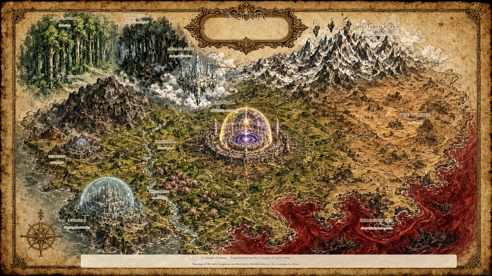
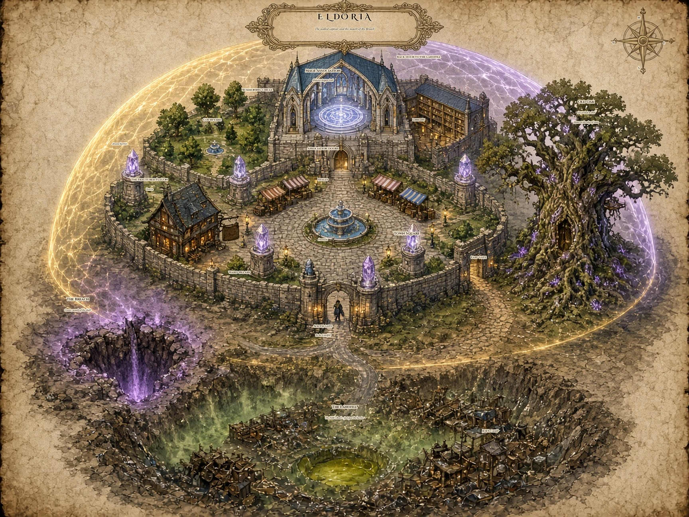
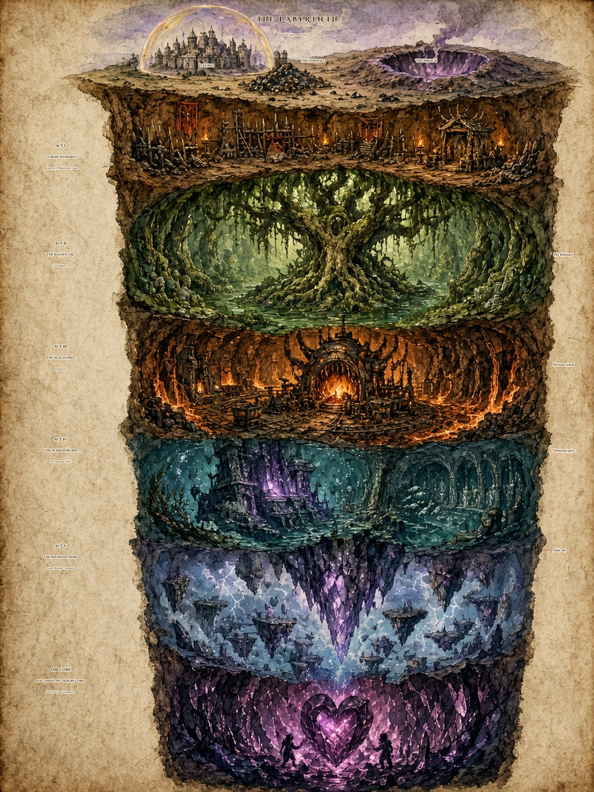

# Covenant of Embers Bible

Player-facing canon for story and play, written 12 Nov 2026 from the game through **v0.9.0**, the approved act outlines, and ShobieShy's decisions of 24 Oct, 27 Oct, 4–5 Nov, and 11 Nov 2026.

This is a rewrite of ShobieShy's Magewar Bible and Magewar Storyline, adapted to Covenant of Embers. Those two source files stay on his machine. They are not part of this repository. Where they disagree with a later decision or with what v0.9.0 actually does, Covenant wins. The losses are listed under Changed from Magewar.

## How to read the tags

Unmarked sentences are in the game through v0.9.0, or they are a decision ShobieShy has already made and this bible is treating as the rule.

- **Open.** Not settled, or settled on paper and not in the game yet. An Open section can still record an approved outline. It is not a fact you can walk.
- **Proposed.** New connective tissue in this bible. It waits on ShobieShy.

Numbers below are the current tuning. Several of them were written as placeholders and can still move. The relationships (what beats what, what a consecration does, who drops what) are the design.

## What you are playing

Covenant of Embers is a co-op loot shooter for one to four players. You are one of the Summoned: an ordinary person pulled into Elyria, handed a staff, and pointed at a hole in the world. You shoot spells from staffs and wands you build out of parts. You keep what you kill. You come back when you die.

The Magewar Bible's own header is "Konosuba, but it's Borderlands." The heroes are ordinary people dropped into a catastrophe. The weapons, the death, and the loot are a looter-shooter's. The skill names carry the ember language of this title. An earlier Covenant story, exiles and lamps and altars, was retired on 24 Oct 2026. This is the Magewar story.

There is no open world in the build. Each place you can walk is its own level, joined by gates and waystones. The rest of Elyria is still out there. You hear it. You do not drive across it.

## World

**Elyria** is the realm: kingdoms, ancient forests, mountains, a sea. **Eldoria** is the walled capital you actually live in, under an arcane barrier, merchants still haggling in the glow. Bob welcomes you to Elyria. The stalls sell to you in Eldoria. Both names are in use on purpose. The chapter list in the old storyline left the town as "? Town." The Bible and the lines in the square settled it. Eldoria.

Ten years ago the dungeons fractured. Formal speech in the Magewar Bible calls that day the **Dungeon Invasion**. In the square and in Joe's mouth it is the Fracture, and the hole north of the dump is the Breach. They are one catastrophe. The walls between the underworlds and the surface shattered. Monsters came out in waves. Farmland became a battlefield. Trade roads became death traps. Villages vanished into ghost towns and overgrown ruin. A person with a pitchfork, or a rudimentary spell, did not last.

The Mage Association and the surviving governments raised domes of arcane energy over the cities that could still be saved. The domes repel monsters and steady the mana under them. They are powered by crystal obelisks attuned to the stars. Ward-pillars are the face of that work on Eldoria's square. The domes are failing. Joe says so in the hall. The patron at the Fractured Flagon says the outer dungeons started acting up again last month.

About sixty percent of Elyria's habitable land is still wild: adventurers, bandits, and refugees, one step ahead of the beasts. The campaign does not give you that map as a road. The places are real. The levels you can load are the city, the dump, the crater, and the shaft.

The **Breach** is the fracture as the campaign meets it: a crater north of the landfill, and the mouth of one labyrinth. The Demon Lord caused it. Crazy Joe is his useful-idiot proxy. Bob can already tell you the Fracture was deliberate. He does not yet say the Demon Lord's name.

### The lands

These are the lands the Magewar storyline names. None of them is a separate level in v0.9.0. Several of them were folded into the labyrinth's acts. The others are still the world past the dome.

The bible does not give these kingdoms a compass. On the chart below they are placed by terrain type only: sea, peaks, woods, river, mines, waste, a floating citadel. Those bearings are illustrative, not canon. Eldoria, the landfill just past its barrier, and the Breach north of the dump are the places the campaign actually locates.

Labels and the sources for each name are in [maps/MAP_LEGEND.md](maps/MAP_LEGEND.md).

| Land | What it is | Where the campaign put it |
|---|---|---|
| Arcana Spire | The Association's floating citadel, the old headquarters | You do not go there. The hall in Eldoria is the chapter that summoned you. |
| Kingdom of Valdoria | The human kingdoms that sat down with the Association | The politics behind the barriers. No throne room in the build. |
| Sylvandar | Elven enclaves | A caravan out of Sylvandar is one of the old side stories. It is not a mission you can accept. |
| Ironforge | Dwarven holds | The living holds are off the map. The buried mines are Act III, the Slagworks. |
| The Wastes | Nomadic orc tribes, brought into the barrier alliance | Not a level. |
| Luminar | A scholarly haven whose libraries the Fracture did not touch | Not a level. Bob's research has that flavor. |
| Willowbrook | A riverside village of apple orchards. The barriers reached it. Goblins raid it. | Those raids are the memory of Act I, the Goblin Warrens. |
| Stonehaven | A mining outpost that supplied iron for enchanted weapons | Not a level. The Slagworks is the mine the story actually enters. |
| Whispering Woods | Trees that murmur secrets and hide ambushes | Act II, the Blightcoil, is that wood pulled underground. |
| Shattered Peaks | Avalanche mountains and aerial dungeons | **Open** Act V, the Inverted Spire. |
| Crimson Sea | A monster-infested ocean and its underwater ruins | Act IV, the Sunken Ruins. |

The Magewar plan was five separate dungeons, then the Demon Lord's lair. Those five places collapsed into one shaft under Elyria. The labyrinth's five acts are what is left of them. Willowbrook's hidden entrance, the whispering wood, Ironforge's mines, the sunken ruins, and the peaks are no longer five trips. They are five depths.

## History

Before the Fracture, dungeons were contained. They were training grounds. Spells, Joe says, flowed like wine. He is three hundred years old, the oldest mage in the Association, born before the cataclysm. He once sealed a volcano dungeon by himself during the Eruption Wars. The Association kept him for that, and tolerated the rest.

The last fifty years warped him, by the public telling. He rambles about interdimensional echoes and forgotten gods in the trash heaps. The private truth, decided 11 Nov 2026, is uglier than a sickness: after the Elders threw him out, he joined the Demon Lord. The rambling is real. The loyalty is the part Eldoria has not been told.

Scholars spent the decade on three theories: a divine curse, a failed rite by an ambitious archmage, or a ley line torn out of balance. A later line in the old storyline adds a slumbering elder god in the core as the culprit. That guess lost. The Demon Lord caused the Breach. People in Eldoria are still allowed to repeat the old theories. The story is not.

The answer the kingdoms actually built was political. Valdoria, Sylvandar, Ironforge, and the orc tribes of the Wastes put centuries of rivalry aside and sat down with the Association. Together they raised the domes, first over capitals like Eldoria and library-cities like Luminar, then, slowly, over smaller towns: Willowbrook, Stonehaven, and places like them. Mana crystals came out of the few dungeons that were still safe to mine. Mages burned out from the work. Local governments skimmed the funds. Mages fought each other over who got the next ward. Unfinished barriers failed, and the massacres that followed ate the public's trust. That is the decade Bob means when he says politics is the true monster.

Then Joe, in the Association's grand hall, opened tomes smuggled from ruined libraries and spent a fortune in mana on a forbidden summoning. He wanted champions from beyond the veil: demigods, warriors from other worlds, anyone stronger than Elyria. The rite cracked the marble and sent a shock through the barriers. What stepped out of the smoke were ordinary people. The appraisal crystal read them as underwhelming: strength like a child's, mana like a dry well, no inborn element. The Association's fear was practical. A rite that sloppy could have torn a new rift.

They stripped his robes, took his staff, and banished him to the wilds in a tattered cloak, with a warning not to come back. The Summoned stayed. A few mages muttered about sending them home. The rite only runs one way. Protocol paid them out of embarrassment: fifty gold, a week's food in a safe town, clothes enchanted for minor durability, and a permit for a tree at the edge of the city that the survey says has been empty for centuries.

The first day is a market day. Barrier-safe herbs on the stalls. Guards on the wards. Bread bought in clumsy Elyrian Common. Children point. Adventurers scoff. Under the pity is the only advantage the Summoned brought with them: otherworldly knowledge. Physics, machines, and the kind of strategy you learn from games are not magic here, and they are not nothing.

**Proposed.** The crystal's "underwhelming" is the same interference that spoiled Bob's earlier summonings. The Demon Lord has been blocking a real champion from arriving. Joe got ordinary people through anyway, which is why the Demon Lord later finds him useful and why Bob finds you interesting.

## Cosmology

Mana is the stuff spells spend. It also runs in ley lines, the invisible rivers under the earth. You do not map those lines in this game. You spend a pool, you regen it, and you feel an element when the bolt leaves the staff. The Sylvandar caravan story, in the old text, is how an elf's lore puts a ley-line map in your hands. That escort is not a quest in v0.9.0. The lines are still there.

Barriers are the civic use of the same mana: a dome, an obelisk, a ward-pillar. They are failing from the outside in.

**Breach-fire** is Joe's sabotage, carried down the shaft. He carved it into the Rotheart, flooded the Slagworks with it, and the approved Act IV outline has him trade a Breach seed to a drowned cult. **Proposed.** Breach-fire is the Demon Lord's heat caught in ore and trash. Joe believes he discovered it. He is half right about the trash and wrong about the author.

The elder god stays a tavern theory. Do not put him in the Core as a second final boss, and do not reveal that the Demon Lord "was the god all along," unless ShobieShy writes that later. The cause is already assigned.

The prism is an Association focus cracked by Joe's rite. Mid-campaign you seal it or you crack it the rest of the way. Sealing it steadies Eldoria's barrier. Cracking it makes you stronger and widens the crater. Either choice tells the Demon Lord your name. He has been looking through the crack. **Open:** the scene is not written, and it is not in v0.9.0. The skill named Prism, later in this bible, is a combat mark. It is not this focus.

## Magic

The Magewar Bible's chart is six elements in a rock-paper-scissors: Fire, Water, Earth, Air, Light, Dark. Light heals and keeps one summon. Dark corrupts enemies into summons. Covenant keeps both of those tricks and adds a seventh element, Arcane, which picks no fight and carries no brand.

A hit is one and a half times as painful when you have the advantage, and half as painful when you have the disadvantage. The same element on both sides is even. Arcane is even against everything, and everything is even against Arcane.

| Element | Color in the world | Strong against | Weak against | What a hit does |
|---|---|---|---|---|
| Arcane | Grey | — | — | A plain bolt. No brand. It can carry other elements' tricks once you have spent points. |
| Fire | Orange-red | Earth | Water | Burn: some of the hit again over a few seconds. A new burn refreshes the old one. |
| Water | Blue | Fire | Air | Slow. A full charge can chain. |
| Earth | Brown | Air | Fire | A short stagger. Boulders splash. |
| Air | Pale cyan | Water | Earth | A chain to one nearby enemy. The staff spins up while you hold the trigger. |
| Light | Warm white | Dark | — | Bolts hit softer than other elements. They heal an ally they touch. Other elements pass through allies. |
| Dark | Violet | Light | — | A small chance to turn a non-boss into a short-lived ally. Bosses do not turn. |

The cycle you can teach a new player in one breath: Fire beats Earth, Earth beats Air, Air beats Water, Water beats Fire. Light and Dark hurt each other. Arcane picks no fight.

Light can also leave a fighting wisp when you hit an enemy and you do not already have one. Dark's turned creatures fight for you for about half a minute, then fall apart. The chance starts very small and skills can raise it, up to a cap. A boss ignores the turn.

Resist on armor and on monsters cuts incoming elemental damage. It caps at sixty percent. A weak point takes double damage.

### Brands

The staff's brand follows the Head, not the gem. A gem changes the bolt's element. The brand is how the weapon fires. Wands use the same habits at a lighter touch. Arcane has no manufacturer. It is a steady semi-automatic cast.

| Brand | Element | How it feels | The line on the iron |
|---|---|---|---|
| Pyrowning Arms | Fire | Heat builds as you fire. While it is cooling you are not paying mana per shot. Overheat locks the staff. Vent it. | "Runs hot." |
| Sigil Sauer | Water | Hold to charge. A full charge chains. | "Patience, then a tide." |
| Moss & Berg | Earth | Slow explosive boulders. | "Quarried, not conjured." |
| Windchester | Air | Full auto. It speaks faster the longer you hold it. | "The longer it sings, the faster it speaks." |
| Coltara Halo | Light | A toggle between a burst and single shots. Accuracy climbs if you keep firing. | "Three notes of the same hymn." |
| Hexler & Koch | Dark | Precise single shots with a crit bias. After you spend a charge pool, you can throw a cursed orb. | "Every miss is remembered." |

### Skill trees

You gain one skill point each level from level 2, so level 50 is forty-nine points. The level cap is 50. Respec at the tree: the price is 25 gold times one more than the number of respecs you have already bought, and it stops rising at 200. If you have spent nothing, respec is free.

Every Summoned shares the **Path of Embers**, three branches:

- **Hearth** keeps you alive: Thick Bark (health), Deep Lungs (breath), Ember Skin (resist to every element), Second Wind (kills heal you). Vault loot from this branch leans toward Bulwark and Fleetfoot.
- **Pyre** is damage and feet: Kindled Focus, Quick Step, Flare, and the capstone **Wildfire** (a kill adds spell damage for a few seconds). Loot leans toward Kindling.
- **Ash** is mana: Still Mind, Steady Flow, Harvest, Ashfall. Loot leans toward Reaping.

Beside that sit seven element trees. Each has two branches, Attunement and Craft, twenty ranked skills, and one capstone. Points in a tree open the later ranks (the gates sit at 0, 5, 10, 15, and 20 points in that whole tree). The capstone wants a deep investment and it locks the other six element capstones until you respec. Element skills apply only while you are casting that element. A gem's element counts for the bolt.

The action skill is separate from the trees and reads them. It is a thirty-second cooldown. It does nothing while you are downed. The verb comes from the element tree you have spent the most points in. Ties break in this order: Arcane, Fire, Water, Earth, Air, Light, Dark. The current key is Q. The dash, which used to share that kind of key, is on V.

| Most points in | The action skill |
|---|---|
| Light | Summon a wisp. |
| Dark | Convert a nearby gnawer. |
| Fire or Earth | A stagger. |
| Air, Water, or Arcane | A chain. |

#### Path of Embers, per rank

- Thick Bark: +10 max health.
- Deep Lungs: +8 max breath.
- Ember Skin: +3% resist to every element.
- Second Wind: kills heal 4 health.
- Kindled Focus: +1 spell damage.
- Quick Step: +2% move speed.
- Flare: +2 spell damage.
- Wildfire, capstone: each kill gives +8 spell damage for 6 seconds.
- Still Mind: +8 max mana.
- Steady Flow: +1 mana regen.
- Harvest: kills restore 5 mana.
- Ashfall: +12 max mana and +1 regen.

#### Arcane — Pure Focus

Capstone **Convergence**: every fifth Arcane hit on one target triggers the statuses of every element tree you have points in.

Clean Lines +3% Arcane damage. Measured Breath, Arcane casts cost 4% less mana. Steady Hand +4 accuracy. Trigger Discipline, cooldown 4% shorter. Resonant Gem, status from Arcane bolts lasts 0.1 seconds longer. Thin Veil +3% damage to enemies under any of your statuses. Quick Study +2 accuracy. Bloom Control, spread bloom per cast 10% smaller. Echo, every eighth Arcane bolt fires a free copy at 40%, and the rank adds a little more. Mana Lens +2% Arcane damage. Gem Socket Sense +3% Arcane damage. Long Sight, range +8%. Overflow, Arcane kills refund 3 mana. Prism, Arcane hits mark the target for 3 seconds. Focused Fire +2% Arcane damage. Weak Point Study, weak-point damage +8%. Attuned Pool, Arcane kills refund 2 mana. Refraction +4% damage to marked enemies. Clockwork, cooldown 3% shorter. Gem Harmony +4% Arcane damage.

The skill named Prism is a combat mark. It is not the story prism.

#### Fire — Kindling

Capstone **Backdraft**: venting at 80% heat or higher releases a 4 meter fire burst for 120% of one shot and resets burns.

Hot Coals +3% Fire damage. Long Burn, burn lasts 0.5 seconds longer. Heat Sink, heat per shot 6% lower. Cool Hands, heat decays 10% faster. Searing, the burn's extra damage climbs (it has a ceiling). Tinder +2% Fire damage. Quick Vent, vent time 10% shorter. Efficient Crystal, the crystal reload costs less mana, down to a floor. Flashpoint +5% damage to burning enemies. Spread Fire, burn lasts 0.25 seconds longer. Red Line, at high heat, +6% Fire damage. Short Fuse, the overheat lockout is 5% shorter. Wildfire Kin, burn damage +5%. Ember Ward, 2% less damage taken with a Fire staff out. Hot Swap, heat per shot 3% lower. Overclock, cooldown 3% shorter. Inferno Heart, burn damage +10%. Kindred Flame, burn lasts 0.5 seconds longer. Fresh Crystal, heat per shot 4% lower. Thermal Bank, crystal reload costs less mana.

#### Water — Tidecaller

Capstone **Tidal Hold**: a full Sigil charge freezes its first target for 1.2 seconds. Bosses are slowed hard instead of frozen.

Cold Current +3% Water damage. Undertow, slow lasts 0.4 seconds longer. Patient Draw, charge time 6% shorter. Steady Pour, charge time 3% shorter. Heavy Water, the slow bites harder, down to a floor. Riptide +6% damage to slowed enemies. Overflowing Charge, a full charge chains to one more target. Pressure +2% Water damage. Drench, slow lasts 0.3 seconds longer. Calm Pool, Water casts cost 3% less mana. Brimming, charge time 3% shorter. Ripple, chain range +1 meter. Soak, Water hits apply Soaked. Deep Cold, 2% less damage taken with a Water staff out. Tide Turn +3% damage to Soaked enemies. Wave Crest +3% Water damage. Saturation, Soaked lasts 1 second longer. Still Water +4% Water damage. Riverbed, chain range +1 meter. Hydraulic, Water kills refund 2 mana.

#### Earth — Bedrock

Capstone **Fault Line**: every fourth boulder splits into three on impact, each a fraction of the hit, and each can stagger.

Stoneskin +3% Earth damage. Bulk, 2% less damage taken with an Earth staff out. Wide Blast, splash radius +8%. Heavy Shot, boulder speed +10%. Quake, stagger 0.1 seconds longer. Crumble +6% damage to staggered enemies. Rubble, splash +4%. Packed Load, blast damage +10%. Grounded, 2% less damage taken with an Earth staff out. Bedrock Pulse, stagger a little longer. Aftershock, blast +5%. Shrapnel, blast +4%. Tremor, staggering a Soaked enemy lasts longer. Stone Will, 2% less damage taken with an Earth staff out. Cluster, splash +3%. Seismic Charge +4% Earth damage. Landslide, stagger a little longer. Mountain, 3% less damage taken with an Earth staff out. Detonator, blast +5%. Bigger Rocks, splash +5%.

#### Air — Gale

Capstone **Cyclone**: at full spin for 2 seconds, bolts chain to every enemy within 6 meters at a fraction of the hit, then the trick waits 6 seconds.

Tailwind +3% Air damage. Light Feet +2% move speed with an Air staff out. Spool, spin-up 8% faster. Momentum, spin-up 4% faster. Long Arc, chain range +1 meter. Gust, chain hits +5%. Keep Spinning, spin-up 3% faster. Whirl Guard, 2% less damage taken with an Air staff out. Forked, the chain jumps to one more enemy. Conductive, chains on Soaked enemies hit harder. Static +2% Air damage. Overspin, cooldown 3% shorter. Updraft, chain hits +3%. Slipstream +2% move speed with an Air staff out. Feathered, spread bloom smaller. Cyclic, Air kills refund 2 mana. Storm Eye, chain hits +4%. Jetstream +3% move speed with an Air staff out. Gyro, spin-up 3% faster. Thunderhead +3% Air damage.

#### Light — Dawnward

Capstone **Dawnchorus**: a full three-shot burst that lands heals every ally within 6 meters for 15% of max health, then waits 8 seconds.

Bright Hands, heals +5%. Clear Sight +3% Light damage. The softer Light bolt stays softer; this adds on top. Choir, the burst's accuracy ramp climbs. Quick Toggle +2 accuracy. Lasting Glow, the Light summon lasts 5 seconds longer. Mend Bond, heals +4%. Halo Step +3% move speed with a Light staff out. Tight Burst, burst spread tighter. Sanctuary, heals +5%. Radiance, Light hits mark a foe. Ramp Memory, the accuracy ramp climbs further. Fourth Note +3% Light damage. Beacon, the summon lasts 3 seconds longer. Gentle, heals +4%. Measured Semi +4% Light damage. Halo Recall, Light kills refund 3 mana. Martyr, heals +5%. Purify, Light kills heal 3. Chorus Line, cooldown 3% shorter. Hallowed, Light marks last 1 second longer.

#### Dark — Gloam

Capstone **Eclipse**: a crit on a Hexed enemy below 30% health turns it. Bosses are exempt. Once every 20 seconds this can ignore the usual turn cap.

Shadow Touch +3% Dark damage. Whisper, turn chance up a little, still under the cap. Weak Spots, crit damage +8%. Keen Eye, crit chance +2%. Long Night, corrupted allies last 5 seconds longer. Thrall Bond, Dark kills heal 2. Cursed Load, the cursed orb hits harder. Misfortune +2 accuracy. Hex, Dark hits mark the foe and your hits on that mark hurt more. Dread, turn chance up a fraction. Orb Radius, the blast is wider. Lucky Streak, crit chance +1%. Contagion, Hex lasts 1 second longer. Dark Pact +3% Dark damage. Deadeye, weak-point damage +10%. Quick Curse, cooldown 3% shorter. Soul Tithe, Dark kills heal 3. Legion, corrupted allies last 5 seconds longer. Executioner, crit damage +10%. Black Orb +2% damage to Hexed enemies.

## Factions

**The Mage Association** holds the hall in Eldoria, the rite, the Elders, and the Clerk. They expelled Joe, kept the Summoned, and issued the permit. Their wings past the hall stay shut to novices until the tutorial is done. The head of the Association is terrified of the Demon Lord and will not commit resources. **Open:** that person's name, face, and any scene where they say so.

**Eldoria's gate and its shops** are the city, not the Association. The Bored Guard, the Potion Merchant, the Tailor, the Runesmith, and the Fractured Flagon answer to custom and taxes. The merchant will tell you Association taxes make real imports rare.

**Bob** is not a faction. He is a roommate who outranks the Elders in private and refuses the job.

**Joe's trail** is graffiti, bark-marks, slag seals, and, in the approved Act IV outline, hymns. He is one man and a habit of fire, not a guild you can join.

**The goblin war-band** of the Warrens taxes raids and flees downward. They are not rulers of the shaft.

**The drowned cult** of Act IV sings the sea open. **Open:** their name, the hymn text, and the title they give Joe beyond the outline's "dry prophet." Hymn-shards are not items in v0.9.0.

**Rebels against the barrier monopoly** are a faction you can join. They are the other side of the Association's taxes and the skimmed ward-funds. The Potion Merchant already complains that those taxes make real imports rare. Bob will not work for the hall. **Open:** who leads them, how you join, and what the faction gives you. None of that is in v0.9.0.

**The Association, as a path,** is the other offer in that same text: stay with the mages and earn spell tomes. In the build, that is the hall, the closed wings, the skill trees, and the Runesmith. You are not inducted. You are housed and pointed at the dump.

**Romances** in the old storyline bloom with a fiery blacksmith and an enigmatic bard. Neither has a name or a scene. **Open.**

**Rival Summoned** are a question the Magewar storyline asks in its own voice ("Joe's prior failures?") and does not answer. Bob's failed rites produced no one: the Demon Lord blocked them. Joe's earlier attempts are a separate blank. **Open** whether any of those people are walking around. Do not fill the square with them until that is a yes.

## Characters

### The Summoned

The four of you are the party the Magewar storyline was written for: Nerd, Gal, Buff, and Loli, known to Elyria as the Summoned. In co-op, that is the group, up to four. In a solo game the other three stand in the hall while you are appraised, and you pick which of them you are, plus a name and a color. Each pick is a look and one perk. You were not born with an element. The crystal is right about that. The archetype perk is a habit, not an affinity.

The storyline's examples of "ordinary" are an office worker, a student, and a hobbyist gamer. The lines in the hall are more specific, and they win: the Nerd wanted a cheat skill, the Gal was at brunch, the Buff rejects the crystal's reading of his strength, and the Loli is older than she looks. What you share is otherworldly knowledge and a growth left by the rite. Bob reads it with his orb. In a party, the Summoned who is behind the highest level nearby earns more experience from the same kill: a quarter again for each level of gap, up to double. That is the playable face of the "growth multipliers." A level also gives +5 max mana and +5 max breath, and refills both. It does not raise max health. You start at level 1, needing 100 experience, and each later threshold is one and a half times the last. The cap is 50.

| Pick | Perk | What they say in the hall |
|---|---|---|
| Nerd | +15 max mana | This is an isekai, except nobody handed over a cheat skill. |
| Gal | 10% off at vendors | One second ago, brunch. |
| Buff | +20 max health | The crystal said child-tier strength. The crystal is wrong. |
| Loli | +8% move speed | Older than she looks. Don't ask. |

An old save with no pick shows as a Wanderer and gets no perk. Wanderer is not a fifth choice on the crystal.

In a solo game the other three live in the tree with you. They do not go down the shaft. The people who walk the labyrinth with you are other players.

### Crazy Joe

Joseph to the Elders. Crazy Joe to everyone else. He is three hundred, infamous, and the man who cracked the hall to get you here. He called the crystal a liar, told you the dungeons fractured ten years ago, and got marched out. They took his robes and his staff. The wilds he was banished to begin at the landfill, just past the barrier, which is why "do not return" and "he is camping in the trash" are both true. He never goes back to the dais. He waits at the dump, gives you a wind wand that fell out of a portal (not the staff they confiscated), and points you at his bench and at the mound. He believes the trash speaks. His discards are cracked crystals, notes on trash portals, and contraptions Bob can actually use.

He is the Demon Lord's proxy: reckless on his own, banished for it, and then useful. Down the labyrinth he is always a step ahead, feeding Breach-fire to whatever will take it. **Open** (approved, not built): in Act V he stops being ahead of you. He is waiting. In the Core you fight him, corrupted, with spells that feel like a player's, and then you fight the Demon Lord.

### Bob

The Magewar Bible leaves his name as a blank ("introduces himself as ?"). The storyline fills it, and so does every line he speaks. His name is Bob.

He is lazy, nonchalant, and the reason you have a staff. He is two hundred and fifty, tall, cloaked, with a wild beard streaked silver and eyes like embers. He arrives the first night in a teleport vortex, because the tree is his and the city has spent centuries not checking. He is a master illusionist and arcanist. His power could stand with the Elders. He will not take the job. The illusion on the bark is why the survey says the tree is empty. The Clerk, when you use the name, is not surprised. He is annoyed. Someone has a file. Nobody visits.

Bob's work happens in a tree-top laboratory: star charts, monster autopsies, anomalous artifacts, and one lead, a mana distortion at the landfill where barrier-construction refuse mixed with pre-Cataclysm junk. **Open:** that laboratory, and the potion garden the old storyline adds once the tree becomes a real base, are not furnished rooms in v0.9.0. What you can use is the hollow, the moss, the stash, the Magic Assembly Station, and the waystone.

He gives you a staff, a rusty dagger that glows when something nasty is close, a mana potion that tastes like sour berries, and a map scratched on bark. The staff is for fighting. The dagger is for knowing when to. The old text led with the dagger and did not mention the staff in that gift. Covenant added the staff and kept the dagger as the keepsake. After the Filth he builds the fast-travel crystal out of Joe's resonant trash. It jumps between attuned points. The first of those are the tree and the town gate. He tells you the Fracture was deliberate, welcomes you to Elyria, and wants to be left alone. His research line still says five dungeons scattered across the realm. That is the old map. The shaft under the crater is where those five went.

His earlier summonings failed because the Demon Lord blocked them. He explains the lore after the Filth, in the voice of a man who would rather you do the walking. The model on screen is still a placeholder. The description above is the one to write to.

He calls the tree the Great Oak. The permit, the signs, and the quests say Old Oak, because that is what the last survey wrote down. Both names stay. Do not pick one and erase the other.

### The Demon Lord

He caused the Breach. He blocked Bob. He took Joe on after the banishment. He is the last fight of the main campaign, and he leaves. **Open:** his face, his phases, his loot, and the scene of the escape. Do not invent a body for him in side dialogue. The only object that already speaks his name in loot is the Unique Void Charm: "A one-of-a-kind charm whispering of the Demon Lord's lair."

### The hall and the square

- **Elder.** Expels Joseph. Tells the Summoned to see the Clerk. Has nothing more to say.
- **Clerk.** Form 7-B. Fifty gold. Clothes you are already wearing. A residency permit. Later, if Bob sent you, the back door behind the dais. Mind the smell.
- **Bored Guard.** Pity before the Filth, a grudging respect after, and a DANGER sign he does not think is a joke.
- **Potion Merchant.** The only potions in Eldoria, by his own account. First pick once you have sludge on your boots.
- **Tailor.** Robes, belts, boots. Gold up front.
- **Runesmith.** Bring a part and Arcane Dust. Same part, same rarity, different luck.
- **Grizzled Patron.** The Fractured Flagon. Ale that tastes like barrier dust. A rumor that the outer dungeons stirred last month.
- **Wounded scavenger.** In the landfill. Asks for Light, then points you past the mound toward the breach and tells you not to go in bleeding. Those lines are still placeholders.

### Down the shaft

- **Verdant Mother.** A dryad bound to the Rotheart. She asks you to burn the infection out before it climbs. After the Matriarch she says the tree is dead and she does not know what tore the cocoon open. She must not be given that answer.
- **Scrap-spirit.** Names Forgemaw as the troll who kept the furnaces lit, and calls you uninvited ore. After the fight, the lift is open and the cooling slag holds an empty human shape. The spirit does not explain the shape.

## Locations

### The Mage Association

The game starts here, as the Bible says. Cool, dim, a dais, Joe, the crystal, the Elders, the Clerk. The Bible's note on the room is one word: expensive. The marble, the rite, and the taxes all agree. The front door opens on the square. The back door behind the dais opens on the landfill once Bob has sent you. That back door was a question mark in the Bible. The campaign answered it. The side wings stay closed to novices until the tutorial is done. The Archmage's wings are closed, and the door says so. Arcana Spire, the floating citadel, is the order's old seat. This hall is the Eldoria chapter, and it is the only Association room you enter.

### Eldoria, Town Square

The hub. A paved square, ward-pillars, stalls, the Fractured Flagon, the guard on the landfill gate. North to the Association, south to the landfill, east to the tree. A waystone. After Forgemaw, the square also holds the post-game toys: a chest, a vendor stall, a slot machine, and a bounty board.

### The Great Oak

Home. A colossal hollow tree at the edge of town, candle-lit, moss beds, a stash, an assembly station, and Bob. The survey, the permit, the signs, and the quests call it the Old Oak. Bob calls it the Great Oak. Both names stay. The Clerk has not updated Form 7-B, and he is not going to. The Magewar storyline says no one had lived there for centuries because it was rumored haunted. Bob was the haunting. In a solo game the other three Summoned live here with you. They do not follow you into the shaft.

### The Landfill

The junkyard tutorial. One zone, one boss, a soft fail. A sunken trash trench, a compactor, a scrap climb, and the bowl where the Filth waits. The air is a green-brown haze. Joe's camp and bench are here. South goes back to town. North, after the Filth, is the road to the Breach. The Landfill is not Act I.

### The Breach

A half-level doorway, not an act. Violet-grey haze, a gnawer den, an ember gallery, a mire cistern, a switch, and an arena. The Breach Warden holds the vault. Past that, the crater portal is the labyrinth gate. Issue #30's intent, still the structure to aim at: Acts II through V are paths through this same labyrinth, not separate countries. In v0.9.0 the later acts are still reached as their own stretches after the previous boss.

### The labyrinth

One shaft. The five acts are the five old dungeon trips, stacked. Act V and the Core are drawn here because they are outlined. They are not in the current build.

Handmade story floors stay handmade. Generated floors fill the space between bosses. A waystone on a boss floor brings you back to the square, and the Breach gate offers the next descent. There is no overworld shortcut. The Forgotten Abyss and Endless Descent are later modes of this same shaft, not extra places on the chart.

| Act | Name | Checkpoints | In v0.9.0 |
|---|---|---|---|
| I | The Goblin Warrens | Floors 1–4 generated, floor 5 the King | Yes |
| II | The Blightcoil, also called the Overgrown Deep | One cavern: Sump, Canopy, Crown | Yes |
| III | The Slagworks | Floors 9–12 generated, floor 13 Forgemaw | Yes |
| IV | The Sunken Ruins | Checkpoints 14–18: Gallery, Pocket, Murals, Spire, Nave | Yes |
| V | The Inverted Spire | Five floors, boss on the last | **Open.** Approved outline, not built. |
| — | The Core | Joe, then the Demon Lord | **Open.** Not outlined in full, not built. |

Act loot sits in bands: Act I around levels 5–12, Act II 14–22, Act III 24–34, Act IV 36–46.

**Act I.** Packed earth, stolen timber, goblin banners, spike traps, gnawer nests. The goblins are fleeing something below. Their wards against "green fire" point down. The King's hall is bone piles and stolen Association crates. Clearing it does not seal the Fracture. Joe's graffiti starts here in chalk and blood. You leave with a goblin key-token, a crown, and a hole full of roots.

**Act II.** A jungle that should not be underground, spiraling around the Rotheart. The Sump is poison mire. The Canopy is root bridges. The Crown is spore fog. Joe's marks are in the bark. He has been feeding the tree Breach-fire. Three of those marks are a side quest. When the Matriarch dies, the tree dies, the fog clears, and an empty cocoon sits torn open from the inside.

**Act III.** Buried mines: rails, lava, heat that pushes you onto gantries, mine carts, a furnace-anvil as the landmark of the floors. Association charts called it a collapse. Joe flooded the shafts. The furnaces never cooled. Slag seals on the rails are the side quest. Forgemaw's floor is a crucible. When he falls, the lift unlocks, the waystone home lights, and cooling slag holds the empty shape of a person.

**Act IV.** Flooded halls, coral, cult murals, a drowned spire still glowing Breach-violet. Breath is the leash. Water spends Breath, then health. Each floor has an air bell that refills Breath. The Choir is fought above the water, then under it, and the second phase is the water rising. In the drained nave, a coral sarcophagus, cracked, empty. The pad there is the way home. This act is the Sunken Ruins. An earlier sketch put Breach fallout here. That sketch was dropped on 11 Nov 2026.

The Drowned Choir is many singers sharing one will. v0.9.0 still shows one body, surfaced and then submerged while the water rises. That single body is a build gap. Write the Choir as a crowd.

The approved outline also has Joe as the cult's dry prophet, a Breach seed traded for passage, sealed exits, and hymn-shards. **Open.** Those words and items are not in the v0.9.0 build. What was in the sarcophagus is revealed in the Core. The identity is not written yet.

**Act V, Open.** The shaft becomes sky. Platforms hang in a vertical void. The Inverted Spire grows downward from a false sky, and every earlier act's geometry shows in its facets. This is the five dungeons collapsed into one throat. Harpies and storm elementals try to push you off. The boss is the Storm Warden, keeper of the wind locks, fought across breaking platforms. When the Warden falls, a crystal throat leads toward the Core. You can waystone home from the boss pad. Looking down, you do not see another empty cocoon. You see a lit path. Joe is waiting. Side ledges are supposed to hold who Joe was before the Breach, and why the Demon Lord let him walk this deep. None of that is written yet.

**The Core, Open.** Crazy Joe, then the Demon Lord. The Demon Lord escapes. That escape is the main campaign's end and the door to DLC. Fight specifics are deliberately not specified.

**The empty shells.** You can already see three: the cocoon under the Matriarch, the human-shaped slag under Forgemaw, the coral sarcophagus in the nave. Something is climbing toward the Core and shedding skins. The Mother and the scrap-spirit do not know what. Who or what shed the skins is revealed in the Core. **Open:** the identity itself is not written. Do not name it before that reveal, and do not invent the name here.

## Enemies

The Fracture's first wave, out in the sixty percent that is still wild, is the list the storyline gives: snarling goblins with rusted blades, hulking trolls that regenerate, ethereal wraiths that drain the life out of what they touch, slime beasts that dissolve flesh, and shadow drakes that blot out the sun. The campaign has given some of those a face. Goblins are the Warrens. Trolls are the branded smiths of the Slagworks; the wild ones that knit their own wounds are still a surface story, not a moveset you have met. Slime is the Filth, and the mire ooze in the Breach. Wraiths and shadow drakes have not walked into a level yet. They remain the reason the road past the dome is a bad idea.

Training dummies stand in the landfill: an earthen one and a tidal one, for learning that elements matter.

**The landfill.** Gnawers are small earth rushers, bitey, thirty health, a nasty snout. Heaps are junk tanks, a seam on the back, a slow slam. The bowl's waves are gnawers, then more gnawers, then the Filth alone.

**The Breach.** Gnawers again, Ember Scorchlings that lob fire and run when hurt, Mire Ooze that splits and leaves slowing puddles, a Heap, then the Warden.

**The Warrens.** Goblin Grunts, Archers, and Shamans, plus gnawers in the nests.

**The Blightcoil.** Spore-cap Husks, Mossbound Treants, Spore Beasts.

**The Slagworks.** Branded Trolls and Forge Constructs, both on Joe's brands.

**The Sunken Ruins.** Drowned Cultists.

Elites can wear a visible affix: Burning, Warded, Swift, or Splitting. They have more health and a name over the bar.

Named rares are a rare roll on an ordinary enemy, tougher, with their own unique:

| Name | Where | Wearing the body of | Drops |
|---|---|---|---|
| The Pit Warden | Landfill | A gnawer | Gnawer's Vow |
| Old Heap | Landfill | A heap | Last Coal |
| The Pale Husk | Blightcoil | A spore-cap husk | Sump Lantern |
| The Crown Treant | Blightcoil | A mossbound treant | Canopy Antler |
| The Walking Brand | Slagworks | A branded troll | Brand-Iron |
| The Unfinished Construct | Slagworks | A forge construct | Cinderspine |

Names and flavor lines on these uniques were drafted as proposals and shipped anyway. **Open** if ShobieShy wants any of them renamed. Until then, they are what the player loots.

## Bosses

**The Filth.** The landfill's boss and the end of the tutorial. A trash-mound slime of alchemical runoff and dungeon residue, earth-aspected, three phases, acid, a habit of regenerating off debris, and a core that ends up exposed. It drops Joe's trash, which the quest wants. Killing it opens the north road. Repeating it can drop Cinder of the Heap or Rotglass Lens.

**Breach Warden.** A dark heap in the crater vault. Under half health it gets faster and meaner. Killing it opens the vault and the labyrinth gate.

**The Goblin King.** Floor 5. Slam, throw, and a roar that calls what is left of the pack. The crown drops. A waystone home lights.

**Blightmaw Matriarch.** The Rotheart's corrupted heart, on the Crown, three phases and no locked arena. Spores and husks, then a treant and vines, then a band of spore fog and a weak point. Her death opens the way toward the Slagworks and reveals the empty cocoon. She can drop Matriarch's Mandible or Crownspore Charm.

**Forgemaw.** The troll who kept the furnaces lit. Three phases in the crucible: the gantry starts whole, then a segment goes, then the ring comes down, the lava widens, and a weak point opens. He can drop Forgemaw's Tooth or Slagheart. His death is also the key to the post-game dial.

**The Drowned Choir.** Act IV, the nave. Many singers, one will. In v0.9.0 you fight one body: above the water, then under it, while the water rises. The single body is a build gap. The story is the crowd.

**Storm Warden. Open.** Act V's wind-lock keeper. Not built.

**Crazy Joe and the Demon Lord. Open.** The Core. Joe first, then the Demon Lord, who escapes.

## Gear and loot

### Rarities

| Tier | Damage multiplier | Color |
|---|---|---|
| Basic | ×1.0 | Grey |
| Uncommon | ×1.25 | Green |
| Rare | ×1.5 | Blue |
| Mythic | ×2.0 | Purple |
| Primordial | ×2.75 | Orange |
| Unique | ×3.0 | Gold |

There is no separate "legendary" tier. Named uniques use the Unique tier and a pearlescent tint on the beam and the card, so you can tell a named one from a rolled one.

An assembled weapon's rarity is the average of its parts, stepped down to a whole tier. A dust upgrade can climb as far as Primordial. It does not mint a Unique. A boss chest pays a Unique the first time you clear that act, and a Rare on a repeat.

Final hurt is the weapon's base, times rarity, plus flat bonuses, then the element matchup, then the target's resist, then double if you hit the weak point.

### Building a weapon

The base staff or wand is the spell. The parts are the modifiers. You only assemble them at a Magic Assembly Station. The one you can use is in the tree. The Bible also calls that bench an enchantment forge. Same station. The Runesmith in the square does not build weapons. He spends Arcane Dust to wake a part's runes again: same part, same rarity, different luck.

The Bible's overview names the parts Handle, Shell, Internals, and Head. The crafting page names Head, Exterior, Interior, Handle, and Charm. Shell is the Exterior. Internals are the Interior. Covenant uses the longer list.

A staff takes four or five parts. The Charm is the optional fifth, and it is staff-only, an extra augment. A wand takes the Head, the Exterior, and the Handle. The Bible left a question mark on whether a wand needs a Handle. Covenant answered it: the wand has one. A wand's Head holds a single gem. A staff Head holds one to three, which in play means a Rare head opens more sockets and a Primordial head opens more still.

| Part | What it is for |
|---|---|
| Head | The element, and the gem sockets that can change the bolt. The brand follows the Head, not the gem. |
| Exterior (Shell) | The fire rate, where the weapon has one. |
| Interior (Internals) | The base of the damage. |
| Handle | Handling, stability, and accuracy. On a staff it also shortens the draw. |
| Charm | Staff only. Optional. A further augment. |

You carry a staff and a wand in the quick slots, plus two more weapons on the extra slots. The Bible's carried set was a staff and a wand. The two extra slots are a Covenant addition.

### What else you wear

Hat, clothes, belt, shoes, and a grimoire, plus a potion on a quick slot. Health potions restore 30. Mana potions restore 25 and taste like sour berries. The clothes you start in are tattered mage robes, enchanted for minor durability, standard issue for new arrivals.

From v0.8.7 you can also find:

- A **shield**, which replaces your shield's size, its recharge delay, and one effect. Ward recharges faster. Spike adds damage while the shield still holds. Calm shortens the wait. Take it off and the old numbers return. The body you start with has 100 health and a 50-point shield that waits about three seconds, then recharges.
- A **flask** on G. One charge, 20 health, and it does not drink a potion. It refills when you rest and when you return to the Mage Association.
- A **relic**. Ember Chip is +3 spell damage. Ward Bead is +15 shield. Sip Stone heals 4 on a kill.

Cinder Staff, Mire Wand, Slag Grip, and Mire Core are extra bases. Their art is still a placeholder. The rate at which shields, flasks, and relics join ordinary kills is not tuned, so a normal kill does not add one until that number is set.

### Consecrations

A Rare or better piece of equipment can roll one consecration. Vault chests bias the roll toward the skill branch you have invested in, about half the time. Ordinary kills consecrate a Rare or better drop about one time in five.

| Name | What you feel |
|---|---|
| Fleetfoot | +1 dash charge |
| Kindling | After a dash, your next spell deals +10 damage |
| Bulwark | While your shield is full, spells deal +5 damage |
| Reaping | Kills restore 10 mana |
| Steady | While focused, spells deal +8 damage |
| Keen | Spells have +8% crit chance |
| Siphon | Kills restore 8 health |

### Named uniques

A story boss drops one of its named uniques about one kill in five, every time you kill it, not only the first. A named rare drops its own unique more often, a bit under half the time.

| Name | From | Effect | Line |
|---|---|---|---|
| Cinder of the Heap | The Filth | Kills restore 6 health | It still remembers the fire that was buried here. |
| Rotglass Lens | The Filth | Below half health, spells deal +8 damage | The Filth looked through it. So do you. |
| Matriarch's Mandible | Blightmaw Matriarch | Kills restore 12 mana | A tooth that never stopped chewing the dark. |
| Crownspore Charm | Blightmaw Matriarch | After a kill, your next spell deals +14 damage | The crown dies. The spore does not. |
| Forgemaw's Tooth | Forgemaw | Spells deal +6 damage | The forge bit down and left this behind. |
| Slagheart | Forgemaw | While focused, spells deal +8 damage | Hold your aim. The slag holds its heat. |
| Gnawer's Vow | The Pit Warden | Kills restore 4 health | The pit keeps what it kills, and so does this. |
| Last Coal | Old Heap | Spells deal +4 damage | One coal left in a heap that should have gone cold. |
| Sump Lantern | The Pale Husk | Kills restore 8 mana | It still burns under the water. |
| Canopy Antler | The Crown Treant | After a kill, your next spell deals +10 damage | Broken from a crown that walks. |
| Brand-Iron | The Walking Brand | Spells deal +5 damage | The mark was hotter than the troll. |
| Cinderspine | The Unfinished Construct | While focused, spells deal +6 damage | The forge never finished it. The heat did. |

### Deep gear

Gear earned deep in the Forgotten Abyss, and later in Endless Descent, under Covenant Escalation, can appear as a very rare drop in an ordinary story run. It keeps its effect and is scaled to the story floor. Each player in co-op rolls their own. The deeper the tier it came from, the stranger it is, and the rarer it is up here. **Open:** the drop rate is unset, so a normal kill does not add one yet. Whether the item is also level-scaled down for that story floor, beyond the scaling already described, is still a question on the page.

### Gold and dust

You start with 50 gold, a week's food if you are careful and a bad afternoon if you are not. Kills drop coins. The Filth's purse is the loud one. Vendors, the Runesmith's dust, respec, bounties, and the hub toys all speak gold. Arcane Dust is what the Runesmith burns to reroll a part.

## Death

You go down, and you have a window. Alone, that window is about eight seconds. In co-op it is about fifteen. A kill in the window gets you up. A living teammate within about two and a half meters, standing there for about three seconds, pulls you up at roughly thirty percent health. The action skill will not fire while you are down.

When the window ends, you come back at the last waystone, or at the spawn the run stored if you have not touched one. You keep your loot, your story, and your gold. An earlier note had you respawn at the Mage Association and drop the gold. That note is withdrawn.

## Co-op

One to four Summoned. The host's world is the world: enemies, the floor you are on, the checkpoint under your feet. A friend who joins arrives on the host's level. Changing level is a vote at the gate. The party follows the host down the stairs, and a split party gets a few seconds to agree.

Enemy health climbs by about sixty percent for each extra player. Labyrinth drop chances climb by about twenty-five percent for each extra player. Loot and experience are still yours. You do not share a roll. Light heals the person it hits. Other elements pass through friends. Each player's skill ranks live on that player's character.

## Quests

The Magewar Bible is blunt about the pace after the dump. The main quest is vague on purpose. There is no divine marker. You learn the next place from a person, and you take the side work that opens it. Covenant keeps the tone and gives the vagueness a spine: Bob will not draw the map for you, and the shaft is still down.

The main path is short on purpose, then the shaft takes over.

| Quest | Kind | What you do | In v0.9.0 |
|---|---|---|---|
| A New Home | Main | Reach the tree with the permit | Yes |
| Trash Talk | Main | Reach the landfill, kill three gnawers, kill the Filth, pick up Joe's trash | Yes |
| Report to Bob | Main | Talk to Bob. He gives you the crystal. The tutorial ends. | Yes |
| The Breach | Main | Reach the crater and go down | Yes |
| The Overgrown Deep | Main | Kill the Blightmaw Matriarch | Yes |
| Joe's Marks | Side | Three ritual marks on the Rotheart | Yes |
| The Slagworks | Main | Kill Forgemaw | Yes |
| Joe's Seals | Side | Three slag seals on the rails | Yes |

A clue journal keeps Joe's trash, the mana distortion, the deliberate Fracture, Joe's rot, and the seals. Act IV, Act V, and the Core have no quest entries yet. **Open.**

### Side stories, and where they went

The Magewar storyline's side work is canon. Most of it became an act instead of an errand on the square.

| The old job | What it uncovered | In Covenant |
|---|---|---|
| Help a Willowbrook farmer against goblin raids | A hidden dungeon entrance | Act I. The farmer is not an NPC you can hire. The raids are the Warrens' history. |
| Escort a Sylvandar caravan | Elven lore, and a ley-line map | Not a mission. The lore is why ley lines are in the cosmology. **Open** as a quest. |
| Delve Ironforge's mines | Trolls, and ore that upgrades gear | Act III. The gear is the slag loot, not a separate upgrade path. |
| The Whispering Woods | Trees that talk, and ambushes | Act II. |
| The Shattered Peaks | Aerial dungeons, avalanches | **Open** Act V. |
| The Crimson Sea | Underwater ruins | Act IV. |
| Tavern gossip: echoing whispers in the deep | A clue, not a map marker | The patron at the Fractured Flagon, and Bob's "talk to people." |
| A merchant's vanished expedition | Another clue | Not written as a named merchant quest. **Open** if it needs its own person. |
| Landfills across Elyria, or old mining greed, as the cause | Bob's early theories | Superseded. The cause is the Demon Lord. The landfill stays the tutorial, not the conspiracy. |

Bob still tells you to talk to townsfolk and take their quests. The board you can clear is the bounty board. The acts are the discovery.

## Bounties, toys, and the mantle

After Forgemaw, Town Square and the tree grow a few bad habits.

The bounty board pays gold for repeatable kills: three gnawers for 12, two heaps for 18, two spore-cap husks for 18. Turn it in, and the count starts over.

A chest takes a Breach key, or 25 gold if you have no key. A stall takes 8 gold. A slot machine takes 5 gold a pull, and one pull in four pays 15 gold back.

A mantle hangs on your shoulders. It changes nothing on your character sheet. Enemies bark when they chase, when they are hit, and when they die.

## The Forgotten Abyss, Endless Descent, and Covenant Escalation

These change the difficulty and the loot. They do not change the story, the dialogue, or the ending.

**The Forgotten Abyss** is the post-campaign descent for as long as the Demon Lord is unbeaten. You go back down after the handmade story. The story floors stay as they were built. New floors are generated. There is no new chapter in them.

**Endless Descent** begins once the Demon Lord is beaten. The further floors are random, and each one draws on every act's themes at once: warrens, rot, slag, drowned halls, and the spire's wind, in whatever mix the floor is dealt. The story still does not change.

**Covenant Escalation** is the one dial on both runs. It replaces the older names Chaos mode and Mayhem tiers. Tiers run from 0 to 10. Tier 0 is the story run and leaves the story floors' math alone. You can turn the dial after Forgemaw is dead. Depth in the descent raises the highest tier you are allowed to set, and you can set anything from 0 up to that cap.

At the current tuning, each tier adds a quarter again to enemy health, fifteen percent to enemy damage, and ten percent to experience. Basic loot gets scarcer. Rare and better loot gets a little more likely. Higher tiers also roll omens. The current omen names are Ember Rain, Restless Dead, Gilded Ashes, Shades rise twice, Hungry Dark, Wards regenerate faster, Blood Moon, and Iron Vow. Easy omens show up first. Harder ones join as the tier climbs. A floor you have not cleared for the story cannot be remixed. A floor you have cleared can.

v0.9.0 still uses the older labels. A finite replay of one labyrinth is called the Abyss on screen, the floors after that replay are called Endless Descent, and the Forgotten Abyss is reserved for a run the build has not made. Those on-screen names are a build gap. Write to the names in this section. The Demon Lord is not in the game yet, so Endless Descent, in the decided sense, cannot start.

## DLC

**Open**, decided in shape and not built. The Magewar Bible's map, after the starting town, is "Town 2" (a square and a first dungeon) and "Small Town" (a dot). Covenant spent that first dungeon on the labyrinth instead of a second city. DLC is where the extra towns come back. Each DLC labyrinth gets its own town and its own Mage Association chapter: shops for trade, the chapter for quests, training, and lore. The main game keeps Eldoria. DLC has level minimums. **Open:** the numbers, the town names, and which labyrinths they are. Covenant Escalation on a DLC labyrinth requires the main game beaten, and it stays mechanical there too. After that DLC's story boss, the same Forgotten Abyss applies until the Demon Lord of that story is beaten, and Endless Descent applies after. Story floors stay handmade. Small Town is still a dot. The main game's Demon Lord is the one this bible means. A DLC's own lord, if it has one, is **Open.**

## How a minute of play feels

Walk, sprint, crouch, slide, and a crouch-jump onto a ledge. Dash on V. It spends breath and gives you a brief moment where hits do not land. Focus down the staff and the view tightens. The view starts wide, about the field of a looter-shooter's hip fire, and focus pulls it in. Breath is a pool of 100. Sprinting spends it. In the Sunken Ruins, swimming spends it, and then the water spends health. Mana is a pool of 100. A level-up adds a little mana and a little breath and refills you. Loot beams use the rarity colors. Pickups come to you if you are close. The compare card sits under the crosshair.

## Tone and style

Write the Summoned like people who were doing something else an hour ago. Bob is short, grudging, and right. Joe rambles, then lands the one sentence you needed. The Elder speaks in verdicts. The Clerk speaks in forms. The Verdant Mother speaks in warnings of one or two lines. The Scrap-spirit speaks like a furnace that learned grammar. The guard and the merchants move from pity to awe after the Filth, and the awe is still rude.

Jokes live in the people. Bosses do not wink. The Filth is disgusting. Forgemaw thinks you are ore. The Choir does not banter.

Use Elyria for the realm and Eldoria for the city. Use the Breach for the crater and for the catastrophe when a character is pointing at the hole. Use the Fracture when a character is talking about the day, ten years ago, when the dungeons broke. They are one event.

The Demon Lord caused it. Say that when the story is ready to say that. Bob, today, stops at "someone caused it deliberately."

Do not name what shed the three skins before the Core. That is where the reveal happens. The people who found the shells do not know.

The permit, the signs, and the quests say Old Oak. Bob says Great Oak. Use both.

Covenant Escalation, the Forgotten Abyss, and Endless Descent get no new dialogue. A harder tier is not a new chapter. The Drowned Choir is many singers. Do not write them as one creature because the current fight uses one body.

Ember language belongs to the title, the Path of Embers, and the skill trees: hearth, pyre, ash, kindling, wildfire. Do not paste it onto Joe's mouth. He talks about trash, portals, and fire that is already wrong.

The four archetype names are the ones ShobieShy kept. Use them as he wrote them.

## Glossary

- **Arcane Dust.** The Runesmith's reroll fuel.
- **Breach.** The crater, the gate, and the catastrophe in Joe's mouth. Caused by the Demon Lord.
- **Breach-fire.** Joe's sabotage down the shaft.
- **Covenant Escalation.** The difficulty dial, tiers 0–10. Mechanical only.
- **Endless Descent.** The random floors after the Demon Lord is beaten. Every act's themes can show up in them. No new story.
- **Eldoria.** The hub city.
- **Elyria.** The realm.
- **Fast-travel crystal.** Bob's gift after the Filth. Waystones are the stones you actually touch.
- **Filth, the.** The landfill boss. Also the reason the junkyard feels like a dare.
- **Forgotten Abyss, the.** The post-campaign descent while the Demon Lord is still unbeaten. No new story.
- **Dungeon Invasion.** The Magewar Bible's formal name for the Fracture.
- **Elyrian Common.** The language you learn badly on the first day.
- **Fracture.** The day the dungeons broke, ten years ago.
- **Ley lines.** The rivers of mana under Elyria. Not a map you draw.
- **Great Oak.** What Bob calls the home tree. The permit, the signs, and the quests say Old Oak.
- **Labyrinth.** Acts I–V under the Breach, one shaft.
- **Path of Embers.** The shared skill tree.
- **Summoned.** You. Underwhelming, on paper.
- **Waystone.** A travel stone. Boss floors have one that knows the way home.

## Open, in one list

- The prism scene. The focus, the choice, and the payoff are decided. The scene is not written.
- The Association head's name, face, and the scene where the fear shows.
- Act IV hymns, the cult's name, hymn-shards, and the words of the dry prophet. The Choir's nature is decided: many singers, one will.
- Act V, the Storm Warden, and the Core fights, including the Demon Lord's escape as a scene.
- The identity of whatever shed the three skins. The reveal happens in the Core. The name is not written.
- Deep-gear drop rate, and any further level-scaling question.
- DLC town names and level minimums. Escalation on DLC still requires the main game beaten. Which labyrinths those towns belong to. Whether a DLC has its own lord before its Endless Descent.
- How you join the rebels, who leads them, and what you get. Joining is decided. The blacksmith and the bard still have no names or scenes. Induction into the mages, beyond the hall you already use, is not a faction path.
- Whether any of Joe's earlier failed summonings produced a rival who is still alive. Bob's failures did not.
- Bob's tree-top laboratory and the potion garden as rooms you can walk.
- The Sylvandar caravan, and the merchant's vanished expedition, as missions.
- Placeholder presentation: the scavenger's lines, Bob's model, and the music. The Bible's music page was blank. The build is silent. The Choir's one body, and the on-screen names "the Abyss" and "Endless Descent," are build gaps against the decisions above.

## Proposed, in one list

- The appraisal crystal's insult is the Demon Lord's block, the same one that spoiled Bob's rites.
- Breach-fire is the Demon Lord's heat in ore and trash. Joe thinks he found it.

## Changed from Magewar

Covenant keeps the rite, the four Summoned, Joe, Bob, the tree, the landfill, the Filth, the crystal, the vague middle, and the fight with Joe and then the Demon Lord. These are the places it does not keep the old text.

| Magewar | Covenant |
|---|---|
| Six elements. | Seven. Arcane is the extra, and it is neutral. |
| The cause is unknown, and a later line blames a slumbering elder god. | The Demon Lord caused the Breach. The elder god is a theory people may still repeat. |
| Joe is a reckless exile. The storyline wonders if he is sick from the Fracture. | He is the Demon Lord's proxy. The sickness is the public story. |
| Bob is a driven recluse who teleports in and sets the pace. The Bible leaves his name blank. | His name is Bob. He is the lazy roommate. The research is the same research. |
| The home is the Old Oak, also called the Home Tree. | The permit, the signs, and the quests say Old Oak, because that is the survey. Bob calls it the Great Oak. Both stay. |
| Five separate dungeons, then the Demon Lord teleports the party to his lair. | One labyrinth of five acts. You walk there. He does not summon you. After the fight, he escapes. |
| Act themes are side trips: Willowbrook, the woods, Ironforge, the Crimson Sea, the peaks. | Those trips are the acts. Act IV is the Sunken Ruins. An earlier Breach-fallout idea for that act was dropped. |
| The starter gift is a glowing dagger, a sour mana potion, and a bark map. | Bob also hands you the staff. The dagger is the keepsake that glows. The Filth is a staff fight, not an improvised trap. |
| Handle on a wand is a question mark. | Wands have handles. |
| You carry a staff and a wand, and you wear hat, clothes, belt, shoes, potion, grimoire. | Those stay. Covenant adds two extra weapon slots, a shield, a flask, and a relic. |
| The enchantment forge is the only bench. | The Magic Assembly Station in the tree is that bench. The Runesmith, who rerolls a part with Arcane Dust, is extra. |
| After the clear, the story is over when the Demon Lord falls. | Until he is beaten, the post-campaign descent is the Forgotten Abyss. After he is beaten, random floors that mix every act are Endless Descent. Covenant Escalation is the dial. None of it changes the story. v0.9.0 still prints the older names. |
| Death is not specified. | You return to the last waystone. You keep your loot, your story, and your gold. |
| Town 2 and Small Town are the next maps. Dungeon 1 sits under Town 2. | Dungeon 1 became the labyrinth. Town 2 and Small Town are the empty slots DLC is meant to fill. |
| Chapters 2 through 16 of the storyline are the letter C and nothing else. | The acts, the shells, and the Core outline are what got written instead. |
| Co-op is stated, with no player cap in the Bible. | One to four. |
| The main quest stays vague, taught by gossip and side jobs. | The tone stays. The path is the shaft. |
