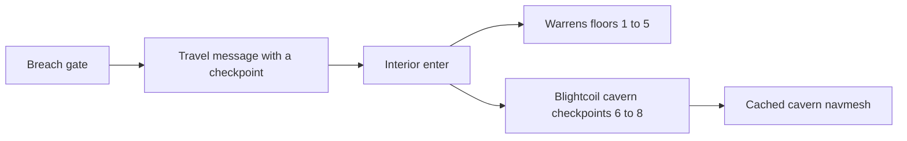
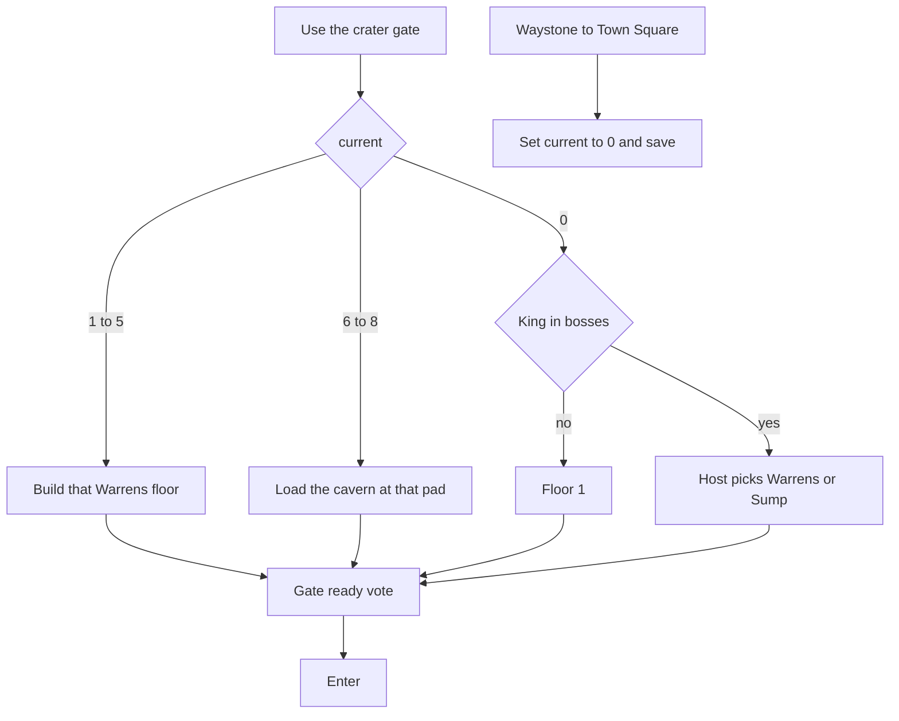
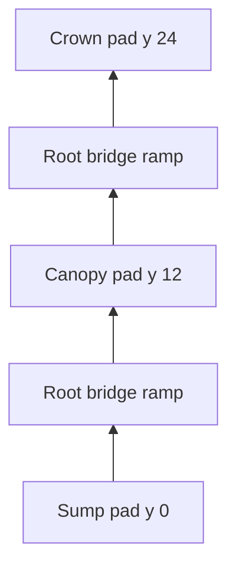
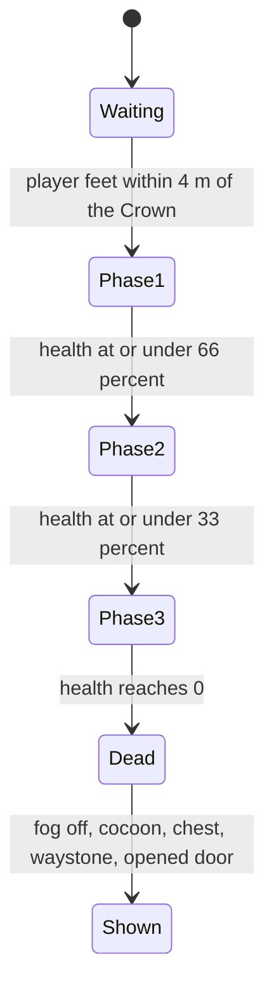

# Labyrinth Act II The Blightcoil - Plan

## Goal Capsule

- **Objective:** A party can leave the Goblin Warrens, walk up a visible spiral of root bridges through the Blightcoil, kill the Blightmaw Matriarch, and return to Town Square, with the way down to the Drowned Forge opened and still not a level, and the empty cocoon left behind.
- **Means:** Build Act II as one hand-made cavern in the existing Labyrinth interior. Act I keeps its floor stack (KTD2).
- **Authority:** The approved brief in `docs/ACT2_STORY.md` wins on story. ShobieShy's vertical-cavern choice wins on layout. This plan's requirements win on the other player-facing behavior. Key technical decisions win on mechanism. `docs/LINEAR_LEVELS_PLAN.md` wins where this plan does not name an override.
- **Execution:** Code. Characterize the crater-gate resume before changing waystone-home. Prove the Warrens golden fixture before the cavern builder exists. Prove a nav path from the Sump pad to the Crown pad before enemies chase.
- **Stop:** Stop if the work would bump `SaveGame` version, add a `GameFlow` level for the Blightcoil or the Drowned Forge, reorder Warrens rooms, or send Act II through `FloorGen`.
- **Finishes:** An implementer lands the units below. This document does not ship the level.

---

## Product Contract

### Summary

Act II, The Overgrown Deep, ships as the 0.7.0 level The Blightcoil. It is one circular cavern. The Sump, the Canopy Ring, and the Crown stay loaded together and spiral around the Rotheart on walkable root-bridge ramps. The party can see the other tiers. The Crown waystone returns them to Town Square.

### Problem Frame

Act I ends on the Goblin King's floor. The approved brief continues into a corrupted jungle whose tiers are stacked in one cavern. `docs/LINEAR_LEVELS_PLAN.md` section 9 puts that act on 0.7.0, after the 0.6.0 trust pass. The build string is still `0.4.0-prealpha`. The only Labyrinth kit is the Warrens, and those floors are flat rooms joined by a stair teleport. A stair teleport cannot show the tier above or carry a player up a root bridge. ShobieShy rejected that shortcut on 4 Nov 2026.

### Key Decisions

- **Act II is The Blightcoil.** The level name, the Rotheart, the three tiers, the Verdant Mother, Crazy Joe's marks, the Blightmaw Matriarch, the empty cocoon, and the opened way down toward the Drowned Forge come from `docs/ACT2_STORY.md`. That way does not load Act III. The older name "the Murmuring Elder" in `docs/LABYRINTH_PLAN.md` is retired for this act. Governs R1, R9, R10, R11.
- **The milestone label is 0.7.0.** That is the Act II line in `docs/LINEAR_LEVELS_PLAN.md` section 9. The story is `docs/ACT2_STORY.md`. The look for this pass is greybox plus the Ember Art list. Music stays ShobieShy's. Governs R1, R16.
- **The cavern is vertical.** ShobieShy chose one walkable volume over flat rings and stair teleports. The three tiers are visible from each other, and root-bridge ramps join them. Act I does not change. Governs R2, R13, R17, R18.
- **No shortcut, and the Forge is a stub.** The party does not open an overworld gate or load Act III. Governs R3, R11.
- **Greybox first.** Music is listed for ShobieShy and is not produced in this milestone. Governs R16.

### Requirements

**Travel**

- R1. The Blightcoil is the 0.7.0 Labyrinth Act II on the closed-level flow, entered from the Breach crater gate after the Goblin King is dead, and it is not a new `GameFlow` level.
- R2. The Blightcoil is one walkable cavern around the Rotheart. The Sump, the Canopy Ring, and the Crown are all present. A player on a tier can see the tiers above and below, and root-bridge ramps connect them.
- R3. Stairs on the Goblin King's floor do not enter Act II, and no overworld shortcut gate opens.
- R4. The Crown has a waystone that sends the party to Town Square.

**Hazards**

- R5. Mire on the Sump and spore fog from the Canopy upward poison a living player, and that poison does not spend the Breath sprint pool.
- R6. Grabbing vines root a living player in place and do not move the body.
- R7. A rest shrine clears poison and writes a save.
- R18. A landing after a drop longer than 4 m hurts a living player. A body that falls out of the cavern comes back to the last tier checkpoint.

**Fighting and loot**

- R8. Spore-cap husks, Mossbound treants, and spore beasts appear in Act II and use per-player level scaling above the Goblin King's band. A pack does not chase off its tier when the walk around the spiral is long.

**Story and ending**

- R9. The Verdant Mother can be talked to on the Canopy rest, and she has a different line after the Matriarch is dead.
- R10. Three Crazy Joe ritual marks can be collected in any order, and a collected mark does not count again when the cavern reloads.
- R11. When the Blightmaw Matriarch dies, the Rotheart's spore fog clears, an empty torn cocoon is visible, the boss chest and Crown waystone appear, and a Drowned Forge door says the way down has opened and does not load a level.

**Co-op and saves**

- R12. A co-op joiner who is still in the Breach enters the cavern on the host's current tier pad, and poison and root come from local volumes. Pose sync already carries height, and a fall stays visible.
- R13. Act I stairs down keep the ready vote. Act II has no stair teleport and no stair vote. The crater gate vote still runs before the cavern is entered.
- R14. Saves stay on `SaveGame` version 1, Act progress stays in the existing Labyrinth block and story flags, and `level_id` stays `breach` while the party is inside.
- R15. Act I floor seeds and the Warrens golden fixture stay the same.

**Presentation and proof**

- R16. The first playable Blightcoil is greybox, with an Ember Art request list and no uncredited or IP-derived files.
- R17. Unit tests, a solo playtest that walks up the ramps, a co-op pass that checks joiner height, and the full test tier cover the cavern.

### Actors

- A1. The host player, who chooses the act and owns the world save.
- A2. A joining player, who brings a character file and renders the host's enemies.
- A3. The Verdant Mother, an NPC on the Canopy rest.

### Key Flows

- F1. Enter Act II
  - **Trigger:** A1 uses the Breach crater gate.
  - **Actors:** A1, A2 if the session has a joiner.
  - **Steps:** Resolve the checkpoint first. If `current` is 1 through 5, resume that Warrens floor. If `current` is 6, 7, or 8, load the one cavern and stand on that tier's pad. If `current` is 0 and the King is alive, the floor is 1. If `current` is 0 and the King is dead, A1 picks floor 1 or the Sump (checkpoint 6). The existing gate vote then runs. The host's two choices are labeled Goblin Warrens, floor 1, and The Blightcoil, Sump. The vote banner names that act. A joiner sees the banner and does not get the choice.
  - **Covered by:** R1, R3, R12, R13
- F2. Climb the spiral
  - **Trigger:** The party walks off a tier pad onto a root-bridge ramp.
  - **Actors:** A1, A2
  - **Steps:** The ramp is solid ground. No floor is freed and no stair vote runs. Reaching the next tier's pad sets `current` to that checkpoint and writes a save. A missed edge falls onto a lower slab or, past the bottom of the cavern, back to the last pad.
  - **Covered by:** R2, R7, R18
- F3. End the act
  - **Trigger:** The Matriarch dies.
  - **Actors:** A1, A2, A3 on a later visit
  - **Steps:** Spore fog clears at every height. The cocoon and the opened Forge door are shown on the Crown. The chest and waystone appear. Waystone travel to Town Square clears `current` and keeps the boss list. A3's post-boss line is on the Canopy pad.
  - **Covered by:** R4, R9, R11

### Acceptance Examples

- AE1. Covers R1, R3. Given the King is in `bosses` and `current` is 0, when A1 uses the crater gate, then A1 chooses floor 1 or the Sump before travel.
- AE2. Covers R1, R2. Given `current` is 7, when A1 uses the crater gate, then the whole cavern loads and the party stands on the Canopy pad, with the Sump visible below and the Crown visible above.
- AE3. Covers R4, R14. Given the party waystones from the Crown to Town Square, when the save is written, then `current` is 0 and `bosses` still contains the Matriarch.
- AE4. Covers R5, R7. Given a living player stands in a Sump mire pool, when one second passes, then health falls and Breath does not. A player standing on the Sump pad, outside the pool and below the fog band, is not poisoned. A rest shrine then clears poison and writes a save.
- AE5. Covers R12. Given A1 is on the Crown pad and A2 is in the crater, when the host state is pushed, then A2 stands on the Crown pad. A2's height matches that pad, and A2 is not poisoned.
- AE6. Covers R11, R6. Given the Matriarch dies, when the cavern updates, then spore fog is off at the Canopy and the Crown, the cocoon is empty and torn, the Forge door says the way down has opened and does not travel, and a rooted body has not been moved.
- AE7. Covers R15. Given the Warrens golden fixture, when floors 1-4 generate, then the fixture still matches.
- AE8. Covers R10. Given the three marks are picked in any order, when the cavern reloads, then the count stays 3.
- AE9. Covers R18, R2. Given a living player walks the ramp from the Sump pad to the Crown pad, when they arrive, then their height has passed the Canopy slab. A drop of 12 m onto the Sump reduces health and does not spend the shield.

### Success Criteria

- A new solo save can be played from the Breach gate up the ramps through the Matriarch and back to Town Square without entering a new scene id, and without a loading seam between tiers.
- An Act I save from before this milestone still loads, still lays out the Warrens, and still refuses a newer `SaveGame` version.
- Two peers on this build can stand on different tiers of the same cavern at the same time, and a peer who joins in the crater appears on the host's tier.

### Scope Boundaries

In scope: one hand-built cavern, three checkpoint pads, root-bridge ramps, a cavern-only navmesh, fall damage, height-banded fog, poison and vines, the three enemy roles with a chase limit, the Mother, the marks, the Matriarch, the ending props, the gate and waystone, save flags that already have a home, greybox art, the Ember Art list, and the tests in R17.

#### Deferred to Follow-Up Work

- Rewriting the 0.6.0 trust-pass line. U2 points the 0.7.0 Act II line at this plan and retires the Murmuring Elder name. It also records that Act II is one cavern, not five generated floors.
- The "named part + Act key item" in `docs/LABYRINTH_PLAN.md` section 5. No key may open the Forge.
- An antidote potion, a fire cleanse, and remixing a cleared delve.
- Draining the Sump's mire when the tree dies. Spore fog clears (R11). The pools remain.
- A procedural spiral generator. 0.7.0 builds the cavern from data by hand.
- Fixing the crater greybox walk past z 86. The Act II playtest still skips that walk.
- Redoing the 0.6.0 gate-vote, dead-player gate, and travel-list fixes. The crater gate uses that vote as it stands. Joiner exit rc 134 stays out of this milestone.

#### Outside this product's identity

- A playable Drowned Forge or any later act.
- An open world, a `--open-world` flag, or a shortcut gate.
- Music composition, uncredited files, and assets from another game's IP.
- A second health bar per player, or a save-format break.
- Changing Warrens generation, Warrens stairs, or the Warrens room-graph walker.

### Decisions for ShobieShy

The vertical cavern is decided. These defaults changed because of it, and they are not open:

- One cavern with checkpoints 6, 7, and 8, instead of floors 6-10. Sump, Canopy, and Crown are pads in that volume, not separate loads.
- Loot and offsets follow the three pads. Item levels are 14, 18, and 22. Offsets are +3, +4, and +5. Chest floors are basic, uncommon, and rare. The old five-step list lost 16 and 20 because those floors are gone. The low and high ends of the band stayed.
- Spore fog starts at the Canopy slab and continues through the Crown. The Sump has mire and no fog. The kill still clears every fog volume. Mire stays.
- The joiner stands on the host's tier pad. They do not appear at the Sump mouth while the host is on the Crown.
- The cavern has its own navmesh. Act I does not.
- Fall damage exists in this milestone. The game has none today.
- `ZoneStreamer` does not load or unload tiers. Its distance is horizontal, so a stack of tiers on the same footprint would stream wrong.

Still open. The cited decision holds until you say otherwise.

- Waystone home clears `current`, so the gate can offer Act II. The Crown and Warrens stones still jump to those places. KTD3.
- Earth as the Act II brand, against Dark. The element list has no poison. KTD5.
- Three Matriarch phases and no regeneration, against a two-phase fight or a regenerating second phase. No arena lock. KTD7.
- Vines as stationary hazards, against a chasing enemy. KTD4.
- Music cues are listed under U7. Whether any of them are commissioned is yours.

### Sources

- `docs/ACT2_STORY.md`
- `docs/LINEAR_LEVELS_PLAN.md` sections 2, 8, 9, and 10, and `docs/PLAN_NEXT.md`
- `docs/LABYRINTH_PLAN.md` sections 4 and 5
- `docs/TEST_TIERS.md`, `docs/EMBER_ART_REQUESTS.md`, `docs/BUGTEST_0.4.0.md`
- `data/labyrinth/warrens.toml`
- `scripts/labyrinth/floor_gen.gd`, `labyrinth_floor.gd`, `labyrinth_state.gd`, `act_loot.gd`, `rest_shrine.gd`
- `scripts/world/interiors.gd`, `scripts/world/fast_travel.gd`, `scripts/world/level_navigation.gd`, `scripts/world/zone_streamer.gd`
- `scripts/combat/level_scale.gd`, `scripts/player/breath.gd`, `scripts/player/player.gd`
- `scripts/enemies/gnawer.gd`, `scripts/enemies/enemy.gd`
- `scripts/net/labyrinth_sync.gd`, `scripts/net/coop_world.gd`, `scripts/core/playtest_bot.gd`
- `scripts/core/save_game.gd`

---

## Planning Contract

### Key Technical Decisions

- KTD1. **Act II is not a FloorGen floor.** Floors 1-5 keep loading `data/labyrinth/warrens.toml`, keep hashing the seed string `warrens`, and keep using `LabyrinthFloor`. `descend` still stops at boss floor 5, so the King's stairs never build the cavern. Checkpoints 6, 7, and 8 mean Sump, Canopy, and Crown inside one cavern. They are not three generated floors and there is no floor 9 or 10. The gate enters that cavern through the existing interior path. Do not edit Warrens room order, do not change the `warrens` seed string, do not teach `tools/labyrinth_gen.py` a ring mode, and do not read `shortcuts`. Governs R1, R3, R15.
- KTD2. **One hand-built cavern, three pads, walkable ramps.** (session-settled: user-directed — chosen over flat rings with stair teleports: the tiers must be one walkable cavern, visible up and down.) `data/labyrinth/blightcoil.toml` stores the measures. A new cavern builder, not `FloorGen`, instances the greybox from that file. Sump walking surface at local y = 0. Canopy at y = 12. Crown at y = 24. The Rotheart is a solid column, radius 4 m, from the Sump through the Crown. The walkable ring sits outside it, outer radius 22 m. The inner edge stays open so a player sees up and down the shaft. Each connection is a root-bridge ramp with at least 20 m of run for the 12 m rise, which is about 31 degrees and under the 45 degree nav slope. Underside clearance on the ramp stays at least 3 m so the capsule and the eye camera are not pushed through the next slab. Each tier has one checkpoint pad at the ramp landing, one elite marker, and the Sump and Canopy each have a side pocket for a secret chest. The Canopy pad holds the rest shrine. The Crown pad holds the boss, the cocoon, the Forge door, and the waystone spot. Stepping on a pad sets `current` to 6, 7, or 8 and writes a save. Death and a void fall return to that pad. The first entry, with `current` 0, uses the Sump pad. Governs R2, R14, R18.
- KTD3. **The gate sends a checkpoint, and waystone-home zeroes `current`.** The host resolves it before the vote: resume 1-5 as a Warrens floor, resume 6-8 as the cavern at that pad, otherwise floor 1, or checkpoint 6 when the picker chooses Act II. Waystone travel to Town Square sets `current` to 0 before the save, and it does not clear `bosses`, `cleared`, or `deepest`. `deepest` may become 6, 7, or 8. That field is only a max integer today. `blightcoil_crown` travels to checkpoint 8 and is refused unless `bosses` contains the Matriarch. `warrens_hall` stays floor 5. Deep travel while already inside the cavern moves the party to the Crown pad. It does not destroy the cavern and build a different floor. Continue still loads the Breach and does not build anything until the gate is used. Governs R1, R4, R14.
- KTD4. **Poison and root are their own player timers. Fog is a height band.** Breath stays the sprint pool. Act IV's note that drowning reuses Breath is left for Act IV. Enemy burn stays Fire. `apply_slow` clamps its factor to at least 0.05, so a root cannot be a slow of 0. Mire deals 4% of max health per second only while a living body overlaps a Sump pool. Spore fog exists where the feet are at or above y = 12, except on the Canopy rest pad and the Sump. It deals 2% per second and keeps ticking for 3 seconds after the body leaves the band. The Crown arena is inside the band. A husk puff is a short cloud at the mire rate, wherever the husk died. Those ticks come off health and do not spend the shield. Volumes do nothing unless the player is alive. Respawn clears poison and root. The shrine clears poison and does not clear root. Root zeroes horizontal speed, expires on its own, and is reapplied if the body is still inside a vine. A vine is not an enemy and is not in the enemy snapshot. Governs R5, R6, R7.
- KTD5. **Act II combat band follows the three pads.** `ActLoot` gains act 2 for checkpoints 6-8 with item levels 14, 18, and 22, chest floors basic, uncommon, and rare, brand element Earth, luck 0.05, and the existing first-clear unique / repeat rare boss chest. Secret pockets keep the one-step rarity bump. `LABYRINTH_OFFSETS` grows by three entries: +3, +4, +5. Floors 1-5 keep `[0, 0, 1, 1, 2]`. The pad offset replaces the boss offset. It is not added on top. Husks use the rusher brain, treants the tank brain, spore beasts the rusher brain. Only the Matriarch gets a new brain kind. New toml `level` values sit in this same band. Governs R8.
- KTD6. **Two quests, flags for marks, Mother on the Canopy pad only.** The cavern builder spawns her as an NPC there and nowhere else, wired the same way Breach NPCs are wired. Dialogue is first-match in file order, so the post-boss entry is placed before the intro. The post-boss entry requires the Matriarch in the boss list and has one repeat line. The intro forbids that and sets story flag `verdant_met`. Quest `the_overgrown_deep` auto-starts on that flag with one kill objective. If the Matriarch is already in `bosses` when the quest starts, that objective is complete. Quest `joes_marks` auto-starts on the same flag with one collect objective, target `joe_mark`, count 3. When that quest starts, its progress is the number of `mark:<id>` flags already set, and the objective is complete if that count is already 3. Each pickup has a stable id, sets `mark:<id>` on collect, and is spawned only when that flag is unset. Marks are not stored in the Labyrinth block. One mark is on the Sump, one on the Canopy pad, and one on the Crown. Governs R9, R10.
- KTD7. **Matriarch phases are fractions, and she shares the volume.** Register kind `matriarch` as a boss brain. Phases advance at 66% and 33% of max health and never move backward. Phase 1 breathes spores and calls husks. Phase 2 adds a treant and vine hazards on the Crown. Phase 3 fills the Crown with the same fog band and opens a weak point. There is no phase-2 regen and no arena lock. She does not aggro while the player's feet are more than 4 m below the Crown surface, so a Sump visitor does not start the fight. The host keeps one health fraction. Clients do not run the brain. Death uses the existing boss-kill path: append the id once, drop the act chest once, spawn waystone `blightcoil_crown`. All spore fog deactivates from that boss id. Mire stays. The cocoon is shown on the Crown when the id is already in `bosses`. The Forge door is an interact line on a prop. It says the way down has opened and cannot be taken yet. It is not a `LevelGate` and it does not call travel. Governs R8, R11.
- KTD8. **Sync carries the tier, and the joiner uses the pad.** Create the Labyrinth sync when the Breach level loads, for host and joiner. A push received in the crater enters the host's Warrens floor or the cavern and does not offer the picker. Inside the cavern the joiner is placed on the checkpoint pad for the host's `current`, not inside the host and not on the Sump when the host is higher. After that, pose sync is the existing position sample, which already includes height, so a fall is visible and nobody is teleported when the other player changes tier. The joiner's own block is restored when the sync node exits, and it is not written into the character file. A later push applies `bosses` in place: fog, cocoon, and waystone update, and the Matriarch is not respawned. Act I stair vote is unchanged, including the 10 second default-yes and the rule that a missing `StairsDown` does not descend. The cavern has no `StairsDown`. Poison stays out of the pose snapshot, so the net protocol stays 5 unless a snapshot field actually changes. Governs R12, R13, R14.
- KTD9. **Navmesh, falls, camera, and what not to stream.** The cavern gets one `NavigationRegion3D` baked from its walkable colliders only. Do not call `LevelNavigation.make_mesh` unchanged: that mesh uses a 0.5 m agent height and 0.1 m cells, and baking it on the main thread at level load is the same class of stall as the embedded Midden's 100-tile bake. The cavern mesh uses a 1.8 m agent height, a 0.4 m radius, a 0.25 m climb, a 45 degree slope, and 0.25 m cells. Cache it under `res://scenes/levels/nav/blightcoil/` and skip the bake when the cache matches the toml. Do not bake it during Breach load or during the crater walk. Gnawer detection on flat floors uses horizontal distance. Cavern enemies use 3D distance plus the existing line of sight, and they drop the chase when the nav path is longer than 40 m. They follow the mesh. If they drop more than 8 m below their home pad, they return to that pad. They do not leap the shaft. The player has gravity and no fall damage today. In the cavern, a landing more than 4 m below the last grounded height removes 8% of max health per extra meter, from health and not from the shield. Below local y = -8, apply that damage once and put a living body on the last pad. A dead body uses the normal respawn at that pad. The camera stays the eye camera on the head. Do not add a third-person arm. Clearance is the 3 m rule in KTD2. `ZoneStreamer` measures horizontal distance and detaches props. Do not put tiers under it. The trunk and the slab undersides may use the occlusion switch already applied at Medium and High. Enemies, ramps, volumes, the Mother, and the door never detach. Dressing pods may use a visibility range. Governs R2, R8, R16, R17, R18.

### High-Level Technical Design

Act I and Act II share the interior and the gate. They do not share a builder.

`current` chooses a Warrens floor or a pad in the cavern. Waystone home clears it.

The spiral is one volume. Pads save. Ramps do not.

Matriarch. Thresholds are fractions so per-player health scaling does not move the phase. She stays quiet until the player is on the Crown.

### Assumptions

- The combat band, Earth brand, luck 0.05, poison rates, fall rate, and 40 m chase cap are balance defaults. The three-pad shape of the band is not. The vertical choice forced it.
- Clearing `current` on waystone-home is still the unconfirmed resume change. AE3 is the rule until ShobieShy says otherwise.
- Creating Labyrinth sync on Breach load still changes today's joiner-in-the-crater case.
- The Mother never stands on the Crown, and she has no line that names what left the cocoon.
- The solo Act II playtest starts with the King already dead rather than clearing floors 1-5 inside the existing Labyrinth timeout.
- Husk death puffs are spawned on each peer from the existing kill message. Each peer poisons only its own player.

### Sequencing

| Phase | Units | Size | Risk |
|---|---|---|---|
| Cavern shell | U1 | Large | High. New builder, ramp slope, and a cached navmesh. A main-thread bake repeats the Midden stall. |
| Checkpoints and gate | U2 | Large | High. The same `current` integer means a Warrens floor or a pad in one volume. |
| Hazards and falls | U3 | Medium | Medium. Fall damage is new. Fog is a height band, not a room flag. |
| Enemies | U4 | Medium | High. Horizontal sight would pull every pack in the shaft. The 3D check and the 40 m path cap have to hold. |
| Story and boss | U5, U6 | Medium | Medium. The Matriarch shares the volume with the Sump, and she must not start from down there. |
| Greybox list | U7 | Small | Low. No new asset files. |
| Vertical proof | U8 | Large | High. The room-graph bot cannot walk a ramp. Co-op has to assert height. |

Size is the amount of code and content, not a schedule. This is larger than the flat-ring plan. The extra size is the cavern, the navmesh, the falls, and the vertical playtests. U1 before U2, U3, U5, and U7. U3 before U4. U1, U3, and U4 before U6. U5 does not wait on U2. U6 does not wait on U5. U8 is last.

### Risks and dependencies

- Changing the Warrens seed string or room order invalidates `tests/fixtures/labyrinth/warrens_golden.txt`. KTD1 forbids that edit. Extending `FloorGen` for the spiral would put Act I on the same code path. That is the risk this plan refuses.
- `current` values 6-8 must not be passed to `LabyrinthFloor.build`. A mistake loads a Warrens-shaped floor, or clamps loot back to the King's +2 offset.
- Waystone-home and Breach-load sync are still behavior changes for Act I resume. Characterize them before editing.
- A nav bake on enter will stall the playtest the way the embedded Midden bake did. The cache is the mitigation. A missing cache in a shipping build is a loud bake, not a silent straight-line steer.
- Gnawers measure horizontal distance. Leaving that in the cavern makes a Sump player visible to the Crown. KTD9 is the override, and it is Act II only.
- `ZoneStreamer` ignores height. Putting a tier in a POI would unload a ring the player can see, or never unload it, because every tier shares a footprint.
- A new drop pool can change the co-op content hash. Mismatched builds already refuse to play. Do not bump the protocol unless the snapshot or hello gains a field. Height is already in the pose.
- The rest-shrine signal is not connected to a save today. U3 has to connect it or R7 is false. The tier pad writes a save too. Both paths must set the same `current`.
- `docs/LABYRINTH_PLAN.md` section 13 still mentions overworld shortcut gates. That line is stale. Do not implement it. Section 2's "5 floors each" is also not true for this act. U2 says so in that file.

---

## Implementation Units

### U1. Hand-built cavern and cached navmesh

- **Goal:** Checkpoints 6-8 load one walkable cavern, and floors 1-5 still generate the Warrens.
- **Requirements:** R1, R2, R3, R15, R18
- **Dependencies:** None
- **Files:** `data/labyrinth/blightcoil.toml`, `scripts/labyrinth/blightcoil_cavern.gd`, `scripts/world/interiors.gd`, `scripts/labyrinth/labyrinth_state.gd`, `tests/unit/test_blightcoil_cavern.gd`, `tests/unit/test_floor_gen.gd`, `tests/fixtures/labyrinth/warrens_golden.txt`, `res://scenes/levels/nav/blightcoil/` as a generated cache
- **Approach:** Follow KTD1, KTD2, and KTD9. The toml is measures and marker positions. The builder instances slabs, the trunk, two ramps, three pads, and the Crown arena. `Interiors` calls it when the checkpoint is 6, 7, or 8 and calls `LabyrinthFloor` otherwise. Bake the cavern mesh once into the cache. Tests may bake in the unit process. The playtest loads the cache.
- **Execution note:** Lock the Warrens golden fixture before adding the cavern branch, and keep that check green. Do not add a code path in `floor_gen.gd` or `tools/labyrinth_gen.py`.
- **Patterns to follow:** The floor-5 handmade hall in `scripts/labyrinth/labyrinth_floor.gd` for a built room, and the cache-or-bake split in `scripts/world/level_navigation.gd`. Copy the cache idea. Do not copy the 0.1 m cell size.
- **Test scenarios:**
  - Happy path: building checkpoint 6, 7, or 8 yields one cavern whose pad heights are 0, 12, and 24, whose ramps are at most 40 degrees, and whose underside clearance is at least 3 m. A nav query from the Sump pad reaches the Crown pad.
  - Edge: `descend` on floor 5 returns without building the cavern. Checkpoint 8 does not build a floor 9. Entering at 7 places the body on the Canopy pad, and the Sump and Crown colliders exist in the same tree.
  - Error: the Warrens golden fixture still matches. A floor 3 seed hashed with `warrens` still matches its previous layout. `LabyrinthFloor.build` is not called for checkpoint 6.
  - Integration: a missing nav cache bakes and writes the cache. A second build with the same toml does not bake again.
- **Verification:** The Warrens fixture is unchanged, and a path exists from the Sump pad to the Crown pad on the cached mesh.

### U2. Gate, checkpoints, and Breach sync

- **Goal:** The host can enter the Sump, return to Town Square, and pull a joiner onto the host's tier pad.
- **Requirements:** R1, R3, R4, R12, R13, R14
- **Dependencies:** U1
- **Files:** `scripts/core/main.gd`, `scripts/world/interiors.gd`, `scripts/world/fast_travel.gd`, `scripts/net/labyrinth_sync.gd`, `tests/unit/test_labyrinth_floor.gd`, `tests/unit/test_labyrinth_sync.gd`, `tests/unit/test_fast_travel.gd`, `tests/unit/test_linear_flow.gd`, `docs/LINEAR_LEVELS_PLAN.md`, `docs/LABYRINTH_PLAN.md`
- **Approach:** Follow KTD3 and KTD8. Resume, the King-alive entry, and the act choice each run the existing gate vote after the checkpoint is resolved. The host prompt names Goblin Warrens at floor 1 and The Blightcoil at the Sump. Add `blightcoil_crown` with checkpoint 8 beside `warrens_hall`. Update the Act II line so it names this plan and one cavern, and replace the Murmuring Elder name. Do not rewrite the 0.6.0 line.
- **Execution note:** Add a characterization test for today's waystone-home `current` and today's joiner-in-the-crater case before changing either.
- **Patterns to follow:** `FastTravel.DEEP_POINTS`, the gate vote in `scripts/net/gate_vote.gd`, the stair vote in `scripts/net/labyrinth_sync.gd` for Act I only.
- **Test scenarios:**
  - Happy path: King in `bosses`, `current` 0, host chooses the Sump, the travel message carries 6, and the party stands on the Sump pad inside the cavern.
  - Edge: `current` 7 loads the cavern on the Canopy pad and does not open the picker. Waystone to `town_gate` saves `current` 0 and keeps `bosses`. `blightcoil_crown` moves a party that is already in the cavern to the Crown pad only when the Matriarch is in `bosses`, and is refused otherwise.
  - Error: the crater path does not send checkpoint 0 once the picker exists. A joiner does not build from an empty character progress block. A client character file does not gain the host's boss list.
  - Integration: a joiner in the crater, with the host on the Crown pad, appears on the Crown pad. Their height matches that pad. Act I stairs still use the 10 second vote. A missing `StairsDown` on a Warrens floor does not descend. The 4.2 m Warrens hole still keeps its landing.
- **Verification:** AE1, AE2, AE3, and AE5 pass, and Town Square remains the waystone destination.

### U3. Poison, fog height, falls, and the shrine save

- **Goal:** Mire, height-banded fog, vines, and falls affect the living player, and a rest or a tier pad writes a save.
- **Requirements:** R5, R6, R7, R18
- **Dependencies:** U1
- **Files:** `scripts/player/player.gd`, `scripts/labyrinth/rest_shrine.gd`, `scripts/labyrinth/blightcoil_cavern.gd`, `scripts/core/main.gd`, a new volume script under `scripts/labyrinth/`, `tests/unit/test_blight_hazard.gd`
- **Approach:** Follow KTD4 and the fall rule in KTD9. Place mire on the Sump, outside the Sump pad. Fog volumes cover the Canopy ring and the Crown, outside the rest pad. Vines sit on the Canopy bridges. Connect the shrine signal to the existing save path. Stepping on a pad sets `current` and saves too.
- **Execution note:** Write the poison, root, and fall tests first.
- **Patterns to follow:** The ooze puddle overlap in `scripts/enemies/ooze.gd`, and the shrine refill in `scripts/labyrinth/rest_shrine.gd`.
- **Test scenarios:**
  - Happy path: one second in a mire pool removes 4% max health, leaves the shield unchanged, and leaves Breath unchanged. A body at y = 0 outside the pool is not in fog. A body at y = 12 outside the rest pad takes fog damage. Leaving the band stops the tick after 3 seconds. A 12 m drop removes 64% of max health and does not spend the shield.
  - Edge: a downed player in a pool takes no further poison. Respawn clears poison and root. The shrine clears poison, writes a save, and leaves an unexpired root in place. A body below y = -8 returns to the last pad.
  - Error: a dead player is not poisoned. Landing on the Sump pad does not start a tick. A 3 m drop deals no fall damage.
  - Integration: the shrine signal reaches the save. A pad step sets `current` to 6, 7, or 8 and saves. A puff on one peer does not poison the other peer unless that peer's own body overlaps a puff.
- **Verification:** AE4 and AE9 pass, and Breath tests in `tests/unit/test_breath.gd` still describe a sprint pool.

### U4. Enemies, tier band, and chase limit

- **Goal:** The three families spawn in the cavern at the pad's band, and they do not pull the whole shaft.
- **Requirements:** R8
- **Dependencies:** U1, U3
- **Files:** `data/enemies/blightcoil.toml`, `scripts/enemies/enemy_table.gd`, `scripts/enemies/enemy.gd`, `scripts/enemies/gnawer.gd`, `scripts/combat/level_scale.gd`, `scripts/labyrinth/act_loot.gd`, `scripts/labyrinth/blightcoil_cavern.gd`, `resources/loot/drop_pools.tres`, `resources/enemies/` generated output, `tests/unit/test_act_loot.gd`, `tests/unit/test_level_scale.gd`, `tests/unit/test_level_scale_coverage.gd`, `tests/unit/test_blight_aggro.gd`
- **Approach:** Follow KTD5 and the sense rule in KTD9. The 3D distance check is selected for cavern spawns. Warrens goblins keep horizontal distance. Husks are fragile rushers that leave a puff. Treants are the elite. Spore beasts poison on a hit while the target is alive. Generate the enemy resource with the existing enemy-table tool. Add drop pools that name the new ids.
- **Patterns to follow:** `data/enemies/goblins.toml`, `scripts/labyrinth/act_loot.gd`, `LevelScale.LABYRINTH_OFFSETS`, and the sense block in `scripts/enemies/gnawer.gd`.
- **Test scenarios:**
  - Happy path: a Canopy spawn is act 2, item level 18, offset +4. A Sump spawn is item level 14, offset +3. A Crown spawn is item level 22, offset +5.
  - Edge: a floor 5 spawn stays act 1 and offset +2. An elite treant uses the pad offset and does not also take the boss offset. A cavern enemy 20 m above the player, with a clear shaft and a nav path of 50 m, does not chase. The same enemy with a 10 m path does.
  - Error: the new ids are rusher or tank, not an unregistered kind. New numeric constants on a brain are listed in the level-scale table. A Warrens grunt still uses horizontal distance. Overlapping drop pools fail validation.
  - Integration: party size still adds the existing drop-chance bonus and the existing extra-player health multiplier. A husk death creates a puff volume. An enemy that falls 8 m below its pad returns to that pad.
- **Verification:** `act_of` for checkpoints 6-8 returns 2, floors 1-5 still return 1, and a Sump player does not pull a Crown pack.

### U5. Verdant Mother and Joe's marks

- **Goal:** The Mother's two lines and the three marks persist across reloads.
- **Requirements:** R9, R10
- **Dependencies:** U1
- **Files:** `data/story/dialogue.toml`, `data/story/quests.toml`, `scripts/labyrinth/blightcoil_cavern.gd`, `scripts/core/main.gd`, `tests/unit/test_dialogue.gd` or a new quest test beside `scripts/story/quest_log.gd`
- **Approach:** Follow KTD6. Intro copy: she is bound to the Rotheart and asks the party to burn out the infection before it climbs. Post-boss copy: the tree is dead, she does not know what tore the cocoon open, and the way down has opened and cannot be taken yet. Mark clues say Joe carved the bark and fed the Rotheart Breach-fire. Do not name the thing that left the cocoon.
- **Patterns to follow:** `data/story/dialogue.toml` first-match entries, `data/story/quests.toml` auto-start flags, `scripts/loot/quest_pickup.gd`.
- **Test scenarios:**
  - Happy path: talking to the Mother on the Canopy pad sets `verdant_met`, starts both quests, and the kill quest's current objective is the Matriarch. After the boss id is in `bosses`, the post-boss entry matches and its repeat line is the one that plays the second time.
  - Edge: the intro does not match once the boss id is set. Marks picked as the third, then the first, then the second still reach count 3. Reloading the cavern does not spawn a mark whose `mark:<id>` flag is set.
  - Error: marks do not require a new Labyrinth-block key.
  - Integration: if the Matriarch is already dead when `verdant_met` is set, the kill objective is complete. If the Sump mark flag is already set when `joes_marks` starts, that collect counts toward 3. The talk wiring matches the other NPC path.
- **Verification:** AE8 passes, and the Mother is on the Canopy pad only.

### U6. Blightmaw Matriarch and the ending

- **Goal:** The Crown fight ends on the brief's beat, and the Forge door does not load a level.
- **Requirements:** R11
- **Dependencies:** U1, U3, U4
- **Files:** `scripts/enemies/blightmaw.gd`, `data/enemies/blightcoil.toml`, `scripts/enemies/enemy.gd`, `scripts/core/main.gd`, `scripts/labyrinth/blightcoil_cavern.gd`, `tests/unit/test_blightmaw.gd`
- **Approach:** Follow KTD7. Extend an existing boss brain. Drive joiner visuals from the shared health fraction and the same-cavern state push. Show the cocoon only as an empty shell torn from the inside. The Forge line tells the player the way down has opened and cannot be taken yet.
- **Patterns to follow:** Phase fractions in `scripts/enemies/filth.gd`, the King kill chest and waystone in `scripts/core/main.gd`, boss tests in `tests/unit/test_goblin_king.gd`.
- **Test scenarios:**
  - Happy path: above 66% health is phase 1, at 50% is phase 2, at 20% is phase 3, and raising the fraction in a test does not return to an earlier phase. Death appends the boss id once, spawns one chest, and spawns `blightcoil_crown`.
  - Edge: a player at the Sump does not pull her. A joiner already in the cavern applies the kill from a state push: fog off at the Canopy and the Crown, cocoon shown, waystone shown, Matriarch absent. Sump mire still ticks.
  - Error: the Forge interact does not call travel and does not add a level id. A second death signal does not append the boss id again or spawn a second waystone.
  - Integration: phase changes stay on the same fractions when the viewer's combat level changes the health pool. Clients do not run the brain.
- **Verification:** AE6 passes, and `GameFlow` level ids are unchanged.

### U7. Greybox kit and the Ember Art list

- **Goal:** The cavern is playable with boxes, and Ember Art has a slot list for later files.
- **Requirements:** R16
- **Dependencies:** U1
- **Files:** `scripts/labyrinth/blightcoil_kit.gd`, `docs/EMBER_ART_REQUESTS.md`, `tests/unit/test_blightcoil_kit.gd`
- **Approach:** Collision stays on the boxes, and a mesh is shown only when its file exists. Add no files under `assets/`. Request original work, CC0 or CC-BY, in the existing table shape: slot, path, spec, metres, Y-up. Slots: moss wall, root-bridge ramp, mire surface, spore pod, trunk column, torn cocoon, forge door, ritual-mark decal, Verdant Mother, spore-cap husk, Mossbound treant, spore beast, grabbing vine, Blightmaw Matriarch. The ramp spec names the 12 m rise, the 20 m minimum run, and the 3 m clearance. Paths live under `assets/original/ember_art/blightcoil/` and `assets/original/ember_art/enemies/`. Music cues, not files: Sump, Canopy, Crown, Matriarch, and a short sting when the fog clears.
- **Patterns to follow:** `scripts/labyrinth/warrens_kit.gd`, the tables in `docs/EMBER_ART_REQUESTS.md`.
- **Test scenarios:**
  - Happy path: with no Blightcoil glb present, the cavern still has collision and reads as greybox.
  - Edge: a listed file at its path replaces that slot's box. A missing file leaves the box.
  - Error: this unit adds no `assets/` file, so the asset-license check has nothing new to fail.
  - Integration: the Warrens kit still dresses the Warrens when those files exist.
- **Verification:** The request table names every slot above, including the ramp measures, and no new asset row is required.

### U8. Vertical solo and co-op proof

- **Goal:** A bot walks up the ramps through the Matriarch, and a joiner appears at the host's height.
- **Requirements:** R17
- **Dependencies:** U2, U3, U4, U5, U6
- **Files:** `scripts/core/playtest_bot.gd`, `tools/run_tests.sh`, `docs/TEST_TIERS.md`, the unit tests added in U1-U6
- **Approach:** Add an Act II playtest leg that starts with the King dead and `current` 0, takes the gate to the Sump, and walks the navmesh from pad to pad until the Matriarch dies. Record the bot's height at each pad. Do not use the Warrens room-graph walker inside the cavern. Leave the crater stall workaround in place, and do not bake nav during that walk. Add the new unit tests to the fast core list. Extend the co-op playtest with a host on the Crown pad and a joiner who must arrive at that pad's height, plus a mire volume that poisons only the body inside it.
- **Patterns to follow:** The Labyrinth leg and timeout notes in `docs/TEST_TIERS.md`. The bot's movement in the cavern follows the cached mesh, the way outdoor enemies follow `LevelNavigation` once the map is ready.
- **Test scenarios:**
  - Happy path: the Act II leg stands on y = 0, then y = 12, then y = 24, and then the Matriarch dies and the waystone exists. There is no load between those heights.
  - Edge: the crater workaround still fires on the old leg. The cavern leg does not log a room-graph route. A second playtest run uses the nav cache and does not rebake.
  - Error: a bot that fails to move logs its position, its height, and the next pad, then unsticks. A timeout fails with that position. A nav path that does not reach the Crown fails the leg before the fight.
  - Integration: the full tier runs the Act II leg and the co-op join onto the Crown pad. The joiner's height matches the pad. The fast tier runs the new unit tests.
- **Verification:** R17's four passes have a named leg, the solo leg has climbed, and the fast core list includes the new tests.

---

## Verification Contract

| Gate | What it proves |
|---|---|
| Fast | `tools/run_tests.sh --fast`, once U8 has put the new Act II unit tests on the core list. Covers the Warrens fixture, the cavern heights and nav path, the gate, hazards, falls, loot, aggro, dialogue, and the boss. |
| Solo Act II | The playtest leg from U8, from the Sump pad up the ramps through the Matriarch and the waystone, with height checks at 0, 12, and 24. |
| Co-op | Joiner pulled from the crater onto the host's Crown pad at that pad's height. Poison only on the body inside the mire. Both peers can occupy the cavern at once. |
| Full | `tools/run_tests.sh`, including the existing Labyrinth leg, the vertical Act II leg, the co-op playtest, and the asset and credit checks. |

Headless playtests stay on the fixed 60 fps runner. A joiner process that exits 134 after a passing gameplay log stays a known non-failure, as `docs/TEST_TIERS.md` already says. The cavern leg must not rebake navigation on every run.

---

## Definition of Done

- R1 through R18 are true in a build, and AE1 through AE9 pass.
- U1 through U8 are complete, including the fast core list and the vertical Act II playtest leg.
- `SaveGame` version is still 1. `GameFlow` has no Blightcoil or Drowned Forge level. The Warrens golden fixture is unchanged. `FloorGen` has no Act II mode.
- From the Sump pad the Crown is visible, and a walk along the ramps reaches it without a stair teleport or a second load.
- No new file under `assets/` is added without an `ASSETS.toml` row and a `CREDITS.md` row. This milestone adds none. The nav cache under `scenes/levels/nav/blightcoil/` is generated data, not an art asset.
- The Forge door does not travel. `shortcuts` is still unread. `ZoneStreamer` does not own the tiers.
- Dead-end prototypes, including any flat-ring generator, are removed before the work is called done.
- `docs/LINEAR_LEVELS_PLAN.md` names Act II as the 0.7.0 cavern, and `docs/LABYRINTH_PLAN.md` names the Blightmaw Matriarch.

---

## Appendix

### What the code does today

The Warrens kit is the only Labyrinth kit. Normal floors are a tree of rooms on a flat slot grid at local y = 0. Stairs teleport, and `descend` stops at boss floor 5. The interior frees the current floor before it instances the next one, both at the same local height. The crater gate enters floor 1, or `labyrinth.current` when that value is already greater than 0. Waystone-home does not zero `current`. Labyrinth sync is created on labyrinth entry. The playtest bot routes on the room graph because those floors have no navmesh, and a separate workaround skips the crater walk near z 86.

`LevelNavigation` bakes from static colliders with a 0.25 m climb, a 45 degree slope, a 0.5 m agent height, and 0.1 m cells. Baking the embedded Midden's tiles on the wrong level was a playtest stall, and the code now skips that bake. `ZoneStreamer` loads props by horizontal distance only. Gameplay nodes are not under its POIs. The player camera is the eye camera on the head. Gravity is 9.8. There is no player fall damage. Enemies that drop 60 m below their first position are put back. Gnawer detection uses horizontal distance plus line of sight.

`ActLoot` has act 1 only, so a floor past 5 is untagged. Level offsets clamp every floor above 5 to +2. Breath is the sprint pool. The shield absorbs ordinary damage before health. There is no poison status. The pose sample already includes the full position, so height is already on the wire. The Goblin King is the only Labyrinth boss id.

### Alternative that was rejected

Flat rings on floors 6-10, with stair teleports between them, was the previous default. It kept `FloorGen` and avoided a navmesh. It could not show the tier above or below, and it could not be a root bridge the player walks. ShobieShy chose the cavern instead. Act I still uses the flat stack. Act II does not.
