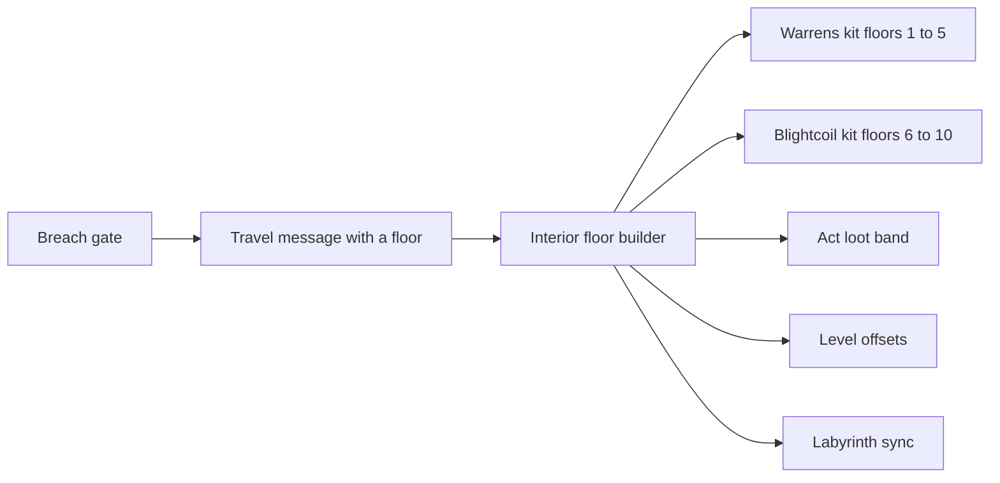
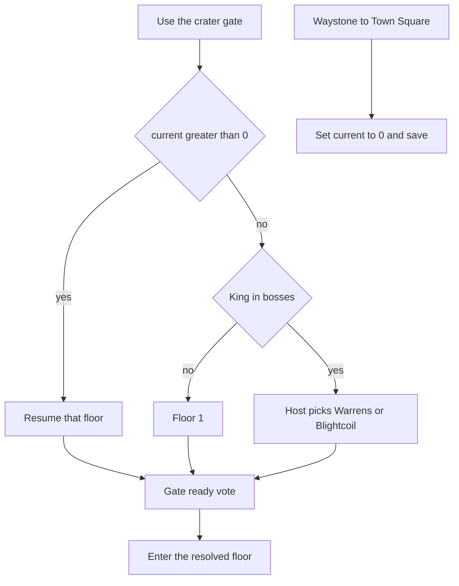
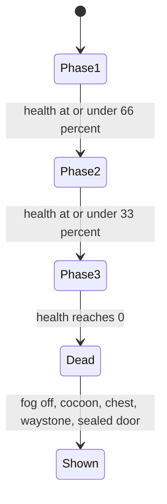

# Labyrinth Act II The Blightcoil - Plan

## Goal Capsule

- **Objective:** A party can leave the Goblin Warrens, walk the Blightcoil's three tiers, kill the Blightmaw Matriarch, and return to Town Square, with the way down to the Drowned Forge opened and still not a level, and the empty cocoon left behind.
- **Means:** Add Act II as floors 6-10 of the existing Labyrinth interior, with a second room kit and the current stair, save, vote, and scaling systems (KTD1).
- **Authority:** The approved brief in `docs/ACT2_STORY.md` wins on story. This plan's requirements win on player-facing behavior. Key technical decisions win on mechanism. `docs/LINEAR_LEVELS_PLAN.md` wins where this plan does not name an override. `docs/LABYRINTH_PLAN.md` wins on dungeon content only where both of those are silent.
- **Execution:** Code. Characterize the crater-gate resume before changing waystone-home. Prove the Warrens golden fixture and the poison timer before widening spawns.
- **Stop:** Stop if the work would bump `SaveGame` version, add a `GameFlow` level for the Blightcoil or the Drowned Forge, or reorder Warrens rooms.
- **Finishes:** An implementer lands the units below. This document does not ship the level.

---

## Product Contract

### Summary

Act II, The Overgrown Deep, ships as the 0.7.0 level The Blightcoil on the linear closed-level campaign. The party descends from the Breach gate after the Goblin King, crosses a circular poison cavern in three tiers, and leaves the Crown by waystone for Town Square.

### Problem Frame

Act I ends on the Goblin King's floor. The approved brief continues underground into a corrupted jungle, and the campaign plan already names that place The Overgrown Deep. `docs/LINEAR_LEVELS_PLAN.md` section 9 now puts that act on 0.7.0, after the 0.6.0 trust pass. The build string is still `0.4.0-prealpha`, and the only Labyrinth kit is the Warrens. Players have no Act II gate, no poison, and no Matriarch. The brief also asks for a circle and two or three levels of verticality, which the current floor stack does not draw as one walkable cavern.

### Key Decisions

- **Act II is The Blightcoil.** The level name, the Rotheart, the three tiers, the Verdant Mother, Crazy Joe's marks, the Blightmaw Matriarch, the empty cocoon, and the opened way down toward the Drowned Forge come from `docs/ACT2_STORY.md`. That way does not load Act III. The older name "the Murmuring Elder" in `docs/LABYRINTH_PLAN.md` is retired for this act. Governs R1, R9, R10, R11.
- **The milestone label is 0.7.0.** That is the Act II line in `docs/LINEAR_LEVELS_PLAN.md` section 9. This plan is that milestone. The story is `docs/ACT2_STORY.md`. The look for this pass is greybox plus the Ember Art list. Music stays ShobieShy's. Governs R1, R16.
- **No shortcut, and the Forge is a stub.** The party does not open an overworld gate or load Act III. Governs R3, R11.
- **Greybox first.** Music is listed for ShobieShy and is not produced in this milestone. Governs R16.

### Requirements

**Travel**

- R1. The Blightcoil is the 0.7.0 Labyrinth Act II on the closed-level flow, entered from the Breach crater gate after the Goblin King is dead, and it is not a new `GameFlow` level.
- R2. The Blightcoil reads as a circular cavern of three tiers around the Rotheart: the Sump, the Canopy Ring, and the Crown.
- R3. Stairs on the Goblin King's floor do not enter Act II, and no overworld shortcut gate opens.
- R4. The Crown has a waystone that sends the party to Town Square.

**Hazards**

- R5. Mire pools and spore fog poison a living player, and that poison does not spend the Breath sprint pool.
- R6. Grabbing vines root a living player in place and do not move the body.
- R7. A rest shrine clears poison and writes a save.

**Fighting and loot**

- R8. Spore-cap husks, Mossbound treants, and spore beasts appear in Act II and use per-player level scaling above the Goblin King's band.

**Story and ending**

- R9. The Verdant Mother can be talked to on the Canopy rest, and she has a different line after the Matriarch is dead.
- R10. Three Crazy Joe ritual marks can be collected in any order, and a collected mark does not count again when the floor reloads.
- R11. When the Blightmaw Matriarch dies, the Rotheart's spore fog clears, an empty torn cocoon is visible, the boss chest and Crown waystone appear, and a Drowned Forge door says the way down has opened and does not load a level.

**Co-op and saves**

- R12. A co-op joiner who is still in the Breach enters the host's live Labyrinth floor, and poison and root come from local volumes.
- R13. Stairs down keep the ready vote, and "near the stairs" follows the floor graph.
- R14. Saves stay on `SaveGame` version 1, Act progress stays in the existing Labyrinth block and story flags, and `level_id` stays `breach` while the party is inside.
- R15. Act I floor seeds and the Warrens golden fixture stay the same.

**Presentation and proof**

- R16. The first playable Blightcoil is greybox, with an Ember Art request list and no uncredited or IP-derived files.
- R17. Unit tests, a solo playtest through Act II, a co-op pass, and the full test tier cover the new floors.

### Actors

- A1. The host player, who chooses the act and owns the world save.
- A2. A joining player, who brings a character file and renders the host's enemies.
- A3. The Verdant Mother, an NPC on the Canopy rest.

### Key Flows

- F1. Enter Act II
  - **Trigger:** A1 uses the Breach crater gate.
  - **Actors:** A1, A2 if the session has a joiner.
  - **Steps:** Resolve the floor first. If `current` is already a floor, resume it. If `current` is 0 and the King is alive, the floor is 1. If `current` is 0 and the King is dead, A1 picks floor 1 or floor 6. The existing gate vote then runs on that floor. The host's two choices are labeled Goblin Warrens, floor 1, and The Blightcoil, Sump, floor 6. The vote banner names the chosen act. A joiner sees the banner and does not get the choice. The choice does not open again while the vote is running.
  - **Covered by:** R1, R3, R12
- F2. Cross a tier
  - **Trigger:** The party holds interact on stairs down.
  - **Actors:** A1, A2
  - **Steps:** The stair vote uses the room graph. On success the current floor is freed and the next floor is built. Floor 5 does not build floor 6. Floor 10 does not build floor 11.
  - **Covered by:** R2, R3, R13
- F3. End the act
  - **Trigger:** The Matriarch dies.
  - **Actors:** A1, A2, A3 on a later visit
  - **Steps:** Spore fog clears, the cocoon and the sealed Forge door are shown, the chest and waystone appear. Waystone travel to Town Square clears `current` and keeps the boss list. A3's post-boss line is available on the next visit to the Canopy rest.
  - **Covered by:** R4, R9, R11

### Acceptance Examples

- AE1. Covers R1, R3. Given the King is in `bosses` and `current` is 0, when A1 uses the crater gate, then A1 chooses floor 1 or floor 6 before travel.
- AE2. Covers R1. Given `current` is 7, when A1 uses the crater gate, then the party enters floor 7 and no act picker opens.
- AE3. Covers R4, R14. Given the party waystones from the Crown to Town Square, when the save is written, then `current` is 0 and `bosses` still contains the Matriarch.
- AE4. Covers R5, R7. Given a living player stands in a mire pool, when one second passes, then health falls and Breath does not, and a rest shrine then clears the poison and writes a save.
- AE5. Covers R12. Given A1 is on floor 8 and A2 is in the crater, when the host floor state is pushed, then A2 is on floor 8 at that floor's start and is not poisoned.
- AE6. Covers R11, R6. Given the Matriarch dies, when the floor updates, then spore fog is off, the cocoon is empty and torn, the Forge door says the way down has opened and does not travel, and a rooted body has not been moved.
- AE7. Covers R15. Given the Warrens golden fixture, when floors 1-4 generate, then the fixture still matches.
- AE8. Covers R10. Given the three marks are picked in any order, when the floor reloads, then the count stays 3.

### Success Criteria

- A new solo save can be played from the Breach gate through the Matriarch and back to Town Square without entering a new scene id.
- An Act I save from before this milestone still loads, still lays out the Warrens, and still refuses a newer `SaveGame` version.
- Two peers on this build can take the stairs together, and a peer who joins in the crater arrives on the host's floor.

### Scope Boundaries

In scope: floors 6-10, the ring layout, poison and vines, the three enemy roles, the Mother, the marks, the Matriarch, the ending props, the gate and waystone, save flags that already have a home, greybox art, the Ember Art list, and the tests in R17.

#### Deferred to Follow-Up Work

- Rewriting the 0.6.0 trust-pass line. U2 points the 0.7.0 Act II line at this plan and retires the Murmuring Elder name.
- The "named part + Act key item" in `docs/LABYRINTH_PLAN.md` section 5. No key may open the Forge.
- An antidote potion, a fire cleanse, and remixing a cleared floor.
- Draining the Sump's mire when the tree dies. Spore fog clears (R11). The pools remain.
- A walkable multi-storey coil, a Labyrinth navmesh, and the crater greybox walk past z 86.
- Redoing the 0.6.0 gate-vote, dead-player gate, and travel-list fixes. Act II uses that vote as it stands. Joiner exit rc 134 stays out of this milestone. Section 8's parked list is older than the trust pass.

#### Outside this product's identity

- A playable Drowned Forge or any later act.
- An open world, a `--open-world` flag, or a shortcut gate.
- Music composition, uncredited files, and assets from another game's IP.
- A second health bar per player, or a save-format break.

### Decisions for ShobieShy

None of these block the build. The cited decision is the default until you say otherwise.

- Five floors against one floor per tier. Default is five floors, Sump on 6-7, Canopy on 8-9, Crown on 10, so the campaign's "5 floors, boss on the 5th" shape stays. KTD1, KTD2.
- A flat ring plus stair teleports against a real vertical cavern. Default is the flat ring. A walkable coil would replace the floor builder. KTD2.
- Waystone home clears `current` against today's crater resume onto the floor you left. Default is to clear `current`, so the gate can offer Act II. The Crown and Warrens stones still jump to those boss floors. KTD3.
- Earth as the Act II brand against Water, Dark, or a new element. Default is Earth. The element list has no poison. KTD5.
- Item levels 14, 16, 18, 20, 22 and offsets +3, +3, +4, +4, +5. KTD5.
- Three Matriarch phases and no regeneration, against a two-phase King-style fight or a regenerating second phase. KTD7.
- Vines as stationary hazards against a chasing enemy. Default is the hazard. KTD4.
- Spore fog on the Sump stays absent. Sump rooms use mire. Canopy and Crown use spore fog, and that fog clears on the kill. KTD4, KTD7.
- Arena lock against the King's open floor. Default is no lock and no spectator mode. KTD7.
- Music cues are listed under U7. Whether any of them are commissioned is yours.

### Sources

- `docs/ACT2_STORY.md`
- `docs/LINEAR_LEVELS_PLAN.md` sections 2, 8, 9, and 10, and `docs/PLAN_NEXT.md`
- `docs/LABYRINTH_PLAN.md` sections 4 and 5
- `docs/TEST_TIERS.md`, `docs/EMBER_ART_REQUESTS.md`, `docs/BUGTEST_0.4.0.md`
- `data/labyrinth/warrens.toml`
- `scripts/labyrinth/floor_gen.gd`, `labyrinth_floor.gd`, `labyrinth_state.gd`, `act_loot.gd`, `rest_shrine.gd`
- `scripts/world/interiors.gd`, `scripts/world/fast_travel.gd`, `scripts/core/main.gd`
- `scripts/combat/level_scale.gd`, `scripts/player/breath.gd`, `scripts/player/player.gd`
- `scripts/net/labyrinth_sync.gd`, `scripts/core/playtest_bot.gd`
- `scripts/core/save_game.gd`

---

## Planning Contract

### Key Technical Decisions

- KTD1. **Two kits, global floors 6-10.** Floors 1-5 keep loading `data/labyrinth/warrens.toml` and keep hashing the seed string `warrens`. Floors 6-9 load a new `data/labyrinth/blightcoil.toml` and hash `blightcoil`. Floor 10 is a handmade Crown, the way floor 5 is a handmade King, and it does not call the King builder. `descend` stops at the active kit's boss floor, so floor 5 never builds floor 6. The gate enters floor 6 through the existing floor-enter path. Do not edit Warrens room order, do not change the `warrens` seed string, and do not read `shortcuts`. Governs R1, R3, R15.
- KTD2. **Tiers are rings on the flat floor grid.** Sump is floors 6-7, Canopy Ring is floors 8-9, Crown is floor 10. Each of floors 6-9 is one loop of orthogonally adjacent slots around a solid blocked center (the Rotheart). The loop has a start, an exit, one elite room, one rest room, and the usual secret branches off the loop. There is no edge across the center and no stair hole in the ring. The spiral in the brief is this loop plus the stair teleport to the next floor. Walls stay about 4 m, slot size stays 24 m, and the party still moves between floors by freeing one floor and instancing the next at the same local height. Governs R2.
- KTD3. **The gate sends an explicit floor, and waystone-home zeroes `current`.** The host resolves the floor before the vote: resume `current` when it is greater than 0, otherwise floor 1, or floor 6 when the picker in F1 chooses Act II. Floor 0 is no longer the crater message once that picker exists. Waystone travel to Town Square sets `current` to 0 before the save, and it does not clear `bosses`, `cleared`, or `deepest`. Stairs up already zero `current`. Deep travel while the party is already inside must rebuild the destination floor. `blightcoil_crown` is floor 10 and is refused unless `bosses` contains the Matriarch. `warrens_hall` stays floor 5. Continue still loads the Breach and does not build the floor until the gate is used. Governs R1, R4, R14.
- KTD4. **Poison and root are their own player timers.** Breath stays the sprint pool. Act IV's note that drowning reuses Breath is left for Act IV. Enemy burn stays Fire and is not the spore socket. `apply_slow` clamps its factor to at least 0.05, so a root cannot be a slow of 0. Mire deals 4% of max health per second only while a living body overlaps the pool. Spore fog deals 2% per second and keeps ticking for 3 seconds after the body leaves. A husk puff is a short cloud at the mire rate. Those ticks come off health and do not spend the shield, because the ordinary damage path spends the shield first and one second of mire would not touch health. Volumes do nothing unless the player is alive. Respawn clears poison and root. The shrine clears poison and does not clear root. Root zeroes horizontal speed, expires on its own, and is reapplied if the body is still inside a vine. A vine is not an enemy and is not in the enemy snapshot. Governs R5, R6, R7.
- KTD5. **Act II combat band.** `ActLoot` gains act 2 for floors 6-10 with item levels 14, 16, 18, 20, 22, chest floors basic, uncommon, uncommon, rare, rare, brand element Earth, luck 0.05, and the existing first-clear unique / repeat rare boss chest. Secret chests keep the one-step rarity bump. `LABYRINTH_OFFSETS` grows to ten entries: +3, +3, +4, +4, +5 for floors 6-10. Floors 1-5 keep their current offsets. The floor offset replaces the boss offset for these spawns. It is not added on top. Husks use the rusher brain, treants the tank brain, spore beasts the rusher brain. Only the Matriarch gets a new brain kind. New toml `level` values sit in this same band. Governs R8.
- KTD6. **Two quests, flags for marks, Mother on floor 8 only.** The floor builder spawns her as an NPC on floor 8's rest and nowhere else, wired the same way Breach NPCs are wired. Dialogue is first-match in file order, so the post-boss entry is placed before the intro. The post-boss entry requires the Matriarch in the boss list and has one repeat line. The intro forbids that and sets story flag `verdant_met`. Quest `the_overgrown_deep` auto-starts on that flag with one kill objective. If the Matriarch is already in `bosses` when the quest starts, that objective is complete. Quest `joes_marks` auto-starts on the same flag with one collect objective, target `joe_mark`, count 3. When that quest starts, its progress is the number of `mark:<id>` flags already set, and the objective is complete if that count is already 3. Each pickup has a stable id, sets `mark:<id>` on collect, and is spawned only when that flag is unset. Marks are not stored in the Labyrinth block. One mark sits on a Sump floor, one on floor 8, and one on the Crown. Governs R9, R10.
- KTD7. **Matriarch phases are fractions, and the ending is presentation.** Register kind `matriarch` as a boss brain so phase logic, corruption immunity, and the boss checks apply. Phases advance at 66% and 33% of max health and never move backward. Phase 1 breathes spores and calls husks. Phase 2 adds a treant and vine hazards in the arena. Phase 3 fills the arena with spore fog and opens a weak point. There is no phase-2 regen and no arena lock. The host keeps one health fraction. Clients do not run the brain. Death uses the existing boss-kill path: append the id once, drop the act chest once, spawn waystone `blightcoil_crown`. Spore fog volumes on floors 8-10 deactivate from that boss id. Mire stays. The cocoon prop is shown at the boss point when the id is already in `bosses`. The Forge door is an interact line on a prop. It says the way down has opened and cannot be taken yet. It is not a `LevelGate` and it does not call travel. Governs R11.
- KTD8. **Sync exists for the whole Breach visit, and the stair test is the graph.** Create the Labyrinth sync when the Breach level loads, for host and joiner, not only after the labyrinth is entered. A floor push received in the crater enters the host floor and does not offer the picker. The joiner's own block is restored when the sync node exits, and it is not written into the character file. A push for the floor the joiner is already on applies `bosses` in place: fog, cocoon, and waystone update, and the Matriarch is not respawned. The stair vote's near-test is "same room or a non-secret neighbor." The 10 second default-yes remains when the stairs exist. If `StairsDown` is missing, the floor does not descend. A body more than 8 m below the floor slab is moved to that floor's start. The Warrens stair hole is 4.2 m and keeps its landing. Poison stays out of the pose snapshot, so the net protocol stays 5 unless a snapshot field actually changes. Governs R12, R13, R14.

### High-Level Technical Design

Kit choice and the systems that must learn floors 6-10:

Gate and `current`. Waystone travel to a boss floor while already inside has to rebuild that floor. Travel home zeroes `current` first.

Matriarch. Thresholds are fractions so per-player health scaling does not move the phase.

### Assumptions

These defaults were not confirmed in review. They are the numbers and switches the decisions above already point at.

- The combat band, Earth brand, luck 0.05, and the 4% / 2% / 3 second poison rates in KTD4 and KTD5 are balance defaults.
- Clearing `current` on waystone-home changes today's crater resume. AE3 is the new rule.
- Creating Labyrinth sync on Breach load changes today's "joiner can stand in the crater while the host is inside."
- The Mother never stands on the Crown, and she has no line that names what left the cocoon.
- The solo Act II playtest starts with the King already dead rather than clearing floors 1-5 inside the existing Labyrinth timeout.
- Husk death puffs are spawned on each peer from the existing kill message. Each peer poisons only its own player.

### Sequencing

| Phase | Units | Size | Risk |
|---|---|---|---|
| Shell | U1, U2 | Large | High. Seeds, travel, and `current` are shared with Act I. |
| Hazards and enemies | U3, U4 | Medium | Medium. New timers and the loot band. |
| Story and boss | U5, U6 | Large | Medium. Dialogue order and the kill presentation. |
| Greybox and proof | U7, U8 | Medium | Medium. The full-tier runtime grows. |

Size is the amount of code and content, not a schedule. U1 before U2, U3, U5, and U7. U3 before U4. U3 and U4 before U6. U5 does not wait on U2. U6 does not wait on U5. U8 is last.

### Risks and dependencies

- Changing the Warrens seed string or room order invalidates `tests/fixtures/labyrinth/warrens_golden.txt` and every existing Act I layout. KTD1 forbids that edit.
- Waystone-home and Breach-load sync are behavior changes for Act I co-op and resume. Characterize them before editing, and update the tests that lock the old resume.
- A new drop pool can change the co-op content hash. Mismatched builds already refuse to play. Do not bump the protocol unless the snapshot or hello gains a field.
- Ring enemies still steer in straight lines, because Labyrinth floors have no navmesh. They will slide on the trunk wall. That is accepted for this milestone.
- The rest-shrine signal is not connected to a save today. U3 has to connect it or R7 is false.
- `docs/LABYRINTH_PLAN.md` section 13 still mentions overworld shortcut gates. That line is stale. Do not implement it.

---

## Implementation Units

### U1. Blightcoil kit and ring floors

- **Goal:** Floors 6-10 exist as a second kit, and floors 1-5 still generate the Warrens.
- **Requirements:** R1, R2, R3, R15
- **Dependencies:** None
- **Files:** `data/labyrinth/blightcoil.toml`, `scripts/labyrinth/floor_gen.gd`, `tools/labyrinth_gen.py`, `scripts/labyrinth/labyrinth_floor.gd`, `scripts/labyrinth/labyrinth_state.gd`, `scripts/world/interiors.gd`, `tests/unit/test_floor_gen.gd`, `tests/unit/test_labyrinth_floor.gd`, `tests/fixtures/labyrinth/warrens_golden.txt`, a new Blightcoil golden fixture
- **Approach:** Follow KTD1 and KTD2. Add a ring mode the Warrens kit does not select. Pick the kit from the floor number at build time. Give floor 10 its own handmade arena and boss id `blightmaw_matriarch`. Keep one `StairsDown` on floors 6-9.
- **Execution note:** Lock the Warrens golden fixture with a failing check before any generator edit, and keep that check green.
- **Patterns to follow:** `data/labyrinth/warrens.toml` header, the floor-5 handmade path in `scripts/labyrinth/labyrinth_floor.gd`, the dual generator in `tools/labyrinth_gen.py`.
- **Test scenarios:**
  - Happy path: a fixed Blightcoil seed builds floors 6-9 as a loop of orthogonal rooms around a blocked center, with one start, one exit, one elite, and one rest, and floor 10 builds an arena whose boss id is `blightmaw_matriarch`.
  - Edge: `descend` on floor 5 returns without a floor 6. `descend` on floor 9 builds floor 10. `descend` on floor 10 returns without a floor 11.
  - Error: the Warrens golden fixture still matches, and a floor 3 seed hashed with `warrens` still matches its previous layout.
  - Integration: building floor 8 uses Blightcoil rooms and lands the party at that floor's start.
- **Verification:** The new golden fixture matches in both generators, and the Warrens fixture is unchanged.

### U2. Gate, waystone, and Breach sync

- **Goal:** The host can choose Act II, return to Town Square, and pull a joiner onto the live floor.
- **Requirements:** R1, R3, R4, R12, R13, R14
- **Dependencies:** U1
- **Files:** `scripts/core/main.gd`, `scripts/world/interiors.gd`, `scripts/world/fast_travel.gd`, `scripts/net/labyrinth_sync.gd`, `scripts/labyrinth/labyrinth_stairs.gd`, `tests/unit/test_labyrinth_floor.gd`, `tests/unit/test_labyrinth_sync.gd`, `tests/unit/test_fast_travel.gd`, `tests/unit/test_linear_flow.gd`, `docs/LINEAR_LEVELS_PLAN.md`, `docs/LABYRINTH_PLAN.md`
- **Approach:** Follow KTD3 and KTD8. Resume, the King-alive entry, and the act choice each run the existing gate vote after the floor is resolved. The host prompt names Goblin Warrens at floor 1 and The Blightcoil at the Sump on floor 6. The vote banner names that act. A joiner does not see the choice, and the choice stays closed while the vote runs. Add `blightcoil_crown` beside `warrens_hall`. Update the Act II milestone line and replace the Murmuring Elder name. Do not renumber later milestones.
- **Execution note:** Add a characterization test for today's waystone-home `current` and today's joiner-in-the-crater case before changing either.
- **Patterns to follow:** `FastTravel.DEEP_POINTS`, the gate vote in `scripts/net/gate_vote.gd`, the stair vote in `scripts/net/labyrinth_sync.gd`.
- **Test scenarios:**
  - Happy path: King in `bosses`, `current` 0, host chooses floor 6, the travel message carries floor 6, and the party lands on floor 6's start.
  - Edge: `current` 7 resumes floor 7 with no picker. Waystone to `town_gate` saves `current` 0 and keeps `bosses`. Deep travel to `blightcoil_crown` while inside rebuilds floor 10 only when the Matriarch is in `bosses`, and is refused otherwise.
  - Error: the crater path does not send floor 0 once the picker exists. A joiner does not build a floor from an empty character progress block. A client character file does not gain the host's boss list.
  - Integration: a joiner in the crater is entered onto the host's floor 8 by the floor push. A player in a far ring room is not graph-near the stairs, and the 10 second timeout still descends when the stairs exist. A missing `StairsDown` does not descend. A body more than 8 m below the slab is moved to the floor start. The 4.2 m Warrens hole still keeps its landing.
- **Verification:** AE1, AE2, AE3, and AE5 pass, and Town Square remains the waystone destination.

### U3. Poison, vines, and the shrine save

- **Goal:** Mire, spore fog, and vines affect the living player, and a rest clears poison into a save.
- **Requirements:** R5, R6, R7
- **Dependencies:** U1
- **Files:** `scripts/player/player.gd`, `scripts/labyrinth/rest_shrine.gd`, `scripts/core/main.gd`, a new volume script under `scripts/labyrinth/`, `tests/unit/test_player_health.gd` or a new `tests/unit/test_blight_hazard.gd`
- **Approach:** Follow KTD4. Place mire on Sump rooms, spore fog on Canopy rooms except the start and the rest, and vine hazards on Canopy rooms. Keep the floor start and the shrine outside every volume. Connect the shrine signal to the existing save path.
- **Execution note:** Write the poison and root timer tests first.
- **Patterns to follow:** The ooze puddle overlap in `scripts/enemies/ooze.gd`, and the shrine refill in `scripts/labyrinth/rest_shrine.gd`.
- **Test scenarios:**
  - Happy path: one second in a mire pool removes 4% max health, leaves the shield unchanged, and leaves Breath unchanged. Leaving the pool stops the tick. Spore fog keeps ticking for 3 seconds after exit, then stops.
  - Edge: a downed player in a pool takes no further poison. Respawn clears poison and root. The shrine clears poison, writes a save, and leaves an unexpired root in place. Root holds horizontal speed at zero.
  - Error: a dead player is not poisoned. Landing on the floor start does not start a tick.
  - Integration: the shrine signal reaches the save. A puff on one peer does not poison the other peer unless that peer's own body overlaps a puff.
- **Verification:** AE4 passes, and Breath tests in `tests/unit/test_breath.gd` still describe a sprint pool.

### U4. Enemies, offsets, and Act II loot

- **Goal:** The three families spawn on Act II floors at the Act II band.
- **Requirements:** R8
- **Dependencies:** U1, U3
- **Files:** `data/enemies/blightcoil.toml`, `scripts/enemies/enemy_table.gd`, `scripts/enemies/enemy.gd`, `scripts/combat/level_scale.gd`, `scripts/labyrinth/act_loot.gd`, `scripts/labyrinth/labyrinth_floor.gd`, `resources/loot/drop_pools.tres`, `resources/enemies/` generated output, `tests/unit/test_act_loot.gd`, `tests/unit/test_level_scale.gd`, `tests/unit/test_level_scale_coverage.gd`
- **Approach:** Follow KTD5. Husks are fragile rushers that leave a puff. Treants are tanks and are the elite of the floor. Spore beasts are rushers that poison on a hit while the target is alive. Point the floor's spawn list at these ids on floors 6-10 and leave the goblin list on floors 1-5. Generate the enemy resource with the existing enemy-table tool. Add drop pools that name the new ids.
- **Patterns to follow:** `data/enemies/goblins.toml`, `scripts/labyrinth/act_loot.gd`, `LevelScale.LABYRINTH_OFFSETS`.
- **Test scenarios:**
  - Happy path: a floor 8 spawn is act 2, item level 18, offset +4. A floor 6 spawn is item level 14, offset +3. A floor 10 spawn is item level 22, offset +5.
  - Edge: a floor 5 spawn stays act 1 and offset +2. An elite treant uses the floor offset and does not also take the boss offset.
  - Error: the new ids are rusher or tank, not an unregistered kind. New numeric constants on a brain are listed in the level-scale table. Overlapping drop pools fail validation.
  - Integration: party size still adds the existing drop-chance bonus and the existing extra-player health multiplier. A husk death creates a puff volume.
- **Verification:** `act_of` for floors 6-10 returns 2, and floors 1-5 still return 1.

### U5. Verdant Mother and Joe's marks

- **Goal:** The Mother's two lines and the three marks persist across reloads.
- **Requirements:** R9, R10
- **Dependencies:** U1
- **Files:** `data/story/dialogue.toml`, `data/story/quests.toml`, `scripts/labyrinth/labyrinth_floor.gd`, `scripts/core/main.gd`, `tests/unit/test_dialogue.gd` or a new quest test beside `scripts/story/quest_log.gd`
- **Approach:** Follow KTD6. Intro copy: she is bound to the Rotheart and asks the party to burn out the infection before it climbs. Post-boss copy: the tree is dead, she does not know what tore the cocoon open, and the way down has opened and cannot be taken yet. Mark clues say Joe carved the bark and fed the Rotheart Breach-fire. Do not name the thing that left the cocoon.
- **Patterns to follow:** `data/story/dialogue.toml` first-match entries, `data/story/quests.toml` auto-start flags, `scripts/loot/quest_pickup.gd`.
- **Test scenarios:**
  - Happy path: talking to the Mother on floor 8 sets `verdant_met`, starts both quests, and the kill quest's current objective is the Matriarch. After the boss id is in `bosses`, the post-boss entry matches and its repeat line is the one that plays the second time.
  - Edge: the intro does not match once the boss id is set. Marks picked as the third, then the first, then the second still reach count 3. Reloading the floor does not spawn a mark whose `mark:<id>` flag is set.
- Error: marks do not require a new Labyrinth-block key.
- Integration: if the Matriarch is already dead when `verdant_met` is set, the kill objective is complete. If the Sump mark flag is already set when `joes_marks` starts, that collect counts toward 3. The talk wiring matches the other NPC path.
- **Verification:** AE8 passes, and the Mother is absent on floors other than 8.

### U6. Blightmaw Matriarch and the ending

- **Goal:** The Crown fight ends on the brief's beat, and the Forge door goes nowhere.
- **Requirements:** R11
- **Dependencies:** U1, U3, U4
- **Files:** `scripts/enemies/blightmaw.gd`, `data/enemies/blightcoil.toml`, `scripts/enemies/enemy.gd`, `scripts/core/main.gd`, `scripts/labyrinth/labyrinth_floor.gd`, `tests/unit/test_blightmaw.gd`
- **Approach:** Follow KTD7. Extend an existing boss brain. Drive joiner visuals from the shared health fraction and the same-floor state push. Show the cocoon only as an empty shell torn from the inside. The Forge line tells the player the way down has opened and cannot be taken yet.
- **Patterns to follow:** Phase fractions in `scripts/enemies/filth.gd`, the King kill chest and waystone in `scripts/core/main.gd`, boss tests in `tests/unit/test_goblin_king.gd`.
- **Test scenarios:**
  - Happy path: above 66% health is phase 1, at 50% is phase 2, at 20% is phase 3, and healing the fraction in a test does not return to an earlier phase. Death appends the boss id once, spawns one chest, and spawns `blightcoil_crown`.
  - Edge: a joiner already on floor 10 applies the kill from a same-floor push: fog off, cocoon shown, waystone shown, Matriarch absent. Canopy fog is off after the kill. Sump mire still ticks.
  - Error: the Forge interact does not call travel and does not add a level id. A second death signal does not append the boss id again or spawn a second waystone.
  - Integration: phase changes stay on the same fractions when the viewer's combat level changes the health pool. Clients do not run the brain.
- **Verification:** AE6 passes, and `GameFlow` level ids are unchanged.

### U7. Greybox kit and the Ember Art list

- **Goal:** The level is playable with boxes, and Ember Art has a slot list for later files.
- **Requirements:** R16
- **Dependencies:** U1
- **Files:** `scripts/labyrinth/blightcoil_kit.gd`, `docs/EMBER_ART_REQUESTS.md`, `tests/unit/test_blightcoil_kit.gd`
- **Approach:** Mirror the Warrens kit rule: collision stays on the boxes, and a mesh is shown only when its file exists. Add no files under `assets/`. Request original work, CC0 or CC-BY, in the existing table shape: slot, path, spec, metres, Y-up. Slots: moss wall, root-bridge doorway, mire surface, spore pod, trunk column, torn cocoon, forge door, ritual-mark decal, Verdant Mother, spore-cap husk, Mossbound treant, spore beast, grabbing vine, Blightmaw Matriarch. Paths live under `assets/original/ember_art/blightcoil/` and `assets/original/ember_art/enemies/`. Music cues, not files: Sump, Canopy, Crown, Matriarch, and a short sting when the fog clears.
- **Patterns to follow:** `scripts/labyrinth/warrens_kit.gd`, the tables in `docs/EMBER_ART_REQUESTS.md`, the measurement notes in `docs/credits/ember_art_batch_09c_HANDOFF.md`.
- **Test scenarios:**
  - Happy path: with no Blightcoil glb present, a floor still has collision and reads as greybox.
  - Edge: a listed file at its path replaces that slot's box. A missing file leaves the box.
  - Error: this unit adds no `assets/` file, so the asset-license check has nothing new to fail.
  - Integration: the Warrens kit still dresses the Warrens when those files exist.
- **Verification:** The request table names every slot above, and no new asset row is required.

### U8. Solo, co-op, and full-tier proof

- **Goal:** A bot can clear Act II, and the fast and full tiers run the new tests.
- **Requirements:** R17
- **Dependencies:** U2, U3, U4, U5, U6
- **Files:** `scripts/core/playtest_bot.gd`, `tools/run_tests.sh`, `docs/TEST_TIERS.md`, the unit tests added in U1-U6
- **Approach:** Add an Act II playtest leg that starts with the King dead and `current` 0, takes the gate to floor 6, and walks through the Matriarch using the ordered room-graph route. Do not route across the Rotheart center. Leave the crater stall workaround in place, and do not require the bot to walk the pillar. Add the new unit tests to the fast core list. Extend the co-op playtest with the crater-joiner case and a vine or pool that poisons only the body inside it.
- **Patterns to follow:** The Labyrinth leg and timeout notes in `docs/TEST_TIERS.md`, the room-graph walk in `scripts/core/playtest_bot.gd`.
- **Test scenarios:**
  - Happy path: the Act II leg reaches the Matriarch's death and the waystone.
  - Edge: the crater workaround still fires on the old leg. A ring route's segments stay on orthogonal doorways and do not cross the center.
  - Error: a bot that fails to move on an Act II floor logs the room and the route, then unsticks. A timeout fails with a position.
  - Integration: the full tier runs the Act II leg and the co-op join onto floor 8. The fast tier runs the new unit tests.
- **Verification:** R17's four passes have a named leg, and the fast core list includes the new tests.

---

## Verification Contract

| Gate | What it proves |
|---|---|
| Fast | `tools/run_tests.sh --fast`, once U8 has put the new Act II unit tests on the core list. Covers the golden fixture, gate, hazards, loot, dialogue, and boss. |
| Solo Act II | The playtest leg from U8, from the crater gate through the Matriarch and the waystone. |
| Co-op | Host and joiner stair vote on a ring, joiner pulled from the crater onto the host floor, poison only on the body inside the volume. |
| Full | `tools/run_tests.sh`, including the existing Labyrinth leg, the Act II leg, the co-op playtest, and the asset and credit checks. |

Headless playtests stay on the fixed 60 fps runner. A joiner process that exits 134 after a passing gameplay log stays a known non-failure, as `docs/TEST_TIERS.md` already says.

---

## Definition of Done

- R1 through R17 are true in a build, and AE1 through AE8 pass.
- U1 through U8 are complete, including the fast core list and the Act II playtest leg.
- `SaveGame` version is still 1. `GameFlow` has no Blightcoil or Drowned Forge level. The Warrens golden fixture is unchanged.
- No new file under `assets/` is added without an `ASSETS.toml` row and a `CREDITS.md` row. This milestone adds none.
- The Forge door does not travel. `shortcuts` is still unread.
- Dead-end prototypes and unused kits are removed before the work is called done.
- `docs/LINEAR_LEVELS_PLAN.md` names Act II as the 0.7.0 work, and `docs/LABYRINTH_PLAN.md` names the Blightmaw Matriarch.

---

## Appendix

### What the code does today

The Warrens kit is the only Labyrinth kit. Normal floors are a tree of rooms on a flat slot grid. Stairs teleport. `descend` stops at boss floor 5. The crater gate enters floor 1, or `labyrinth.current` when that value is already greater than 0. Waystone-home does not zero `current`. Deep travel while already inside can write the floor number and return without rebuilding. Labyrinth sync is created on labyrinth entry, so a joiner in the crater never hears a later floor push. The lobby floor is the host save from session start, and the shrine does not write that save.

`ActLoot` has act 1 only, so floors past 5 are untagged. Level offsets clamp every floor above 5 to +2. Breath is the sprint pool. The player slow cannot be a full root. There is no poison status. Labyrinth floors have no navmesh. The playtest bot routes on the room graph, and a separate workaround skips the crater walk near z 86.

The Goblin King is the only Labyrinth boss id. Boss kill appends that id, drops a chest, and spawns `warrens_hall`. The Filth's three phases are fractions of max health. The floor builder does not spawn NPCs. Quest objectives advance one at a time, in order.

### Alternative that was rejected

A single walkable cavern with the Sump, Canopy, and Crown stacked in one floor was rejected. The interior frees the current floor and instances the next one. Enemies and the playtest bot do not path in Y, and the stair vote ignores Y. Building that cavern would be a new level architecture. KTD2 is the mapping that keeps the three-tier read on the system Act I already ships.
