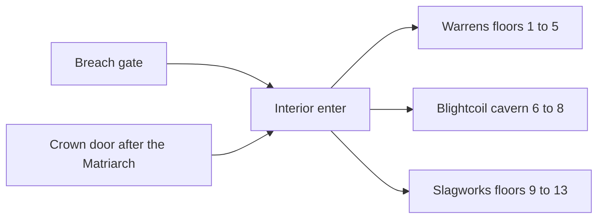
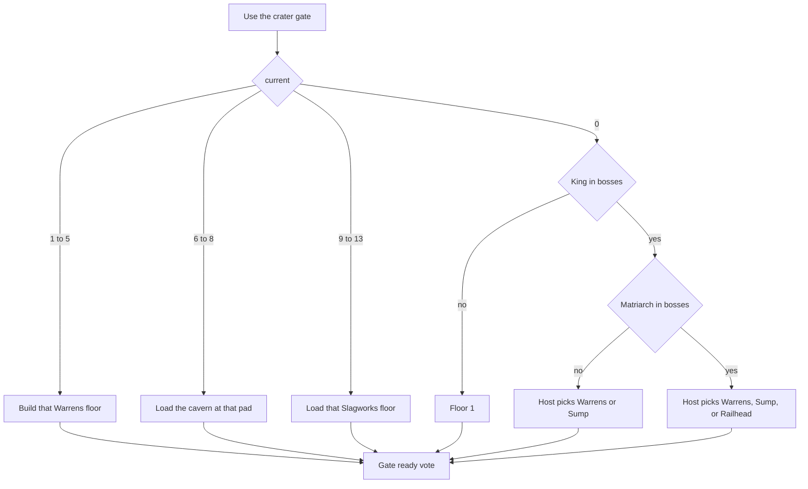
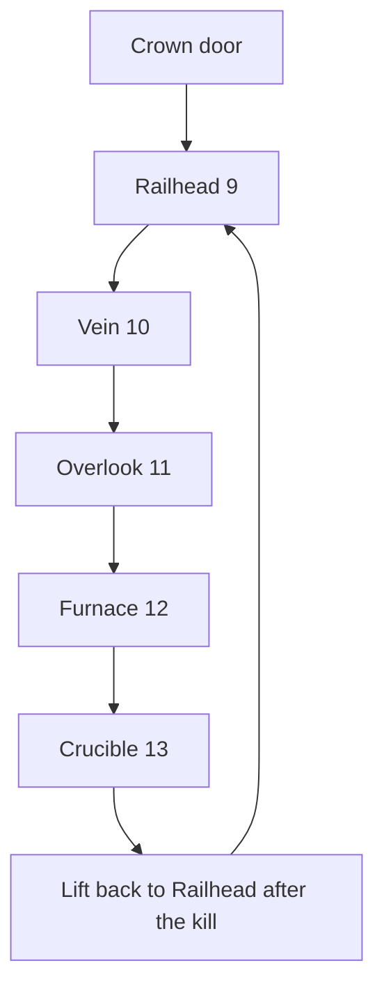
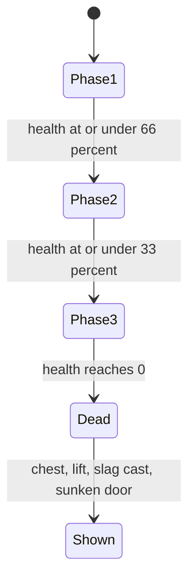

# Labyrinth Act III The Slagworks - Plan

## Goal Capsule

- **Objective:** A party can leave the Blightcoil, descend into the Slagworks, cross five floors to kill Forgemaw, and return to Town Square, with the main lift unlocked, the empty slag cast left behind, and a door toward the Sunken Ruins that is still not a level.
- **Means:** Build Act III as five Labyrinth floors in the existing Breach interior. Floors 9–12 come from a new room kit. Floor 13 is a handmade crucible. Act I and Act II keep the layouts they already have.
- **Authority:** The Act III section of `docs/LABYRINTH_ACTS_STORY.md` wins on story. The version rule in this plan and `docs/PLAN_NEXT.md` wins on milestone numbers, including over older lines that schedule the Core as 1.0. `docs/PLAN_0.7.0_ACT2.md` wins on the integration patterns this plan copies (waystones, Breath, `SaveGame` version 1, `level_id` `breach`, greybox, music slots, a stub door). This plan's requirements win on the other player-facing behavior. Key technical decisions win on mechanism. `docs/LINEAR_LEVELS_PLAN.md` and `docs/LABYRINTH_PLAN.md` win where this plan does not name an override.
- **Execution:** Code, later. This document does not ship the level, bump the build string, or cut a release. Prove the Warrens golden fixture and the Blightcoil cavern before the Slagworks branch exists. Do not clear a Slagworks checkpoint when a waystone sends the party home.
- **Stop:** Stop if the work would bump `SaveGame` version, add a `GameFlow` level, reorder Warrens rooms, change Blightcoil cavern measures, send checkpoints 9–13 through the Warrens kit, load the Sunken Ruins, build the Post-Core endless run, or assign 1.0 to this act, the Core, or the endless run.
- **Finishes:** An implementer lands the units below. The endless run in Post-Core is not one of those units.

---

## Product Contract

### Summary

Act III, The Slagworks, ships as the 0.8.0 Labyrinth floors under the Breach. Ironforge's buried mines are five floors: rails, ore veins, lava channels, and heat shimmer, with a furnace-anvil on every floor. Heat pushes the party onto gantries. Mine carts and forge-constructs keep a broken schedule. Forgemaw waits in a crucible on the last floor. The party can waystone home from each rest pad and from the crucible, and the cleared crucible opens a lift back to the first floor plus a door that only names the Sunken Ruins.

| Checkpoint | Act floor | Name | What it is |
|---|---|---|---|
| 9 | 1 | Railhead | Kit floor. Entry from the Crown door and from the crater choice. |
| 10 | 2 | Vein | Kit floor. Ore vein, rail, cart. |
| 11 | 3 | Overlook | Kit floor. Rest pad and the Scrap-spirit. |
| 12 | 4 | Furnace | Kit floor. Last stair down. |
| 13 | 5 | Crucible | Handmade. Forgemaw, the lift, the slag cast, the Sunken Ruins door. |

Checkpoints 1–5 stay the Warrens. Checkpoints 6–8 stay the one Blightcoil cavern. The names above are layout labels taken from the story's nouns. They are not new beats.

### Problem Frame

Act II ends on the Crown. The Slagworks door there says the way down has opened and cannot be taken yet. `docs/PLAN_NEXT.md` puts Act III on 0.8.0, as five floors with the boss on floor 5. The build string is still `0.4.0-prealpha`. This plan does not change it.

The only generated kit is `data/labyrinth/warrens.toml`. `FloorGen` lays those rooms out on a flat slot grid. `Interiors.descend` stops at the Warrens boss floor, so a stair on the Crown cannot become checkpoint 9. `LevelScale.LABYRINTH_OFFSETS` has eight entries, so a floor past 8 still wears the Crown's +5 offset. `LabyrinthState.floor_seed` always hashes the kit id `warrens`.

The story asks for a floor stack: "the landmark of every floor is the great furnace-anvil." Heat, gantries, and carts can live inside each floor. One shared cavern would put every anvil in a single load and would extend a path Act II used for a spiral the player has to see all at once. That is the rejected option in the appendix.

### Key Decisions

- **Act III is The Slagworks.** The mines, the furnace-anvil on every floor, the heat and the gantries, the carts and the forge-constructs, the branded trolls, the Scrap-spirit, Forgemaw, the slag seals, the lift, the empty slag cast, and the door toward the Sunken Ruins come from `docs/LABYRINTH_ACTS_STORY.md`. The old name for this act is retired and is not reused. The Sunken Ruins door does not load Act IV. Governs R1, R9, R10, R11.
- **The milestone label is 0.8.0, a minor.** Act III is a new act, so it ships as `x.y.0`, not a patch. The version rule below is the authority. The look for this pass is greybox plus the Ember Art list. The build string stays `0.4.0-prealpha`. This plan does not bump it and does not cut 1.0. Governs R1, R16.
- **Five floors, checkpoints 9–13.** Floors 9–12 are generated from a new kit. Floor 13 is handmade. One floor is in memory at a time. A furnace-anvil stands on each floor, and its molten mouth faces the way into that floor's arena. Heat and gantries are inside the floor. Act I and Act II do not change shape. Governs R2, R15, R18.
- **A rest pad and the crucible pad are waystones.** Each one saves, respawns, and travels. Coming back returns to the last pad. A trip to Town Square keeps the checkpoint. The crucible pad is attuned when the party steps on it. Forgemaw's death does not spawn a second stone. The story's "waystone home lights" is this pad. Governs R4, R14.
- **Act III loot is Fire.** Branded drops use Fire. There is no Metal element in `ElementTable`. Metal is the mine fantasy and the existing Fire brand, Pyrowning Arms. Earth and Dark stay Act II's brand pair. Governs R8.
- **Forgemaw has three phases.** Thresholds are 66% and 33% of max health. Phase 2 breaks one gantry segment. Phase 3 breaks the rest and widens the lava so the party is forced through the heat. No phase regenerates, and the arena does not lock. Governs R11.
- **Heat and carts spend health only.** Lava, furnace shimmer, and a cart hit do not spend the Breath sprint pool and do not spend the shield. Same rule as Act II poison. Governs R5, R6.
- **No shortcut.** The crater gate gains a Slagworks choice only when the Goblin King and the Matriarch are both dead. The Crown door becomes a real descent to checkpoint 9 after the Matriarch is dead. It still does not call `GameFlow.travel`. The Sunken Ruins door never loads a level. Governs R3, R11.
- **Greybox first. Music comes later.** Cue slots stay. Until the files exist, playback is silence or the ambience the Breach already has. Governs R16.
- **The endless run is Post-Core.** It is approved direction and it is not a 0.8.0 unit. The Core and that run are later 0.x milestones when ShobieShy opens them. They are not 1.0. See Post-Core below.

### Version rule

ShobieShy locked this on 5 Nov 2026. `docs/PLAN_NEXT.md` carries the same rule.

- **`x.x.y` is a patch.** Bugfixes, or a large addition that is not a new act and not a major feature upgrade. Act I outline polish, if it ships on its own, is a patch such as 0.7.1.
- **`x.y.0` is a minor.** Major polish and finishing on a new act, or a big feature upgrade. Each Labyrinth act is a minor. Act III is 0.8.0.
- The Breach Labyrinth campaign and all of its polish stay on **0.x** minors: 0.8.0, 0.9.0, 0.10.0, and the 0.x minors that follow.
- **1.0 is not a content milestone this plan assigns.** It is a release cut, and only when ShobieShy explicitly tells Luna to make it.
- The Core, the post-clear endless run, and campaign-complete are later **0.x** content, or they wait with no number until ShobieShy opens them. None of them is 1.0.

### Requirements

**Travel**

- R1. The Slagworks is the 0.8.0 Labyrinth Act III on the closed-level flow. The party enters it from the Breach crater gate or from the Crown door, inside `level_id` `breach`. It is not a new `GameFlow` level.
- R2. Checkpoints 9–13 are five separate floors, one in memory. Floors 9–12 are generated from the Slagworks kit. Floor 13 is a handmade crucible. Each floor has a furnace-anvil whose mouth orients that floor's arena. Gantries and lava sit inside the floor. A stair between floors is a load, with the loading screen the Labyrinth already uses.
- R3. Stairs on the Goblin King's floor do not enter Act III. The Blightcoil cavern gains no stair teleport. No overworld shortcut gate opens. Before the Matriarch is dead, the Crown door does not descend. After she is dead, that door loads checkpoint 9. The Sunken Ruins door does not load Act IV.
- R4. The rest pad on floors 9–12 and the crucible pad on floor 13 are waystones. Stepping on one saves, it is the respawn point, and once attuned the travel list can send the party to Town Square and back to that pad. Leaving does not clear the checkpoint.

**Hazards**

- R5. Lava channels and the furnace-anvil's heat shimmer damage a living player. That damage does not spend the Breath sprint pool and does not spend the shield. A body on a gantry deck or on a rest pad is not in the shimmer. Lava is a volume the player can still step into.
- R6. Mine carts on floors 9–12 run a seeded loop and damage a living player they hit. A cart is not an enemy. The hit does not spend Breath or the shield.
- R7. A rest shrine clears heat and writes a save. The shrine and the pad on that floor write the same `current`.
- R18. A landing after a drop longer than 4 m hurts a living player, from health and not from the shield. A 3 m step off a gantry does not. A body that falls below local y = -8 comes back to the last pad.

**Fighting and loot**

- R8. Branded trolls and forge-constructs appear on floors 9–13 and use per-player level scaling above the Crown's band. A branded drop from these floors is Fire. A pack does not leave its floor, because the other floors are not loaded.

**Story and ending**

- R9. The Scrap-spirit can be talked to on the Overlook rest, names Forgemaw as the troll who kept the fires lit, and has a different line after Forgemaw is dead. The spirit does not name what left the Blightcoil cocoon.
- R10. Three slag seals can be collected in any order. A collected seal does not count again when the floor reloads. Seals do not advance the Act II mark quest.
- R11. When Forgemaw dies, the boss chest appears once, the main lift unlocks and can return the party to the Railhead pad, a cooling slag cast shows an empty humanoid negative, and a Sunken Ruins door says the way down has opened and does not load a level. The crucible pad is already a waystone before he dies. His phases break gantry cover and force the party through the heat.

**Co-op and saves**

- R12. A co-op joiner who is still in the Breach enters on the host's current floor, standing on that floor's checkpoint pad. Heat, shimmer, and cart hits come from local volumes. A cart's clock matches the host's.
- R13. Act I stairs keep the ready vote. The Blightcoil cavern still has no stair vote. Slagworks stairs use that same vote. The Crown door uses it when a joiner is in the session. The crater gate vote still runs before a gate entry.
- R14. Saves stay on `SaveGame` version 1. The Labyrinth block stays version 1 and gains no new key. Act progress stays in `current`, `bosses`, `cleared`, `deepest`, and story flags. `level_id` stays `breach` while the party is inside. The net protocol stays 5.
- R15. Act I floor seeds, the Warrens golden fixture, and the Blightcoil cavern measures stay the same.

**Presentation and proof**

- R16. The first playable Slagworks is greybox, with an Ember Art request list and no uncredited or IP-derived files. Music cue slots play silence or the existing ambience.
- R17. Unit tests, a solo playtest that walks floors 9–13, a co-op pass that checks the joiner's pad, and the full test tier cover the act.

### Actors

- A1. The host player, who chooses the act and owns the world save.
- A2. A joining player, who brings a character file and renders the host's enemies.
- A3. The Scrap-spirit, an NPC on the Overlook rest. One spirit. No second foreman, and no personal name beyond that role.

### Key Flows

- F1. Enter from the crater
  - **Trigger:** A1 uses the Breach crater gate.
  - **Actors:** A1, A2 if the session has a joiner.
  - **Steps:** Resolve the checkpoint first. If `current` is 1 through 5, resume that Warrens floor. If `current` is 6, 7, or 8, load the Blightcoil cavern on that pad. If `current` is 9 through 13, load that Slagworks floor and stand on its pad. If `current` is 0 and the King is alive, the floor is 1. If `current` is 0 and the King is dead and the Matriarch is alive, A1 picks floor 1 or the Sump, the same two labels as today. If `current` is 0 and both bosses are dead, A1 picks floor 1, the Sump, or the Railhead (checkpoint 9). The existing gate vote then runs. The vote banner names the act. A joiner sees the banner and does not get the choice.
  - **Covered by:** R1, R3, R12, R13
- F2. Enter from the Crown door
  - **Trigger:** A1 uses the Slagworks door on the Crown after the Matriarch is dead.
  - **Actors:** A1, A2 if the session has a joiner.
  - **Steps:** The door speaks one line that the way down into the Slagworks is open. It does not call `GameFlow.travel`. When a joiner is present, the existing stair vote runs, then the cavern unloads and checkpoint 9 loads behind the loading screen. Solo play descends on the interact. The party stands on the Railhead pad. `current` becomes 9. Blightcoil waystone flags stay set. Before the Matriarch is dead, the door says the way is still shut and does not descend.
  - **Covered by:** R1, R3, R13
- F3. Cross the mines
  - **Trigger:** The party takes stairs down, or steps on a rest pad.
  - **Actors:** A1, A2
  - **Steps:** Stairs down on floors 9–12 clear that floor and load the next one. The stair vote runs when the party is split. Floor 13 has no stairs down. Stepping on a rest pad or the crucible pad attunes that waystone, sets `current`, and writes a save. A missed gantry lands on the slab or in lava, or, below the floor, back on the last pad. Stairs up on floors 9–13 return to the crater and leave `current` on the floor just left.
  - **Covered by:** R2, R4, R5, R7, R18
- F4. End the act
  - **Trigger:** Forgemaw dies.
  - **Actors:** A1, A2, A3 on a later visit
  - **Steps:** One chest appears. The crucible pad is already on the travel list if the party stepped on it. The main lift, locked until this kill, can place the party on the Railhead pad and set `current` to 9. The slag cast shows an empty humanoid negative. The Sunken Ruins door says the way down has opened and does not travel. Waystone travel to Town Square keeps `current` and the boss list. A3's post-boss line is on the Overlook pad.
  - **Covered by:** R4, R9, R11

### Acceptance Examples

- AE1. Covers R1, R3. Given the King and the Matriarch are in `bosses` and `current` is 0, when A1 uses the crater gate, then A1 chooses floor 1, the Sump, or the Railhead before travel. Given only the King is dead, the Railhead choice is absent and the two existing labels are unchanged.
- AE2. Covers R1, R2, R3. Given the Matriarch is dead and A1 uses the opened Crown door, when the load finishes, then `current` is 9, the party stands on the Railhead pad, `GameFlow` has no new level id, and the door's `calls_travel` is still false. Given she is alive, the door does not descend.
- AE3. Covers R4, R14. Given the party has stepped on the crucible pad and waystones to Town Square, when the save is written, then `current` is still 13, `waystone:slagworks_crucible` is set, and `bosses` still contains Forgemaw. Choosing that stone returns them to the crucible pad. Forgemaw's death does not create a second waystone.
- AE4. Covers R5, R7. Given a living player stands in lava, when one second passes, then health falls and Breath does not, and the shield does not. A player on the gantry deck is not in the shimmer. A rest shrine then clears heat and writes a save.
- AE5. Covers R12. Given A1 is on the Overlook pad and A2 is in the crater, when the host state is pushed, then A2 stands on the Overlook pad. A lava volume hurts only the body inside it.
- AE6. Covers R11, R6. Given Forgemaw dies, when the crucible updates, then the lift can return the party to the Railhead, the slag cast is an empty humanoid negative, and the Sunken Ruins door says the way down has opened and does not travel. A cart hit on floor 9 reduces health and does not spend Breath.
- AE7. Covers R15. Given the Warrens golden fixture, when floors 1–4 generate, then the fixture still matches. Given the Blightcoil cavern, the Sump, Canopy, and Crown pads are still one volume at the same heights.
- AE8. Covers R10. Given the three seals are picked in any order, when the floor reloads, then the count stays 3. The Act II mark count does not move.
- AE9. Covers R18, R2. Given a living player walks from the Railhead pad to the crucible pad, when they arrive, then each floor had a furnace-anvil and the loads were the stair loads. A 3 m drop off a gantry onto safe ground does not reduce health. A 12 m drop onto safe ground does, and does not spend the shield.

### Success Criteria

- A new solo save can be played from the Crown door through Forgemaw and back to Town Square without entering a new scene id.
- An Act I or Act II save from before this milestone still loads, still lays out the Warrens, still loads the Blightcoil cavern, and still refuses a newer `SaveGame` version.
- Two peers on this build can occupy the same Slagworks floor, and a peer who joins in the crater appears on the host's pad.

### Scope Boundaries

In scope: five floors at checkpoints 9–13, a new room kit, a handmade crucible, furnace-anvils, gantries, lava, shimmer, carts, two enemy roles, the Scrap-spirit, three slag seals, Forgemaw, the lift, the slag cast, the Sunken Ruins stub, the Crown door descent, the crater choice, waystones, save flags that already have a home, greybox art, the Ember Art list, and the tests in R17.

#### Deferred to Follow-Up Work

- The Post-Core endless run. Approved, and specified below so it is not built here.
- Act I outline polish. `docs/PLAN_NEXT.md` allows it inside 0.8.0 prep or an optional 0.7.1. This plan does not do it.
- Act IV, The Sunken Ruins, and any later act.
- The "named part + Act key item" in `docs/LABYRINTH_PLAN.md` section 5. No key may open the Sunken Ruins door.
- An antidote, a fire cleanse item, and remixing a cleared delve. The shrine and a respawn clear heat.
- A procedural generator for the story floors beyond the existing seeded kit generator. 0.8.0 does not roll a fresh layout on each entry.
- Fixing the crater greybox walk past z 86. The Act III playtest still skips that walk.
- Redoing the 0.6.0 gate-vote fixes. The crater gate uses that vote as it stands. Joiner exit rc 134 stays out of this milestone.

#### Outside this product's identity

- An open world, a `--open-world` flag, or a shortcut gate.
- Music composition, uncredited files, and assets from another game's IP.
- A second health bar per player, or a save-format break.
- Changing Warrens generation, Warrens stairs, Blightcoil cavern geometry, or the Blightcoil nav cache.
- Core fight design. The Core stays closed.

### Decisions for ShobieShy

Settled by the story and by this plan. None of these are open:

- The act name is The Slagworks. The retired name is not reused.
- Five floors at checkpoints 9–13. Floors 9–12 are a seeded kit. Floor 13 is handmade. One cavern for this act was rejected. See the appendix.
- Layout names: Railhead, Vein, Overlook, Furnace, Crucible.
- The NPC is the Scrap-spirit, on the Overlook only. The spirit names Forgemaw. There is no second foreman.
- Loot brand is Fire only. Metal is that brand's fantasy. No new element.
- Forgemaw has three phases, no regeneration, and no arena lock.
- Waystones are the rest pads and the crucible pad. Stepping on the pad attunes it. Death does not spawn a stone. A trip home keeps `current`.
- Heat and carts do not spend Breath.
- The Crown door descends to checkpoint 9 after the Matriarch is dead. The Sunken Ruins door does not load a level.
- The endless-after-clear rule is approved and is Post-Core. 0.8.0 does not build it. DLC labyrinths get a story first, then the same conversion. The Core and that run are later 0.x content when ShobieShy opens them. 1.0 is a release cut he orders, not their version.

Settled with the rest, 5 Nov 2026. ShobieShy kept the name:

- **The endless run is named The Forgotten Abyss.** The mode stays deferred Post-Core. It is an underground abyss in the "forgotten" sense: endless floors under a cleared labyrinth, rising monster stats, random generation only on those floors. The name is not a `GameFlow` level id and not a 0.8.0 scene. 0.8.0 does not build the mode.

### Sources

- `docs/LABYRINTH_ACTS_STORY.md` Act III
- `docs/PLAN_NEXT.md`, `docs/LINEAR_LEVELS_PLAN.md` sections 2, 8, 9, and 10
- `docs/PLAN_0.7.0_ACT2.md`, `docs/LABYRINTH_PLAN.md` sections 4, 5, 6, and 13
- `docs/TEST_TIERS.md`, `docs/EMBER_ART_REQUESTS.md`, `docs/BRANDS_PLAN.md`
- `data/labyrinth/warrens.toml`, `data/labyrinth/blightcoil.toml`
- `scripts/labyrinth/floor_gen.gd`, `labyrinth_floor.gd`, `labyrinth_state.gd`, `act_loot.gd`, `lab_gate.gd`, `blight_forge.gd`, `blight_hazard.gd`, `blight_mark.gd`
- `scripts/world/interiors.gd`, `scripts/world/fast_travel.gd`
- `scripts/combat/level_scale.gd`, `scripts/combat/element_table.gd`
- `scripts/core/main.gd`, `scripts/core/save_game.gd`, `scripts/core/game_flow.gd`
- `scripts/net/labyrinth_sync.gd`, `scripts/net/net_session.gd`
- `scripts/story/quest_log.gd`

---

## Planning Contract

### Key Technical Decisions

- KTD1. **Act III is a new kit, not a Warrens floor and not a second cavern.** Floors 1–5 keep loading `data/labyrinth/warrens.toml`, keep hashing the seed string `warrens`, and keep using `LabyrinthFloor`. Checkpoints 6–8 keep `BlightcoilCavern` and `data/labyrinth/blightcoil.toml`. Do not edit those measures, the cavern builder's heights, or the cavern nav cache. `descend` on a Warrens floor still stops at boss floor 5, and the cavern still has no `StairsDown`. Checkpoints 9–13 are Slagworks floors. `Interiors._enter_floor` branches to a new builder for that range and calls `LabyrinthFloor.build` only for 1–5. `LabyrinthFloor.build` dresses with `WarrensKit` and spawns goblins, so it must not run for 9–13. `LabyrinthState.floor_seed` keeps kit id `warrens`. Slagworks seeds call `FloorGen.floor_seed(save_seed, "slagworks", n, remix)` and do not change the `warrens` hash. Do not edit `FloorGen.generate` or `FloorGen.signature`. `tools/labyrinth_gen.py` may take an optional kit path whose default stays `warrens.toml`. Its `--check` still fails if `warrens_golden.txt` drifts. A second fixture, `tests/fixtures/labyrinth/slagworks_golden.txt`, covers the new kit. Governs R1, R2, R3, R15.
- KTD2. **Five floors, one in memory, gantries inside the floor.** `data/labyrinth/slagworks.toml` is a room kit in the Warrens shape: slot 24 m, `floors = [9, 10, 11, 12]`, `boss_floor = 13`, and the same room kinds the generator already requires (`start`, `normal`, `elite`, `rest`, `secret`, `exit`). Tags on those rooms (`lava`, `gantry`, `rail`, `furnace`) are read by the builder from the kit id. The generator does not need to copy tags, and the Warrens signature does not change. A new `slagworks_floor.gd` instances the greybox from `FloorGen.generate` for 9–12 and a handmade crucible for 13. Each floor's elite room, and the crucible center, gets one furnace-anvil. The mouth faces the doorway the player enters through, so the anvil orients the arena. Gantries are the safe deck at local y = 3. A ramp up to a gantry rises 3 m over a run of at least 6 m, about 27 degrees, under the 45 degree nav slope. Lava sits on the slab in volumes about 1.2 m tall, off the gantry deck and off the rest pad. A walk from the start pad to the exit exists on gantries and safe slabs and does not require standing in lava. The rest pad is the waystone. Its exempt radius is 2.5 m, the same idea as the Canopy rest. Floor 13 is a crucible about 36 m across, lava strips on the floor, a gantry ring at y = 3 in three segments, the anvil at the center, the pad on the ring, the lift, the slag cast, and the Sunken Ruins door. Stepping on a pad attunes `waystone:slagworks_railhead` (9), `slagworks_vein` (10), `slagworks_overlook` (11), `slagworks_furnace` (12), or `slagworks_crucible` (13), sets `current`, and writes a save. Death and a void fall return to that pad. There is a loading seam between floors. That seam is the existing Labyrinth load. Governs R2, R4, R18.
- KTD3. **Each pad is a waystone, and going home keeps it.** The host resolves travel before the vote, as `LabGate` does today, extended for 9–13. `current` 1–5 resumes the Warrens. `current` 6–8 resumes the cavern. `current` 9–13 resumes that floor's pad and does not open the picker. `current` 0 with the King alive is floor 1. `current` 0 with the King dead and the Matriarch alive offers floor 1 and the Sump, with the labels `Goblin Warrens, floor 1` and `The Blightcoil, Sump` unchanged. `current` 0 with both bosses dead adds `The Slagworks, Railhead` at checkpoint 9. A choice of 9 while the Matriarch is alive resolves to -1 and does not enter. `FastTravel.DEEP_POINTS` gains the five ids beside the existing four. A pad is listed only after its `waystone:` flag is set. Picking Town Square does not change `current`, `bosses`, `cleared`, or `deepest`. `deepest` may become 9–13. `warrens_hall` stays floor 5. The Blightcoil pads stay 6, 7, and 8. `Interiors.leave` still sets `current` to 0. Waystone travel to town saves `progress()` before any scene change, which is why Act II already keeps its pad. Slagworks stairs-up call `leave` and then restore `current` to the floor just left. Do not change that zero for floors 1–5. The crucible pad attunes on the step. Forgemaw's death does not spawn a waystone. Continue still loads the Breach and does not build a floor until the gate, the Crown door, or a listed stone is used. Governs R1, R3, R4, R14.
- KTD4. **Heat is its own timer. Carts are movers. Falls match Act II.** Breath stays the sprint pool. Act IV's drowning note stays in Act IV. Lava deals 8% of max health per second only while a living body overlaps a lava volume, and it stops when the body leaves. Furnace-mouth shimmer deals 2% per second and keeps ticking for 2 seconds after the body leaves the mouth. The rest pad and the gantry deck are outside the shimmer. Those ticks use `hurt_health`. They do not spend the shield. Volumes do nothing unless the player is alive. Respawn clears heat. The shrine clears heat and writes a save. Carts exist on floors 9–12 in rooms tagged `rail`, one loop each. The period is chosen from the floor seed in the range 6 to 14 seconds. A hit deals 12% of max health, then ignores that body for 1 second, and shoves it along the rail. Carts are not enemies, not in the enemy snapshot, and not in the Labyrinth block. The host's existing `lab` message may include `cart_t`, seconds into the loop. A joiner sets the local clock from that field. `cart_t` is not saved. Missing `cart_t` means the joiner starts at 0. Do not bump the protocol. Fall damage reuses `BlightHazard.fall_fraction`: a landing more than 4 m below the last grounded height removes 8% of max health per extra meter. A 3 m gantry drop does not qualify. Below local y = -8, apply the fall once and put a living body on the last pad. Do not change the Blightcoil mire, fog, or vine rates. Slag volumes use their own group, not `blight_volume`. Governs R5, R6, R7, R18.
- KTD5. **Act III combat band follows the five floors, with Fire.** `ActLoot` gains act 3 for checkpoints 9–13 with item levels 24, 26, 28, 30, and 34, chest floors basic, basic, uncommon, uncommon, and rare, luck 0.10, and the existing first-clear unique / repeat rare boss chest. When a drop takes the act brand, the element is Fire. The unbranded share still uses the enemy's own affinity. Trolls, constructs, and Forgemaw are authored Fire, so that share is Fire too. There is still no Metal element, and this act does not add one. Secret rooms keep the one-step rarity bump. `LABYRINTH_OFFSETS` grows by five entries so it is `[0, 0, 1, 1, 2, 3, 4, 5, 6, 7, 8, 9, 10]`. Floors 1–8 keep the values they have. The floor offset replaces the boss offset. It is not added on top. An elite affix still adds the existing +1 inside `ActLoot.tag`. Trolls use the rusher brain. Constructs use the tank brain. Only Forgemaw gets a new brain kind. New toml `level` values sit in this same band. `act_of` for 1–5 stays 1, for 6–8 stays 2, and for 9–13 returns 3. A floor past 13 stays untagged until a later act. Governs R8.
- KTD6. **Two quests, flags for seals, the spirit on the Overlook only.** The floor builder spawns the Scrap-spirit on checkpoint 11 and nowhere else, wired the same way the Verdant Mother is wired. Dialogue is first-match in file order, so the post-boss entry is placed before the intro. The post-boss entry requires `forgemaw` in the boss list and has one repeat line. The intro forbids that and sets story flag `scrap_met`. Quest `the_slagworks` auto-starts on that flag with one kill objective. If Forgemaw is already in `bosses` when the quest starts, that objective is complete. Quest `joes_seals` auto-starts on the same flag with one collect objective, target `slag_seal`, count 3. When that quest starts, its progress is the number of `seal:<id>` flags already set, and the objective is complete if that count is already 3. Do not count flags that start with `mark:`. That prefix is the Act II quest seed in `QuestLog._seed_act2`. Each pickup has a stable id, sets `seal:<id>` on collect, uses item id `slag_seal`, and is spawned only when that flag is unset. Seals are not stored in the Labyrinth block. One seal is on the Railhead rail, one on the Overlook rail, and one on a crucible rail prop. Floor 13 has that prop and no cart. Governs R9, R10.
- KTD7. **Forgemaw phases are fractions, and the ending props share the crucible.** Register kind `forgemaw` as a boss brain. Phases advance at 66% and 33% of max health and never move backward. Phase 1 keeps the gantry ring intact and the lava strips at their base width. Phase 2 collapses segment A of the ring, so that cover is gone. Phase 3 collapses segments B and C, widens the lava strips, and opens a weak point. No phase regenerates, and `arena_locked` stays false. The host keeps one health fraction. Clients do not run the brain. Joiner phase visuals follow the health already in the enemy snapshot, and the joiner's phase only moves forward, so a stale higher health sample does not restore cover. Death uses the existing boss-kill path: append `forgemaw` once and drop the act chest once. It does not spawn a waystone. The crucible pad was attuned when the party reached it. The slag cast is shown when that id is already in `bosses`. It is an empty humanoid negative in cooling slag. It is not an NPC and it has no occupant. The main lift is an interact on a prop. Before the kill it says the lift is locked and does nothing. After the kill it places the party on the Railhead pad, sets `current` to 9, and saves. It is not a `LevelGate` and it does not call `GameFlow.travel`. The Sunken Ruins door is a second prop. Before the kill it says the way down is still shut. After the kill it says the way down has opened and cannot be taken yet. `calls_travel` stays false. It does not add a level id. Governs R8, R11.
- KTD8. **The Crown door descends, and sync carries the floor.** `BlightForge.calls_travel` stays false. While `opened` is false, `interact` only speaks the shut line. While `opened` is true, `interact` speaks the open line and asks the interior to load checkpoint 9. It does not call `GameFlow.travel`. When a joiner is in the session, that load waits on the existing 10 second stair vote. Solo play does not wait. The load frees the cavern. It is not `descend()`, because `descend` still treats every floor at or above the Warrens boss floor as the end of the Warrens. Slagworks stairs down are a branch ahead of that check: floors 9–12 build the next Slagworks floor, floor 13 returns without building a floor 14, and floors 1–8 keep today's result. Create no new sync node. The existing `lab` push already carries `n` and the Labyrinth block. A joiner in the crater, or on another floor, enters the host's `n` and stands on that floor's checkpoint pad, not inside the host. The cavern rule stays: a push that stays inside 6–8 does not teleport when the other player changes tier. A push from 8 to 9 is a floor change and does load floor 9. The joiner's own block is restored when the sync node exits, and it is not written into the character file. A later push applies `bosses` in place: the lift, the slag cast, and the Sunken door update, and Forgemaw is not respawned. Heat stays out of the pose snapshot. `cart_t` rides the `lab` message, not the snapshot. The protocol stays 5 unless a snapshot or hello field actually changes. Governs R3, R12, R13, R14.
- KTD9. **Per-floor navmesh, and what not to stream.** Each Slagworks floor gets one `NavigationRegion3D` baked from its safe walkable colliders. Lava is not on the mesh. Carts are not on the mesh. Do not call `LevelNavigation.make_mesh` unchanged: that mesh uses a 0.5 m agent height and 0.1 m cells. Use the cavern mesh settings: a 1.8 m agent height, a 0.4 m radius, a 0.25 m climb, a 45 degree slope, and 0.25 m cells. Cache each floor under `res://scenes/levels/nav/slagworks/` and skip the bake when the cache matches the toml and the floor seed. Do not bake during Breach load or during the crater walk. Do not rebake the Blightcoil cache. Warrens floors still have no navmesh. Slagworks enemies use horizontal distance plus line of sight, the Warrens rule, and they drop the chase when the nav path is longer than 40 m. They follow the safe mesh. They cannot walk into another floor. The camera stays the eye camera on the head. `ZoneStreamer` measures horizontal distance. Do not put a Slagworks floor under it. The interior already frees the previous floor on the way down. Governs R2, R8, R16, R17, R18.

### High-Level Technical Design

Act I, Act II, and Act III share the interior and the gate. They do not share a builder.

`current` chooses a Warrens floor, a cavern pad, or one Slagworks floor. Waystone travel home keeps the last checkpoint.

Stairs move one floor. The Crown door is the only entrance from the cavern, and it always lands on 9.

Forgemaw. Thresholds are fractions so per-player health scaling does not move the phase.

### Assumptions

- The lava rate, the shimmer rate, the cart hit, the cart period, and luck 0.10 are balance defaults. Fire as the only brand, and keeping `current` on the way home, are decided.
- The rest-shrine signal is connected for the Blightcoil canopy. The Slagworks shrine uses that same save path and must set the floor's own `current`, not 7.
- The Scrap-spirit never stands on the crucible, and no line names what left the cocoon or what the slag cast is missing.
- The solo Act III playtest starts with the King and the Matriarch already dead rather than clearing Acts I and II inside the Labyrinth timeout.
- Cart hits and heat ticks are applied on each peer to that peer's own body. `cart_t` only aligns the loop.

### Sequencing

| Phase | Units | Size | Risk |
|---|---|---|---|
| Floor shell | U1 | Large | High. A wrong branch sends 9–13 through the Warrens kit or retargets the golden fixture. |
| Door, gate, pads | U2 | Large | High. The same `current` integer now means a Warrens floor, a cavern pad, or a Slagworks floor. |
| Heat, carts, falls | U3 | Medium | Medium. Heat must stay off Breath, and off the Blightcoil volumes. |
| Enemies | U4 | Medium | Medium. The offset array clamps at +5 until it grows. |
| Story | U5 | Medium | Medium. `mark:` is already the Act II seed. Seals need their own prefix. |
| Boss and ending | U6 | Medium | Medium. The Crown door's old test expects a stub. |
| Greybox list | U7 | Small | Low. No new asset files. |
| Proof | U8 | Medium | Medium. The room-graph bot cannot walk a gantry. The leg follows the floor navmesh. |

Size is the amount of code and content, not a schedule. U1 before U2, U3, U5, and U7. U3 before U4. U1, U3, and U4 before U6. U5 does not wait on U2. U6 does not wait on U5. U8 is last. No unit builds the Post-Core run.

### Risks and dependencies

- Changing the Warrens seed string, `FloorGen.generate`, or the Warrens room order invalidates `tests/fixtures/labyrinth/warrens_golden.txt`. KTD1 forbids that edit. Pointing `tools/labyrinth_gen.py`'s default kit at the Slagworks file would do the same.
- Checkpoints 9–13 passed to `LabyrinthFloor.build` come out as Warrens rooms full of goblins. The offset clamp would also leave them at +5.
- `QuestLog._seed_act2` counts every `mark:` flag toward `joes_marks`. A slag seal on that prefix completes or inflates the Act II quest.
- `Interiors.leave` zeros `current`. A Slagworks stairs-up that does not restore it dumps a deep party back at the picker.
- `BlightForge` tests require `calls_travel` false and an opened line. The descent has to keep `calls_travel` false and update the line assertion on purpose. Cavern height tests stay as they are.
- A nav bake on enter will stall the playtest the way an uncached cavern bake would. The per-floor cache is the mitigation.
- A new drop pool can change the co-op content hash. Mismatched builds already refuse to play. Do not bump the protocol unless the snapshot or hello gains a field. Health is already in the snapshot. `cart_t` goes on the `lab` message.
- `docs/LABYRINTH_PLAN.md` section 13 still has a stale shortcut note, and section 2's "5 floors each" is already corrected for Act II. This act matches the five-floor line. Do not implement shortcut gates. Do not start the endless generator while implementing that line.

---

## Implementation Units

### U1. Slagworks kit, floors 9–12, and the crucible shell

- **Goal:** Checkpoints 9–13 load Slagworks floors, and floors 1–8 stay on their current builders.
- **Requirements:** R1, R2, R3, R15, R18
- **Dependencies:** None
- **Files:** `data/labyrinth/slagworks.toml`, `scripts/labyrinth/slagworks_floor.gd`, `scripts/world/interiors.gd`, `scripts/labyrinth/labyrinth_state.gd`, `tests/unit/test_slagworks_floor.gd`, `tests/unit/test_floor_gen.gd`, `tests/unit/test_blightcoil_cavern.gd`, `tests/fixtures/labyrinth/warrens_golden.txt`, `tests/fixtures/labyrinth/slagworks_golden.txt`, `tools/labyrinth_gen.py` only for an optional kit path whose default stays the Warrens, `res://scenes/levels/nav/slagworks/` as a generated cache
- **Approach:** Follow KTD1, KTD2, and KTD9. The toml is the kit plus anvil, gantry, lava, and rail markers. The builder instances rooms for 9–12 and the crucible for 13. `Interiors` calls it when the checkpoint is 9–13, the cavern builder for 6–8, and `LabyrinthFloor` otherwise. Bake each floor's safe mesh into the cache. Tests may bake in the unit process. The playtest loads the cache.
- **Execution note:** Lock the Warrens golden fixture and a Blightcoil height check before adding the branch, and keep both green. Do not add a mode inside `FloorGen.generate`. Do not add an endless loop to `descend`.
- **Patterns to follow:** `LabyrinthFloor` for a kit floor and a handmade boss room. `BlightcoilCavern.ensure_nav` for cache-or-bake. Copy the cache idea and the cavern agent settings. Do not copy the 0.1 m cell size, and do not instance the cavern.
- **Test scenarios:**
  - Happy path: building checkpoint 9, 10, 11, or 12 yields one floor whose start pad connects to the exit on walkable ground, whose gantry ramps are at most 40 degrees, and whose elite room contains one furnace-anvil facing the entry. Checkpoint 13 yields a crucible with an anvil, three gantry segments, and a pad. A nav query from the start pad reaches the exit without crossing a lava volume.
  - Edge: `descend` on floor 5 returns without building a floor. Checkpoint 8 still builds the cavern, not a Slagworks floor. Checkpoint 13 does not build a floor 14. Entering at 11 places the body on the Overlook pad, and floors 9 and 13 are not in the same tree.
  - Error: the Warrens golden fixture still matches. A floor 3 seed hashed with `warrens` still matches its previous layout. `LabyrinthFloor.build` is not called for checkpoint 9. The Blightcoil pad heights stay 0, 12, and 24.
  - Integration: a missing nav cache bakes and writes the cache. A second build with the same toml and seed does not bake again. The Blightcoil cache is not rewritten.
- **Verification:** The Warrens fixture is unchanged, the cavern is unchanged, and a path exists from each floor's pad to its exit on that floor's mesh.

### U2. Crown door, crater choice, and checkpoints

- **Goal:** The host can enter the Railhead from the Crown or from the gate, return to Town Square, and pull a joiner onto the host's pad.
- **Requirements:** R1, R3, R4, R12, R13, R14
- **Dependencies:** U1
- **Files:** `scripts/labyrinth/lab_gate.gd`, `scripts/labyrinth/blight_forge.gd`, `scripts/core/main.gd`, `scripts/world/interiors.gd`, `scripts/world/fast_travel.gd`, `scripts/net/labyrinth_sync.gd`, `tests/unit/test_blight_gate.gd`, `tests/unit/test_blightmaw.gd`, `tests/unit/test_slagworks_gate.gd`, `tests/unit/test_fast_travel.gd`, `tests/unit/test_labyrinth_sync.gd`, `docs/LINEAR_LEVELS_PLAN.md`
- **Approach:** Follow KTD3 and KTD8. Resume, the King-alive entry, and the first-entry act choice each run the existing gate vote after the checkpoint is resolved. Add the five deep points. Do not zero `current` on a trip to Town Square. Restore `current` after a Slagworks stairs-up. Leave Act I stairs-up and Act II waystone travel as they are. The opened Crown door loads checkpoint 9 with `calls_travel` still false. Update the Act III line in `docs/LINEAR_LEVELS_PLAN.md` only if the plan link is not already there.
- **Execution note:** Characterize today's two-choice picker and the Crown door stub before editing them. The closed door still does not descend. The cavern-to-cavern sync early-return stays.
- **Patterns to follow:** `LabGate.resolve`, `FastTravel.DEEP_POINTS`, the gate vote in `scripts/net/gate_vote.gd`, the stair vote in `scripts/net/labyrinth_sync.gd`.
- **Test scenarios:**
  - Happy path: both bosses in `bosses`, `current` 0, host chooses the Railhead, the travel message carries 9, and the party stands on the Railhead pad. The opened Crown door does the same, and `calls_travel` is false.
  - Edge: `current` 11 loads the Overlook and does not open the picker. `current` 7 still loads the Canopy pad. Waystone travel to `town_gate` keeps `current` at 11 and keeps `bosses`. The travel list shows `slagworks_railhead` only after that pad is attuned. `slagworks_crucible` is refused until the crucible pad has been stepped on, including when Forgemaw is already dead. `warrens_hall` still travels to floor 5. `blightcoil_crown` still travels to 8. A choice of 9 while the Matriarch is alive does not enter. Stairs up on floor 12 restore `current` to 12.
  - Error: the crater path does not send checkpoint 0 once the picker exists. The King-alive path is still floor 1. The King-dead, Matriarch-alive picker still has exactly the two existing labels. A joiner does not build from an empty character progress block. A client character file does not gain the host's boss list. The opened door does not add a `GameFlow` level id.
  - Integration: a joiner in the crater, with the host on the Overlook pad, appears on that pad. A host push from checkpoint 8 to 9 loads floor 9 for the joiner. A push that stays inside 6–8 does not teleport. Act I stairs still use the 10 second vote. The Crown door uses that vote when a joiner is present.
- **Verification:** AE1, AE2, AE3, and AE5 pass. Town Square and each attuned pad are on the travel list. A trip home does not clear the last pad.

### U3. Heat, carts, falls, and the shrine save

- **Goal:** Lava, shimmer, carts, and falls affect the living player, and a rest or a pad writes a save.
- **Requirements:** R5, R6, R7, R18
- **Dependencies:** U1
- **Files:** `scripts/player/player.gd`, `scripts/labyrinth/rest_shrine.gd`, `scripts/labyrinth/slagworks_floor.gd`, `scripts/labyrinth/slag_hazard.gd`, `scripts/core/main.gd`, `tests/unit/test_slag_hazard.gd`, `tests/unit/test_blight_hazard.gd`, `tests/unit/test_breath.gd`
- **Approach:** Follow KTD4. Place lava off the pads and off the gantry decks. Place shimmer at the anvil mouth. Place carts on rail rooms of floors 9–12. Connect the shrine to the existing save path. Stepping on a pad sets `current` and saves too. Reuse `BlightHazard.fall_fraction` without editing its rates.
- **Execution note:** Write the heat, cart, and fall tests first. Keep the Blightcoil poison tests green.
- **Patterns to follow:** The overlap tick in `scripts/labyrinth/blight_hazard.gd`, and the shrine refill in `scripts/labyrinth/rest_shrine.gd`.
- **Test scenarios:**
  - Happy path: one second in lava removes 8% max health, leaves the shield unchanged, and leaves Breath unchanged. A body on the gantry deck takes no shimmer. A body in the anvil mouth takes shimmer, and leaving the mouth stops the tick after 2 seconds. A cart hit removes 12% max health and does not spend Breath. A 12 m drop removes 64% of max health and does not spend the shield. A 3 m drop removes none.
  - Edge: a downed player in lava takes no further heat. Respawn clears heat. A second cart overlap inside 1 second does not hit again. The shrine clears heat and writes a save. A body below y = -8 returns to the last pad. `cart_t` on a lab message sets the loop time. A missing `cart_t` starts at 0.
  - Error: a dead player is not heated. Landing on the rest pad does not start a tick. A Blightcoil mire pool still uses the mire rate, and a slag volume is not in `blight_volume`.
  - Integration: the shrine signal reaches the save. A pad step attunes that waystone, sets `current` to 9–13, and saves. Heat on one peer does not hurt the other peer unless that peer's own body overlaps a volume.
- **Verification:** AE4 and AE9 pass, Breath tests still describe a sprint pool, and the Blightcoil hazard tests still pass.

### U4. Enemies and the Fire band

- **Goal:** Trolls and constructs spawn on the floor's band, and branded drops are Fire.
- **Requirements:** R8
- **Dependencies:** U1, U3
- **Files:** `data/enemies/slagworks.toml`, `scripts/enemies/enemy_table.gd`, `scripts/enemies/rusher_def.gd`, `scripts/combat/level_scale.gd`, `scripts/labyrinth/act_loot.gd`, `scripts/labyrinth/slagworks_floor.gd`, `resources/loot/drop_pools.tres`, `resources/enemies/` generated output, `tests/unit/test_act_loot.gd`, `tests/unit/test_level_scale.gd`, `tests/unit/test_level_scale_coverage.gd`, `tests/unit/test_slag_aggro.gd`
- **Approach:** Follow KTD5 and the sense rule in KTD9. Normal rooms spawn branded trolls. The elite room spawns one forge-construct. The crucible spawns Forgemaw until he is in `bosses`. Warrens goblins keep horizontal distance. Slagworks enemies use that same horizontal check, plus the 40 m path cap, and they walk the safe mesh. Generate the enemy resource with the existing enemy-table tool. Add drop pools that name the new ids.
- **Patterns to follow:** `data/enemies/blightcoil.toml`, `scripts/labyrinth/act_loot.gd`, `LevelScale.LABYRINTH_OFFSETS`.
- **Test scenarios:**
  - Happy path: an Overlook spawn is act 3, item level 28, offset +8. A Railhead spawn is item level 24, offset +6. A Crucible spawn is item level 34, offset +10. A branded Act III drop is Fire.
  - Edge: a floor 5 spawn stays act 1 and offset +2. A floor 8 spawn stays act 2, and a branded Act II drop is still Earth or Dark. An elite construct uses the floor offset plus the elite +1, and does not also take the boss offset. Forgemaw uses the floor offset and does not also take the boss offset. A Slagworks enemy with a 50 m nav path does not chase. The same enemy with a 10 m path does.
  - Error: the new ids are rusher, tank, or `forgemaw`, not an unregistered kind. New numeric constants on the Forgemaw brain are listed in the level-scale table. A Warrens grunt still uses horizontal distance. Overlapping drop pools fail validation. `act_of(14)` is 0.
  - Integration: party size still adds the existing drop-chance bonus and the existing extra-player health multiplier.
- **Verification:** `act_of` for checkpoints 9–13 returns 3, floors 1–8 still return 1 or 2, and a branded Act III drop is Fire.

### U5. Scrap-spirit and slag seals

- **Goal:** The spirit's two lines and the three seals persist across reloads, and Act II marks stay independent.
- **Requirements:** R9, R10
- **Dependencies:** U1
- **Files:** `data/story/dialogue.toml`, `data/story/quests.toml`, `scripts/labyrinth/slag_seal.gd`, `scripts/labyrinth/slagworks_floor.gd`, `scripts/story/quest_log.gd`, `scripts/core/main.gd`, `tests/unit/test_slag_story.gd`, `tests/unit/test_blight_story.gd`
- **Approach:** Follow KTD6. Intro copy: Joe flooded the shafts with Breach-fire, the furnaces never cooled, and Forgemaw is the troll who kept them lit. The party is uninvited ore. Post-boss copy: the lift is open, the cooling slag holds an empty human shape, and the way further down cannot be taken yet. Seal clues say Joe burned the seals into the rails. Do not name the thing that left the cocoon, and do not name a figure inside the cast.
- **Patterns to follow:** `data/story/dialogue.toml` first-match entries, `scripts/labyrinth/blight_mark.gd`, `QuestLog._seed_act2`.
- **Test scenarios:**
  - Happy path: talking to the spirit on the Overlook sets `scrap_met`, starts both quests, and the kill quest's current objective is Forgemaw. After the boss id is in `bosses`, the post-boss entry matches and its repeat line is the one that plays the second time.
  - Edge: the intro does not match once the boss id is set. Seals picked as the third, then the first, then the second still reach count 3. Reloading the floor does not spawn a seal whose `seal:<id>` flag is set. A `seal:` flag does not increase the `joes_marks` seed count. A `mark:` flag does not increase the seal count.
  - Error: seals do not require a new Labyrinth-block key. The spirit is not spawned on floors 9, 10, 12, or 13.
  - Integration: if Forgemaw is already dead when `scrap_met` is set, the kill objective is complete. If the Railhead seal flag is already set when `joes_seals` starts, that collect counts toward 3. The Act II Mother tests still pass.
- **Verification:** AE8 passes, and the spirit is on the Overlook pad only.

### U6. Forgemaw, the lift, the slag cast, and the Sunken door

- **Goal:** The crucible fight ends on the story's beat, the lift returns to the Railhead, and the Sunken door does not load a level.
- **Requirements:** R11
- **Dependencies:** U1, U3, U4
- **Files:** `scripts/enemies/forgemaw.gd`, `data/enemies/slagworks.toml`, `scripts/enemies/enemy.gd`, `scripts/core/main.gd`, `scripts/labyrinth/slagworks_floor.gd`, `scripts/labyrinth/blight_forge.gd`, `tests/unit/test_forgemaw.gd`, `tests/unit/test_blightmaw.gd`
- **Approach:** Follow KTD7. Extend an existing boss brain. Drive joiner phase visuals from the shared health fraction. Show the slag cast only as an empty negative. The lift line before the kill says the lift is locked. After the kill, the lift sets `current` to 9 and moves the party to the Railhead pad. The Sunken line tells the player the way down has opened and cannot be taken yet.
- **Patterns to follow:** Phase fractions in `scripts/enemies/blightmaw.gd`, the boss chest in `scripts/core/main.gd`.
- **Test scenarios:**
  - Happy path: above 66% health is phase 1, at 50% is phase 2 with segment A down, at 20% is phase 3 with the ring down and the weak point open, and raising the fraction in a test does not return to an earlier phase. No phase regenerates or locks the arena. Death appends the boss id once and spawns one chest. It does not create a waystone.
  - Edge: a joiner already on the crucible applies the kill from a state push: slag cast shown, lift unlocked, Forgemaw absent. The crucible pad waystone was already attuned. The unlocked lift sets `current` to 9. Phase 3 lava is wider than phase 1 lava.
  - Error: the Sunken interact does not call travel and does not add a level id. A second death signal does not append the boss id again. The locked lift does not move the party. The Crown door still has `calls_travel` false.
  - Integration: phase changes stay on the same fractions when the viewer's combat level changes the health pool. Clients do not run the brain.
- **Verification:** AE6 passes, and `GameFlow` level ids are unchanged.

### U7. Greybox kit and the Ember Art list

- **Goal:** The floors are playable with boxes, and Ember Art has a slot list for later files.
- **Requirements:** R16
- **Dependencies:** U1
- **Files:** `scripts/labyrinth/slagworks_kit.gd`, `docs/EMBER_ART_REQUESTS.md`, `tests/unit/test_slagworks_kit.gd`
- **Approach:** Collision stays on the boxes, and a mesh is shown only when its file exists. Add no files under `assets/`. Request original work, CC0 or CC-BY, in the existing table shape: slot, path, spec, metres, Y-up. Slots: furnace-anvil, gantry deck, gantry ramp, lava channel, rail, mine cart, slag-seal decal, Scrap-spirit, branded troll, forge-construct, Forgemaw, slag cast, main lift, Sunken Ruins door, ore-vein dressing. The ramp spec names the 3 m rise and the 6 m minimum run. The slag cast spec says an empty humanoid negative. Paths live under `assets/original/ember_art/slagworks/` and `assets/original/ember_art/enemies/`. Music is later work and does not block this milestone. Cue slots, not files: Railhead, Overlook, Crucible, Forgemaw, and a short sting when the lift unlocks. Vein and Furnace use the Railhead bed until they have a file. Until those files exist, playback is silence or the ambience the level already has.
- **Patterns to follow:** `scripts/labyrinth/blightcoil_kit.gd`, the tables in `docs/EMBER_ART_REQUESTS.md`.
- **Test scenarios:**
  - Happy path: with no Slagworks glb present and no music files present, a floor still has collision, reads as greybox, and still loads.
  - Edge: a listed file at its path replaces that slot's box. A missing file leaves the box.
  - Error: this unit adds no `assets/` file, so the asset-license check has nothing new to fail.
  - Integration: the Warrens kit and the Blightcoil kit still dress their own levels when those files exist.
- **Verification:** The request table names every slot above, including the ramp measures and the empty cast, and no new asset row is required for the milestone to play.

### U8. Solo and co-op proof

- **Goal:** A bot walks the five floors through Forgemaw, and a joiner appears on the host's pad.
- **Requirements:** R17
- **Dependencies:** U2, U3, U4, U5, U6
- **Files:** `scripts/core/playtest_bot.gd`, `tools/run_tests.sh`, `docs/TEST_TIERS.md`, the unit tests added in U1–U6
- **Approach:** Add an Act III playtest leg that starts with the King and the Matriarch dead and `current` 0, takes the gate to the Railhead, and walks the cached mesh from pad to pad until Forgemaw dies. Record the checkpoint at each pad. Do not use the Warrens room-graph walker on a gantry floor, and do not use the Blightcoil ramp walker here. Leave the crater stall workaround in place, and do not bake nav during that walk. Add the new unit tests to the fast core list. Keep the Act II tests on that list. Extend the co-op playtest with a host on the crucible pad and a joiner who must arrive at that pad, plus a lava volume that heats only the body inside it.
- **Patterns to follow:** The Act II leg in `docs/TEST_TIERS.md` and `scripts/core/playtest_bot.gd`. The bot follows the cached mesh.
- **Test scenarios:**
  - Happy path: the Act III leg stands on checkpoints 9, then 10, then 11, then 12, then 13, and each pad is attuned when the bot reaches it. Forgemaw then dies. A waystone trip to Town Square leaves `current` at 13. The lift then leaves `current` at 9.
  - Edge: the crater workaround still fires on the old leg. The Act II leg still climbs 0, 12, and 24. The Slagworks leg does not log a cavern ramp route. A second playtest run uses the nav cache and does not rebake.
  - Error: a bot that fails to move logs its position and the next pad, then unsticks. A timeout fails with that position. A nav path that does not reach the exit fails the floor before the next stair.
  - Integration: the full tier runs the Act III leg, the existing Act II leg, and the co-op join onto the crucible pad. The fast tier runs the new unit tests and the existing Blightcoil tests.
- **Verification:** R17's four passes have a named leg, the solo leg has crossed the five floors, and the fast core list includes the new tests without dropping the Act II tests.

---

## Verification Contract

| Gate | What it proves |
|---|---|
| Fast | `tools/run_tests.sh --fast`, once U8 has put the new Act III unit tests on the core list. Covers the Warrens fixture, the Blightcoil cavern, the five floors, the gate, the Crown door, heat, carts, falls, loot, aggro, seals, and Forgemaw. |
| Solo Act III | The playtest leg from U8, from the Railhead through Forgemaw and the waystone, with a checkpoint check at 9, 10, 11, 12, and 13. |
| Co-op | Joiner pulled from the crater onto the host's crucible pad. Heat only on the body inside the lava. Both peers can occupy the floor at once. |
| Full | `tools/run_tests.sh`, including the existing Labyrinth leg, the Act II leg, the Act III leg, the co-op playtest, and the asset and credit checks. |

Headless playtests stay on the fixed 60 fps runner. A joiner process that exits 134 after a passing gameplay log stays a known non-failure, as `docs/TEST_TIERS.md` already says. The Slagworks leg must not rebake navigation on every run.

---

## Definition of Done

- R1 through R18 are true in a build, and AE1 through AE9 pass.
- U1 through U8 are complete, including the fast core list and the Act III playtest leg.
- `SaveGame` version is still 1. The Labyrinth block version is still 1. `GameFlow` has no Slagworks level and no Sunken Ruins level. `level_id` is still `breach` inside the mines. The net protocol is still 5. The level work leaves `config/version` alone. The act's milestone is 0.8.0. A release cut to that number, and any 1.0 cut, waits on ShobieShy. This work does not assign 1.0 to the Core or the endless run.
- The Warrens golden fixture is unchanged. The Blightcoil cavern heights are unchanged. `FloorGen.generate` has no Act III mode and no endless mode.
- Each of floors 9–13 shows a furnace-anvil. A walk from the Railhead to the crucible uses the stairs and the gantries.
- No new file under `assets/` is added without an `ASSETS.toml` row and a `CREDITS.md` row. This milestone adds none. The nav cache under `scenes/levels/nav/slagworks/` is generated data, not an art asset.
- The Sunken Ruins door does not travel. The Crown door descends to checkpoint 9 and still does not call `GameFlow.travel`. `shortcuts` is still unread. A waystone trip home keeps the last Slagworks pad. The milestone does not wait on music files.
- The Post-Core endless run is not implemented. No endless floor, no new generator, and no save key for it exist in this milestone.
- `docs/LINEAR_LEVELS_PLAN.md` names Act III as the 0.8.0 five-floor Slagworks and points at this plan.

---

## Post-Core

Approved by ShobieShy on 5 Nov 2026. This is roadmap. It is not a 0.8.0 unit, not a greybox task, and not a file an implementer of U1–U8 should create. It is also not 1.0. The Core and this run are later 0.x content milestones, numbered when ShobieShy opens them. 1.0 stays a release cut he explicitly tells Luna to make.

Once the Core is completed and the Breach Labyrinth campaign is cleared, the main story ending leaves that labyrinth as an endless dungeon. Floors keep coming. Monster stats rise as the party goes deeper. The same rule applies to every labyrinth, the Breach one and any future DLC labyrinth: when that labyrinth's own story campaign is cleared, it converts into this endless run.

**Name: The Forgotten Abyss.** Settled by ShobieShy on 5 Nov 2026. The name is for an underground abyss, a forgotten depth under a cleared labyrinth. The mode stays deferred. The title is not a level id.

What is already decided about the structure:

- Story acts stay the handmade and kit floors they shipped as. Act I stays the Warrens kit. Act II stays the one cavern. Act III stays checkpoints 9–13. Later acts stay whatever plan ships them. Those floors stay on the save's seeded layout. Entering them again does not roll a new map.
- Random generation is only for the endless floors, the floors offered after that labyrinth's campaign clear. They are a separate generator. They are not `FloorGen.generate`, not a new mode in `tools/labyrinth_gen.py`, and not a loop on `Interiors.descend`.
- DLC labyrinths get their own stories first: own entrance, own floor set, as `docs/LABYRINTH_PLAN.md` section 13 already allows. After that story is cleared, the same conversion applies. 0.8.0 does not design a DLC story.
- The Core's fights are not described here. This section does not name mechanics, phases, or loot for Joe or the Demon Lord. The trigger is the campaign clear ShobieShy already stated, and the details wait until the Core is opened.
- Save shape, stat curve, and where the endless counter lives are part of that later work. 0.8.0 adds no save key, no checkpoint range, and no protocol field for it.

`docs/PLAN_NEXT.md` points here. The version table does not number this mode as 1.0, and it does not invent the 0.x minor until ShobieShy opens it.

---

## Appendix

### What the code does today

The Warrens kit is the only generated Labyrinth kit. Normal floors are a tree of rooms on a flat slot grid at local y = 0. Stairs teleport, and `descend` stops at boss floor 5 because `_kit()` is the Warrens file. The interior frees the current floor before it instances the next one. Checkpoints 6, 7, and 8 load one Blightcoil cavern. The Crown door is `BlightForge`. After the Matriarch dies it says the way down has opened and cannot be taken yet. `calls_travel` stays false. It does not load a floor.

`LabGate` offers floor 1, or floor 1 and the Sump once the King is dead. `current` 6–8 resumes a cavern pad. Waystone travel home saves the Labyrinth block as it stands. `Interiors.leave` sets `current` to 0, which stairs-up still hits. `LabyrinthState.floor_seed` hashes `warrens` for every floor number. `LABYRINTH_OFFSETS` has eight entries, so floor 9 would clamp to +5. `ActLoot` has acts 1 and 2 only. `ElementTable` has Arcane, Fire, Water, Earth, Air, Light, and Dark. There is no Metal element.

`QuestLog._seed_act2` counts every story flag whose name starts with `mark:` toward Joe's three bark marks. Breath is the sprint pool. `hurt_health` is how Act II poison and falls avoid that pool. The enemy snapshot already includes health. The `lab` message carries the floor number and the Labyrinth block. Protocol is 5. `SaveGame` version is 1. `GameFlow.LEVELS` has no Slagworks id. The build string is `0.4.0-prealpha`.

### Alternative that was rejected

One walkable cavern, extended from `BlightcoilCavern`, was the other layout. The code would accept it: `LabGate.is_cavern` is a closed range, `Interiors._enter_floor` already branches to a special builder, and a second volume could have reused the cavern nav cache, the fall rule, and the "joiner stands on the host pad" path.

It loses on the story and on the systems Act III actually fits. The story says the furnace-anvil is the landmark of every floor, and `docs/PLAN_NEXT.md` says Acts III–V are five floors with the boss on floor 5. A single load would show every anvil at once, which is the Blightcoil spiral's reason for existing and not this mine's. `descend`, the stair vote, and one-floor memory are the Act I path, and they already solve "the party is on one floor." `ZoneStreamer` ignores height, which is why Act II refused to stream stacked tiers. Five floors in one footprint would hit that limit again. Gantries and lava fit inside a single floor's collision, at a 3 m rise, without a shared shaft.

So checkpoints 9–13 are real floors. The cavern pattern stays Act II's.
