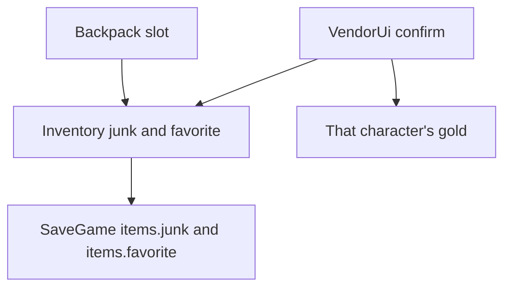
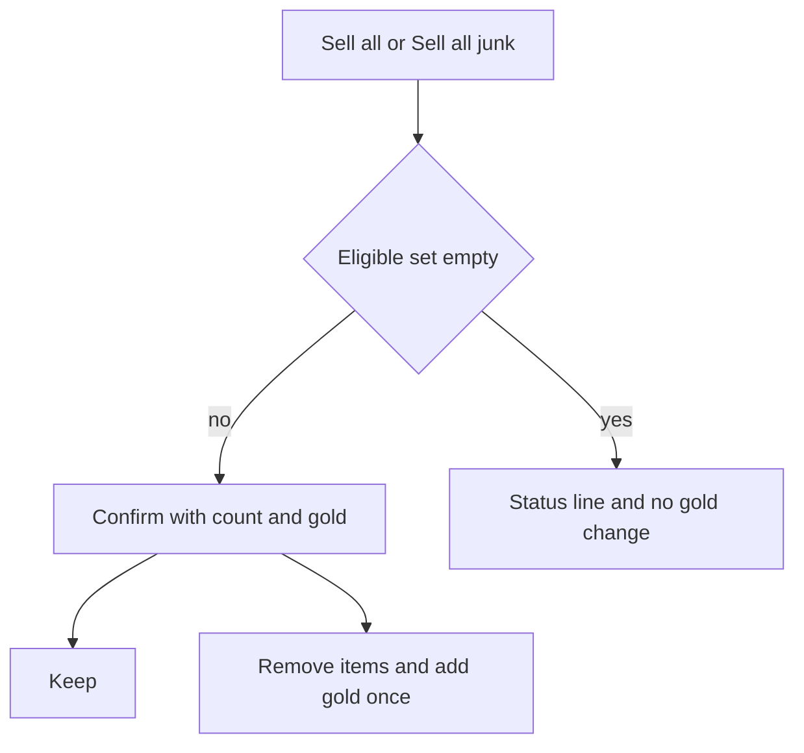
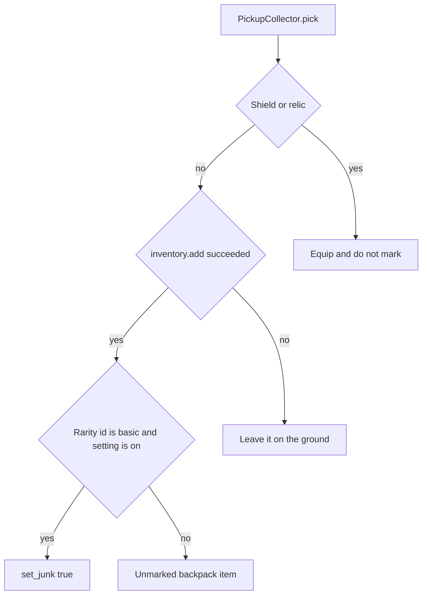

# Vendor sell junk - Plan

## Goal Capsule

- **Objective:** A player can mark backpack items as junk or favorite, sell the junk or the eligible backpack at a vendor after seeing the gold and the count, and find those marks still there after a save.
- **Means:** Extend the existing junk index and `Vendor.sell_junk`, and add favorite the same way (KTD1, KTD2).
- **Authority:** Requirements win on product behavior. Key technical decisions win on mechanism inside those requirements. Assumptions are working defaults until ShobieShy redirects them. They are not confirmed decisions.
- **Execution:** Code, after this plan is approved. This document does not change gameplay.
- **Stop:** Do not bump `SaveGame.VERSION`. Do not add a vendor RPC or bump the co-op protocol. Do not add music or a new proper name. Do not hook auto-mark on `Inventory.add`.
- **Ships as:** 0.11.6, still on 0.x. The player who sells is the one who is paid.

---

## Product Contract

### Summary

Junk marks, a junk badge, and Sell all junk already work. Favorite, a junk hotkey, a slot menu, Sell all, and a sale confirm do not. This plan adds those, keeps save version 1, and leaves auto-mark of Basic loot off.

### Problem Frame

The backpack holds 60 items. Gray loot fills it, and the only bulk sale sells junk the moment the button is pressed. There is no lock that Sell all would have to skip, and there is no Sell all. A player who wants to clear the pack has to sell one row at a time or mark junk and accept an immediate sale.

### Key Decisions

- Save version stays 1. Governs R8. A higher version is rejected by `SaveGame.read`, so the new mark has to be an optional field.
- Bulk sale asks before it pays. Governs R7.
- Auto-mark of Basic loot ships off. Governs R4.
- No new proper names and no new music. Governs R10.

### Requirements

**Marks**

- R1. A backpack item can be marked or unmarked as junk from the existing button, a hotkey, and a slot context menu, and the slot shows the junk marker that already exists.
- R2. A backpack item can be marked favorite, and that mark is visible on the slot and on the shop list.
- R3. A favorite item is skipped by Sell all.
- R4. A setting can auto-mark gray loot as junk. Gray loot is rarity id `basic`. The setting is off by default, and an old settings file keeps it off.

**Selling**

- R5. The vendor screen has Sell all junk and Sell all.
- R6. Sell all skips equipped items, favorite items, quest items, and key items.
- R7. When the eligible set is not empty, Sell all and Sell all junk show a confirmation with the sell-price gold total and the item count, and they change nothing until the player accepts. An empty eligible set shows a status line and does not open a confirm or change gold.

**Save and co-op**

- R8. Junk and favorite marks persist in the character save. `SaveGame.VERSION` stays 1. A save with no favorite field loads as no favorites.
- R9. The player whose shop is open receives the gold on that character. The host does not approve the sale.

**Proof and limits**

- R10. The change adds no proper names and no music.
- R11. Headless unit tests and the existing headless UI tests cover the marks, both bulk sales, the confirm, the save field, and the setting default.

### Acceptance Examples

- AE1. Covers R1, R8. Given a Basic hat in the backpack, when the player marks it junk and the game saves and loads through JSON, then that hat is junk and the other hat is not.
- AE2. Covers R7. Given a favorite hat and a junk hat, when the player chooses Sell all and then Keep, then both hats and the gold are unchanged.
- AE3. Covers R5, R7, R9. Given two junk hats and a favorite hat, when the player accepts Sell all junk, then only the junk hats leave and the gold rises by the sum of their sell prices on that character.
- AE4. Covers R4. Given the setting off, when a Basic part is picked up, then it is not junk. Given the setting on, the same pickup marks it junk, and loading a save does not mark a Basic item the player had unmarked.
- AE5. Covers R6. Given a worn hat, a quest id, and a backpack gem, when Sell all runs, then the worn hat and the quest id stay, and the gem is in the eligible set only when it is not favorite.

### Scope Boundaries

In scope: backpack marks, the inventory screen controls for them, vendor bulk sale and its confirm, the optional save field, the off-by-default setting, and tests.

Out of scope: stash bulk sale, a change to buy prices or the Runesmith, station salvage rates, new item art, new audio, a co-op protocol bump, and a save version bump.

#### Deferred to Follow-Up Work

- Rebinding the junk hotkey in the settings screen. Trash is also not rebindable today.
- A pad button for junk. Pad Y is already hold-to-trash. Gamepad uses the on-screen buttons.
- Selling potions. Potions live in the quick slot, not the backpack.

### Open Questions

These do not block planning. Each has a working default under Assumptions. ShobieShy can redirect any of them before implementation.

- Does favorite also block Sell all junk, and can one item be both? Default: they exclude each other, and both bulk sales skip a favorite.
- Does a junk mark survive a station upgrade that raises the part's rarity? Default: yes, because the object never left the backpack.
- Does Sell all include backpack gems, relics, and shields? Default: yes, at `Vendor.sell_price`. A gem with no rarity sells for 5. The confirm names how many are Rare or better and how many are gems, relics, or shields.
- Which key marks junk, and what does the slot menu contain? Default: J, with the menu rows listed in Assumptions.

### Success Criteria

- An old save with no `items.favorite` and no `items.junk` loads, and the backpack matches that save.
- Sell all junk on an empty junk list does not open a confirm and does not change gold.
- `project.godot` `config/version` can move to `0.11.6-prealpha` with this feature without a save-version or protocol change.

---

## Planning Contract

### Key Technical Decisions

- KTD1. Favorite is a second index array, `items.favorite`, beside `items.junk`. Do not store either mark in Ember Mark flags. `scripts/loot/item_codes.gd` sets `unknown flags` and drops the item when the flag bits are outside `FLAG_EXTRAS`. `SaveGame.read` returns an error when `version` is not 1, so a version bump would reject every current save. The junk array is the pattern that already loads when the key is missing.
- KTD2. Sale gold is `Inventory.add_gold` on the player bound to `VendorUi`. `Main.open_shop` binds the local player. A client writes `CharacterSave`. The host writes the save slot. `CoopWorld` pose sync sends backpack capacity only. `tests/unit/test_pickup.gd` already treats instanced loot as the client's, like gold. A host RPC would invent an authority the shop does not have. Co-op protocol stays 7.
- KTD3. Auto-mark must not run inside `Inventory.add`. That function also runs for load, buy, stash withdraw, import, undo, craft, and unequip. The call site is the successful backpack branch of `PickupCollector.pick`.

### High-Level Technical Design



Marks live on the backpack resource. Equip, salvage, assemble, socket, stash, trash, and sell call `Inventory.remove`, which drops the mark. Upgrade and reroll edit the part in place, so the mark stays on that object.



Esc while the confirm is open returns to the shop without selling. Close does not sell. Accept builds the eligible set again at click time. If that set is empty, the status line shows and gold does not change.



### Assumptions

Working defaults. They are not confirmed. Implementation follows them until ShobieShy says otherwise.

- Auto-mark runs only after `PickupCollector.pick` adds a backpack item whose `WieldablePart.rarity`, `EquipmentItem.rarity`, or `WieldableInstance.rarity_id()` is exactly `basic`. Gems, shields, relics, and potions do not match. Turning the setting on does not sweep the current backpack. Turning it off leaves marks that are already there.
- `set_junk(true)` clears favorite. `set_favorite(true)` clears junk. On load, an index listed in both arrays becomes favorite only. `sell_junk` and Sell all both skip favorites.
- A junk or favorite mark survives `CraftingExtras.upgrade` and the Runesmith reroll. Trash undo puts the item back unmarked, because `remove` already cleared it.
- Sell all includes backpack gems, relics, and shields at `Vendor.sell_price`. The confirm line is the count and the gold, plus a tally of Rare or better, gems, relics, and shields when any of those counts is above zero. Skipped favorites are not in the count.
- One shop confirm. Decline is focused, matching the Rare+ trash confirm. Accept is labeled Sell. Decline is labeled Keep. Esc dismisses the confirm and leaves the shop open. Any other shop button cancels the confirm first and then runs that button. When the confirm closes by Keep, Sell, or Esc, focus returns to the Sell all or Sell all junk button that opened it. When another shop button cancels the confirm and then runs, focus stays on that button. A single Sell of the selected row stays immediate, including when that row is junk or favorite.
- Empty copy: Sell all junk with no junk says `Nothing marked as junk.` Sell all with an empty backpack says `Nothing to sell.` Sell all where every backpack item is favorite says `Everything left is locked.`
- The junk hotkey is J, action `inventory_junk`, installed the same way as `inventory_trash`: runtime `InputMap`, not in `project.godot`, and not in `Settings.rebindable`. It uses the trash target order: hovered slot, else selected, else the focused backpack slot. It does nothing while the Ember Mark field is focused. There is no favorite hotkey. A Favorite button sits beside Mark junk. It is enabled only for a selected backpack item, and it uses the same mutual exclusion as the menu.
- Right-click on a backpack slot selects it and opens a menu with Mark junk or Unmark junk, Favorite or Unfavorite, and Trash. Worn slots, the potion button, and quest ids have no menu. The shop list has no menu. Esc closes that menu and leaves the inventory open. Choosing a row closes the menu before the row runs. If Trash then opens the Rare+ confirm, Esc cancels that confirm and still leaves the inventory open.
- Favorite does not darken the slot. The tooltip and the shop row gain ` (favorite)`. A text mark `F` sits in the corner opposite the junk badge. No new texture and no new audio.
- The settings key is `auto_mark_basic_junk`, default false. It is one more entry in `Settings._options` and one more checkbox in `settings_ui.gd`, using the same capitalize label as the other checkboxes. A missing key stays false.

### Sequencing

U1 before U2 and U3. U4 after U1, because pickup calls `set_junk`. U2 and U3 can land in either order after U1.

The version string lands only after U1 through U4. `project.godot` `config/version` becomes `0.11.6-prealpha`. `export_presets.cfg` Windows `file_version` and `product_version` become `0.11.6.0`. `tests/unit/test_branding.gd` expects `0.11.6-prealpha`, menu strings `v0.11.6-prealpha` and `Pre-Alpha 0.11.6`, and co-op suffix `0.11.6-prealpha/p7`. `docs/release/CHANGELOG_0.11.6.md` names the marks, both sale buttons, and that save version and co-op protocol are unchanged. The fast tier runs `test_branding.gd` from `CORE_TESTS` in `tools/run_tests.sh`, so those three files move together.

### Effort and version

Target `0.11.6-prealpha`. `docs/PLAN_NEXT.md` keeps a patch for work that is not a new act, and it keeps 1.0 as a release cut only. This change is the inventory screen, the shop screen, save apply, one pickup call, and one settings checkbox. No new scene, no new net message, no music.

The plan-only change does not edit `project.godot`. The implementation change, after U1 through U4, sets `config/version` to `0.11.6-prealpha`, updates `export_presets.cfg` and `tests/unit/test_branding.gd` to match, and adds `docs/release/CHANGELOG_0.11.6.md`.

### Risks

- `SaveGame.apply` clears `items` and then marks junk from indices, but it does not clear the junk array first. A second apply on the same player can leave stale resource refs. `junk_items` hides them because it checks `items`. The new path clears both arrays before replay, and it compares indices with `int()` so a JSON float still matches a slot.
- `tests/unit/test_inventory_trash.gd` calls `SaveGame.apply` on the in-memory capture. It never passes through `SaveGame.write` and `SaveGame.read`. JSON numbers come back as floats. The new test has to round-trip the file.
- `Vendor.tier_of` turns a missing rarity into Basic, so a gem's sell price is 5. Auto-mark must not use `tier_of`. Sell all may still sell that gem at 5, which the confirm tally is there to show.
- `test_settings.gd` expects `_options().size() == 30`. Adding the checkbox without updating that check fails the suite.

---

## Implementation Units

### U1. Favorite mark and save field

- **Goal:** A backpack item can be favorite, the mark is saved at version 1, and junk and favorite cannot both stick.
- **Requirements:** R2, R3, R8
- **Dependencies:** none
- **Files:** `scripts/player/inventory.gd`, `scripts/core/save_game.gd`, `tests/unit/test_inventory_trash.gd`, `tests/unit/test_save.gd`
- **Approach:** Follow KTD1 and the mutual-exclusion assumption. Clear favorite in `Inventory.remove` next to the junk erase. `SaveGame.apply` clears junk and favorite before it replays the backpack. A missing `favorite` key loads as none. An index in both arrays becomes favorite only.
- **Execution note:** Extend the junk save test so it fails on a write/read round trip before changing apply.
- **Patterns to follow:** `Inventory.set_junk` and the `items.junk` capture in `SaveGame.capture`.
- **Test scenarios:**
  - Mark a backpack hat favorite and the flag reads back. Marking a resource that is not in the backpack returns false.
  - Marking junk on a favorite clears favorite. Marking favorite on junk clears junk.
  - `remove` drops both marks. A later `add` of that same resource is unmarked.
  - Capture, `SaveGame.write`, `SaveGame.read`, and apply keep the favorite index and the junk index on the right slots.
  - A dict with no `items.favorite` and no `items.junk` loads with both lists empty and the items still present.
  - A dict that lists the same index in both arrays loads that item as favorite only.
  - Apply on a player who already had marks replaces those marks with the save, with no leftover refs in either array.
- **Verification:** The trash and save tests pass, `SaveGame.VERSION` is still 1, and a save from before this field still loads.

### U2. Inventory hotkey, menu, and favorite marker

- **Goal:** The player can mark junk from the keyboard and from a slot menu, and can see and set favorite on the inventory screen.
- **Requirements:** R1, R2, R10
- **Dependencies:** U1
- **Files:** `scripts/ui/inventory_ui.gd`, `tests/unit/test_inventory_trash.gd`, `tests/unit/test_inventory_ui.gd`
- **Approach:** Follow the hotkey, menu, favorite-button, and favorite-marker assumptions. Keep the existing junk darken and `JunkBadge`. Do not add a texture file or a sound.
- **Patterns to follow:** `InventoryUi.ensure_trash_action`, `toggle_junk`, and `_junk_badge`.
- **Test scenarios:**
  - With the inventory open and a slot selected, the junk hotkey toggles junk and the status line says it was marked.
  - The same hotkey while the Ember Mark field has focus does not toggle.
  - The hotkey uses the hovered slot when one is set, otherwise the selected slot.
  - Right-click on a filled backpack slot selects it. The menu's junk row toggles junk. The favorite row toggles favorite. The trash row uses the existing trash path, including the Rare+ confirm.
  - A worn slot and a quest id do not open that menu.
  - The Favorite button sets and clears favorite on the selected backpack item, and it is disabled when the selection is not a backpack item.
  - Esc while the slot menu is open closes the menu and leaves the inventory open.
  - A favorite slot's tooltip ends with ` (favorite)` and a junk slot still ends with ` (junk)`.
  - Mark junk on a favorite leaves only junk. Mark favorite on junk leaves only favorite.
- **Verification:** The inventory UI tests pass headless, with no new asset path and no new audio player.

### U3. Sell all and the shop confirm

- **Goal:** Sell all and Sell all junk pay only after a confirm, and they skip favorites.
- **Requirements:** R3, R5, R6, R7, R9
- **Dependencies:** U1
- **Files:** `scripts/economy/vendor.gd`, `scripts/ui/vendor_ui.gd`, `tests/unit/test_vendor.gd`
- **Approach:** Follow KTD2 and the confirm, empty-copy, and tally assumptions. Keep `Vendor.sell` immediate for one selected row. Shop rows show the same junk and favorite suffixes as the inventory tooltips. Do not add an RPC.
- **Patterns to follow:** `Vendor.sell_junk`, `Vendor.sell_price`, and `InventoryUi.confirm_row` with Keep focused.
- **Test scenarios:**
  - Sell all junk with two junk hats and one plain hat asks first. Keep leaves gold and items. Accept removes only the junk hats and adds `sell_price` of each once.
  - Sell all asks with the count and the gold of every backpack item that is not favorite. A favorite stays. A worn hat and a quest id are not in the count.
  - A backpack gem is in Sell all at `Vendor.sell_price`, which is 5, and the confirm tally includes it. The same gem is not auto-junk.
  - Sell all junk does not sell a favorite. After the exclusion rules, a favorite is not junk, and a direct call still skips it.
  - No junk shows `Nothing marked as junk.` and does not open the confirm. An empty backpack shows `Nothing to sell.` A backpack of only favorites shows `Everything left is locked.`
  - Esc during the confirm leaves the shop open and does not pay. Focus returns to the bulk button that opened the confirm. Accept after the last eligible item was sold another way adds no gold.
  - Single Sell still sells a favorite or a junk item without a confirm.
  - Two inventories: selling on one does not change the other's gold or items.
- **Verification:** `test_vendor.gd` passes, including the existing price checks of 20/5 for Basic and 100/25 for Rare.

### U4. Auto-mark setting, off by default

- **Goal:** Basic ground loot can be marked junk by a setting that defaults off and does not rewrite a load.
- **Requirements:** R4, R11
- **Dependencies:** U1
- **Files:** `scripts/core/settings.gd`, `scripts/ui/settings_ui.gd`, `scripts/player/pickup_collector.gd`, `tests/unit/test_settings.gd`, `tests/unit/test_pickup.gd`
- **Approach:** Follow KTD3 and the auto-mark assumption. The checkbox uses the existing settings loop. The version string, export presets, branding test, and changelog are the sequencing step after U1 through U4, not part of this unit.
- **Execution note:** Update the `_options().size()` expectation in the same change as the new key, or the settings test fails at 30.
- **Patterns to follow:** `Settings.load_from` missing-key default, and the checkbox list in `settings_ui.gd`.
- **Test scenarios:**
  - A new `Settings` has `auto_mark_basic_junk` false. A config file that omits the key still loads false. A file that sets it true loads true.
  - `_options().size()` is 31 and includes the new key.
  - With the setting off, `PickupCollector.pick` of a Basic part leaves it unmarked.
  - With the setting on, pick of a Basic part, a Basic equipment piece, and a Basic wieldable marks each junk. Pick of an Uncommon part does not. Pick of a shield or relic equips it and does not mark it.
  - `SaveGame.apply` of a Basic item with the setting on does not mark it unless the save's junk index says so.
  - `Vendor.buy` of a Basic part with the setting on does not mark it.
- **Verification:** The settings and pickup tests pass. This unit does not change `config/version`.

---

## Verification Contract

Run from the repo root with a private user dir so a real save is not touched:

```bash
export XDG_DATA_HOME=$(mktemp -d -t coe-user.XXXXXX)
TEST_ONLY=test_inventory_trash.gd,test_inventory_ui.gd,test_vendor.gd,test_save.gd,test_settings.gd,test_pickup.gd tools/run_tests.sh --fast
```

That is the fast tier in `docs/TEST_TIERS.md`: the named files, the core list, and one smoke run. The feature is done for a milestone when that command exits 0 and no test asserts a save version other than 1.

Headless UI coverage is `InventoryUi` and `VendorUi` constructed in those unit tests, which is how `test_shop_screen` and `test_junk_sold_together_and_saved` already run. `tools/trash_shots.gd` stays a manual capture tool.

---

## Definition of Done

- R1 through R11 hold, including AE1 through AE5.
- `SaveGame.VERSION` is 1. A save without `items.favorite` loads.
- No vendor RPC, and the co-op protocol constant is unchanged.
- No new audio file and no new proper name in labels, changelog, or data.
- `config/version` is `0.11.6-prealpha`. `tests/unit/test_branding.gd` and `export_presets.cfg` match that string, including Windows `0.11.6.0`.
- The fast-tier command in the Verification Contract exits 0.
- Abandoned experiments are not left in the diff.

---

## Appendix

### Audit

Read against `project.godot` `config/version` `0.11.5-prealpha`. Line numbers are from that tree.

| Area | State | Where |
|---|---|---|
| Backpack size | Works. 60 slots, dense list. | `scripts/player/inventory.gd` lines 10-14 |
| What the backpack holds | Works. Wieldable, part, equipment, gem, shield, relic. Potions are not accepted. | `scripts/player/inventory.gd` lines 20-28 |
| Rarity | Works. Ids `basic` through `unique`. Basic is gray, `Color(0.7, 0.7, 0.7)`. There is no `common` id. | `scripts/loot/rarity.gd` lines 11-14; `resources/loot/rarities.tres` lines 6-12 |
| Brands | Works on parts and wieldables. Not a junk flag and not a sell filter. The shop compare line already prints the brand. | `scripts/ui/vendor_ui.gd` lines 127-133; `scripts/ui/compare_card.gd` brand rows |
| Station | Works. Assemble requires the base and parts in the backpack, `remove`s them, and adds the built weapon. Salvage pays dust and gold on that inventory. Upgrade edits the part in place. | `scripts/world/assembly_station.gd` lines 96-115; `scripts/magic/crafting_extras.gd` lines 64-74 and 84-109 |
| Junk model | Works. Parallel `Array[Resource]`. `remove` erases it. | `scripts/player/inventory.gd` lines 17, 56-88 |
| Junk UI | Works. Mark junk button, slot darken by 0.55, tooltip ` (junk)`, corner badge. | `scripts/ui/inventory_ui.gd` lines 131-134, 356-361, 468-475, 549-569 |
| Junk hotkey | Missing. Delete, X, and pad Y are trash, added at runtime, and X is ignored in the Ember Mark field. | `scripts/ui/inventory_ui.gd` lines 175-185, 293-307 |
| Context menu | Missing. Slots are left-click buttons. The only right-click in UI is the world map. | `scripts/ui/inventory_ui.gd` lines 73-81; `scripts/ui/world_map_screen.gd` line 286 |
| Favorite or lock | Missing. No field, no button, no save key. | `scripts/player/inventory.gd`; `scripts/core/save_game.gd` |
| Trash confirm | Works for Rare or better. Keep starts focused. Quest ids and worn gear are refused. | `scripts/ui/inventory_ui.gd` lines 390-403; `scripts/player/item_trash.gd` lines 7-39 |
| Sell one | Works. Immediate. Price is `max(1, price/4)`. Basic sells for 5, Rare for 25. Buy discount does not apply to sell. | `scripts/economy/vendor.gd` lines 13-15, 37-53, 111-116; `tests/unit/test_vendor.gd` lines 53-57 |
| Sell all junk | Works, and it pays immediately with no confirm. | `scripts/ui/vendor_ui.gd` lines 44-49, 155-164; `scripts/economy/vendor.gd` lines 119-127 |
| Sell all | Missing. | `scripts/ui/vendor_ui.gd` lines 44-49 |
| Shop Esc | Closes the shop. It does not cancel a pending sale, because there is no pending sale. | `scripts/ui/vendor_ui.gd` lines 172-175 |
| Quest and key items | Not backpack rows. Quest ids live on `Player.quest_items`. `breach_key` is one of those ids. | `scripts/player/player.gd` line 184; `scripts/world/hub_toys.gd` lines 5, 25-26; `scripts/loot/quest_pickup.gd` lines 61-63 |
| Equipped items | Not in the backpack. Equip goes through `remove`, which clears junk. | `scripts/player/item_trash.gd` lines 31-36; `scripts/player/inventory.gd` lines 56-62 |
| Save | Version 1. Junk is optional indices in `items.junk`. Missing key loads as none. Gold missing on the player block loads as 50, not 0. | `scripts/core/save_game.gd` lines 14, 31-37, 79, 179-181, 210-227 |
| Save test gap | The junk test applies the capture dict in memory. It does not write and read JSON. Apply does not clear `junk` before replay. | `tests/unit/test_inventory_trash.gd` lines 96-129; `scripts/core/save_game.gd` lines 210-227 |
| Settings | 30 options. A missing key keeps the property default. The UI checkbox list is separate from `_options`. | `scripts/core/settings.gd` lines 193-200, 229-261; `scripts/ui/settings_ui.gd` lines 43-59; `tests/unit/test_settings.gd` line 41 |
| Co-op gold | Local. Client save is `CharacterSave`, which uses `SaveGame.capture`. Host save is the slot. Pose sync sends bag size, not items or gold. No vendor RPC. | `scripts/net/character_save.gd` lines 7-9, 27-28; `scripts/core/main.gd` lines 655-674 and 375-386; `scripts/net/coop_world.gd` lines 199-202; `tests/unit/test_pickup.gd` line 172 |
| Auto-mark | Missing. | No setting and no pickup hook. |
| Music and names | Music is already silent in 0.11.5. Vendors stay Potion Merchant, Tailor, and Runesmith. | `docs/release/CHANGELOG_0.11.5.md` line 19; `scripts/economy/vendor.gd` line 20 |

External research was not used. The junk index, the sell path, and the settings default are already in this repo. No `docs/solutions` learnings and no compound-engineering packs were present.
